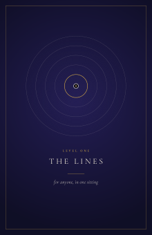
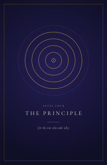
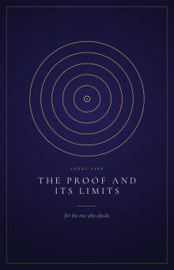

<p align="center">
  
</p>

<table>
<tr>
<td width="36%" valign="top">
<a href="book/README.md"></a>
</td>
<td valign="top">

<h1>The Geometry of Existence</h1>

***A Manual for Life*** — in five levels, the highest at the end.<br>
**Massimo Vincent Panella** · complete edition, 15 November 2026

> *Nothing gives legitimacy to existence except existence itself.*

1. Existence itself is sufficient.
2. Consciousness gives us the opportunity to understand it.
3. Connection gives us the opportunity to honor it.

**[Read the book »](book/README.md)** &nbsp;·&nbsp; [The edition PDF](edition/The_Geometry_of_Existence_A_Manual_for_Life.pdf) &nbsp;·&nbsp; [The workbook](workbook/README.md) &nbsp;·&nbsp; [The gallery](art/README.md) &nbsp;·&nbsp; [The checks](checks/README.md)

[](checks/README.md)

</td>
</tr>
</table>

## Five levels

*This is one book in five levels. Each level says the same thing at a greater depth, and each is complete in itself. You may stop at any level and have the whole of that level.*

<table>
<tr>
<td align="center" valign="top" width="20%"><a href="book/1-the-lines/README.md"></a><br><sub>LEVEL ONE</sub><br><b>The Lines</b><br><sub><i>for anyone, in one sitting</i></sub></td>
<td align="center" valign="top" width="20%"><a href="book/2-the-manual/README.md"></a><br><sub>LEVEL TWO</sub><br><b>The Manual</b><br><sub><i>for the one who will practise</i></sub></td>
<td align="center" valign="top" width="20%"><a href="book/3-the-degree/README.md"></a><br><sub>LEVEL THREE</sub><br><b>The Degree</b><br><sub><i>for the one who has stopped rounding</i></sub></td>
<td align="center" valign="top" width="20%"><a href="book/4-the-principle/README.md"></a><br><sub>LEVEL FOUR</sub><br><b>The Principle</b><br><sub><i>for the one who asks why</i></sub></td>
<td align="center" valign="top" width="20%"><a href="book/5-the-proof/README.md"></a><br><sub>LEVEL FIVE</sub><br><b>The Proof and Its Limits</b><br><sub><i>for the one who checks</i></sub></td>
</tr>
</table>

| | Level | What it holds |
|---|---|---|
| **1** | [The Lines](book/1-the-lines/README.md) | The stance on a few pages, for anyone. The First Principle, the Stance in four lines, and the same ground in plain words. |
| **2** | [The Manual](book/2-the-manual/README.md) | Fifteen chapters of practice in four parts — *The Ground*, *The Practice*, *The Weight*, *The Care*. Each ends in something to do today and a question that can find the chapter wrong. |
| **3** | [The Degree](book/3-the-degree/README.md) | How to grade instead of round: what a degree is, how degrees combine, and how to act once you have weighed. |
| **4** | [The Principle](book/4-the-principle/README.md) | Why the ground holds: existence is sufficient; consciousness and connection are opportunities; change without erasure; dignity owed and respect earned. |
| **5** | [The Proof and Its Limits](book/5-the-proof/README.md) | The mathematics, recomputed. *Sophonticism*, the research book. The program and its frozen tests. The strongest case against it. And, last, what no proof reaches. |

*The levels are levels of understanding, not of worth. A reader who lives Level One has not done less than a reader who checks Level Five.*

## Five marks

Every claim in this book is one of five kinds, and the book tries never to let one kind pass for another. In the Markdown they are set as `LIVED`, `ARGUED`, `DEMONSTRATED`, `MEASURED` and `ON RECORD`.

| | |
|---|---|
|  | A stance or a practice. It is tested only by doing it. Level Two is written in this mark throughout. |
|  | Reasons are given. No one is compelled. |
|  | It follows from stated definitions, or is established science within a stated domain. Every number of this kind was recomputed. |
|  | An observation, with its source. The book reports none of its own; quoted figures are marked *source-reported*. |
|  | A matter of published history: a date, a name, a paper. |

## One promise

*This book does not promise to be free of error. No honest book can — a claim that cannot lose cannot win.* It promises three things instead: every claim says what kind of claim it is; no claim is larger than its evidence; and every computation was run again. This repository keeps that promise in the open:

```sh
python3 checks/verify_all.py
```

re-runs every computation the book relies on — the balanced-ternary theorems of §12, the spin models of §14–§15, the six-site enumeration of §16 to twelve decimal places, the 240 roots of E₈ — using nothing but the Python standard library. [More on the checks »](checks/README.md)

## How this repository is built

```
edition/      the complete edition, as typeset (PDF, 214 pages) — the source of everything else
book/         the book in Markdown, one file per chapter, with its plates and figures
  0-front/          title page · how this book is built
  1-the-lines/      Level One
  2-the-manual/     Level Two — four parts, fifteen chapters, the Fifteen Lines
  3-the-degree/     Level Three — three chapters and the Graded Audits
  4-the-principle/  Level Four — four chapters
  5-the-proof/      Level Five — Sophonticism (§1–§22, Appendices A–D), Chapters 23–25
  6-back-matter/    the Discipline in One Page · Lineage · Glossary · Corrections · Checks · Colophon
art/          36 plates and 41 figures cut from the PDF; the marks; the banner — see the gallery
workbook/     a practice sheet for every chapter: falsifier first, then the Practice, the Audit, the graded line
checks/       verify_all.py — the computations of "The Checks", rebuilt and runnable
site/         the stylesheet and script of the reading edition
tools/        the scripts that cut the PDF into the book and build the site
```

The Markdown is not retyped. [`tools/extract_book.py`](tools/extract_book.py) reads the typesetting itself — fonts, sizes, colours and positions — to decide what is a heading, a mark, a Practice, an Audit, a table, a figure or a plate, and [`tools/check_coverage.py`](tools/check_coverage.py) confirms that every printed word reaches the Markdown (the only words not carried as text are the labels inside figures, which the images carry).

```sh
pip install -r requirements.txt
make book       # re-cut book/ and art/ from the PDF, rebuild the indexes and the workbook
make site       # build the reading edition into _site/
make serve      # read it at http://localhost:8000
make check      # run the checks
```

### The reading edition

[`tools/build_site.py`](tools/build_site.py) turns the Markdown into a website dressed like the book: navy plates with gold line-work open every level, part and chapter; text pages are cream and set in EB Garamond, display in Cormorant Garamond; the marks are small capitals; each Practice and Audit is a ruled box. It follows the reader's light or dark setting, and ← → turn the page. The [Pages workflow](.github/workflows/pages.yml) publishes it on every push to `main` once **Settings → Pages → Source** is set to **GitHub Actions**.

## How to break this book

From [*Corrections and Open Accounts*](book/6-back-matter/04-corrections-and-open-accounts.md) — each has an issue template:

1. **Run the checks.** Any failure is an error in Level Five. → *A check failed*
2. **Find a sentence whose mark is wrong**: an argument printed as a demonstration, a model value printed as a measurement. → *A mark is wrong*
3. **Build the six-site system of §16** on a calibrated device and measure the difference in zero-site occupancy. The prediction is **0.276990454809**. → *A test result*
4. **Do a Practice exactly as written, with your falsifier written first.** If nothing you can observe changes, the practice failed for you. That is a result, and it counts. → *A practice result*, and the [workbook](workbook/README.md)

Corrections go to the author. Each belongs in the next edition's list, dated and attributed. See [CONTRIBUTING](CONTRIBUTING.md).

## Credits

Text by Massimo Vincent Panella. Level Two drafted with Samantha (OpenClaw); research syntheses AI-assisted, as stated in each. New chapters, illustrations, typesetting and audit of the complete edition by Claude. *Every figure is computed from the book's own mathematics.* Set in EB Garamond and Cormorant Garamond.

*Nothing here is medical, psychological, or legal advice. The practices are yours to try and yours to stop.*

Licensed under the [GNU Affero General Public License v3.0](LICENSE). To cite the book, see [CITATION.cff](CITATION.cff).

<p align="center"></p>
<p align="center"><i>Twenty-five chapters. Five levels. One stance.</i></p>
