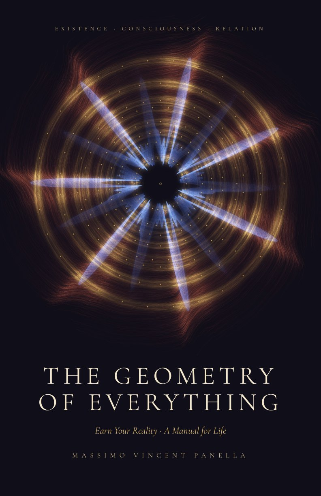
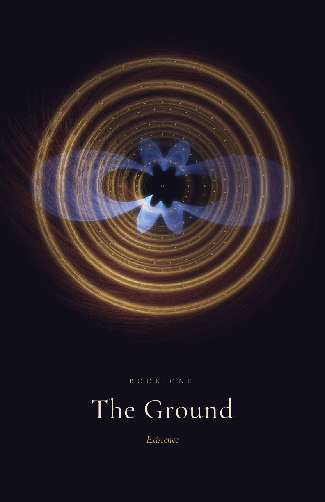
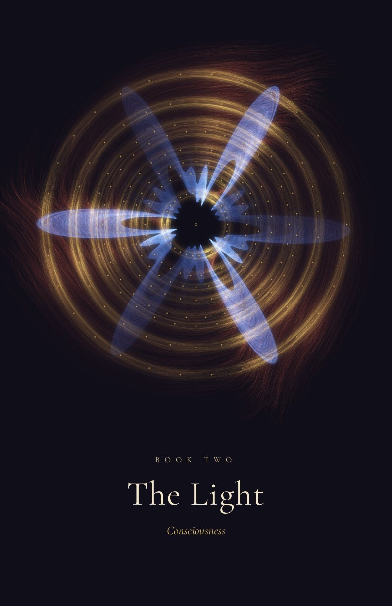
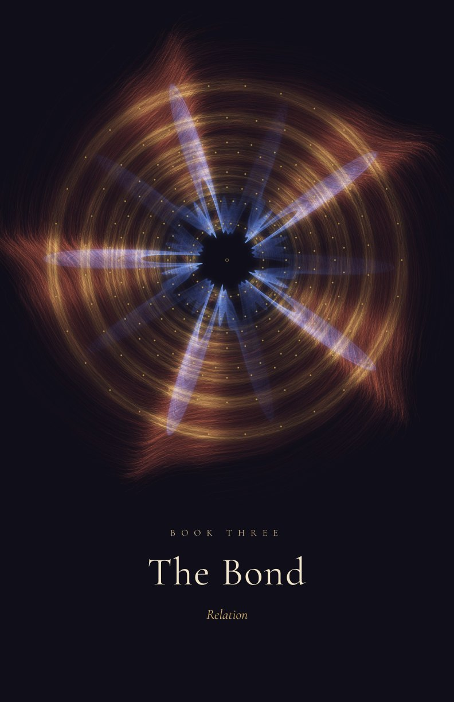
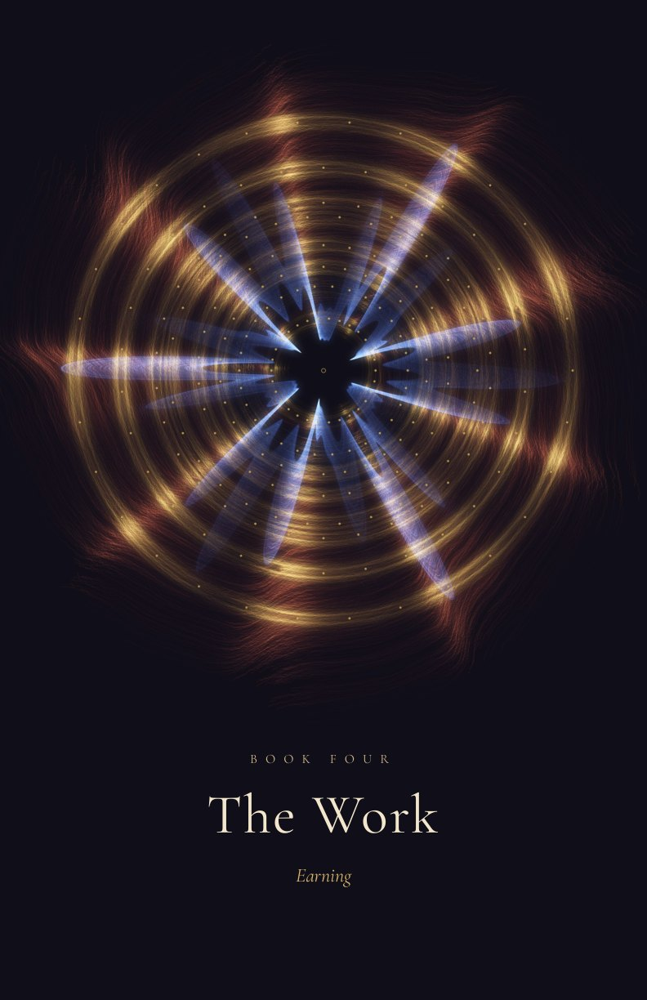
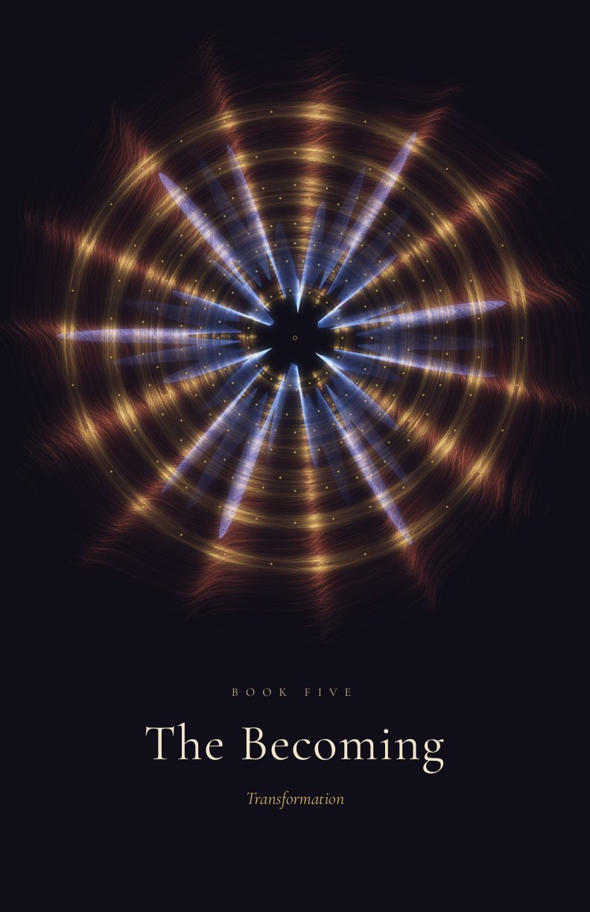
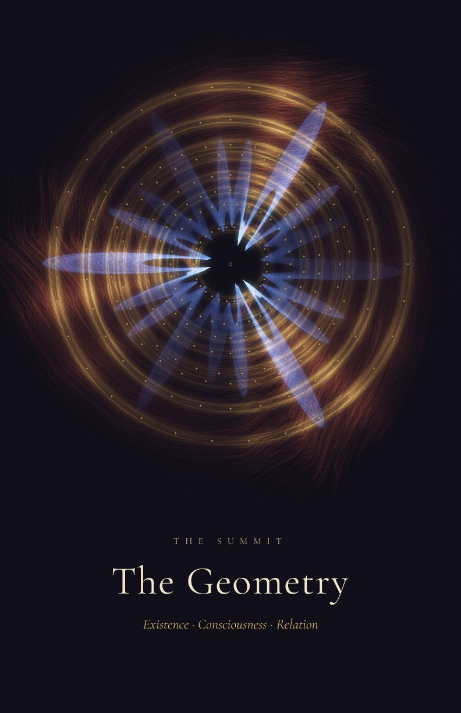

  

<h1 align="center">The Geometry of Everything</h1>

<i>Earn Your Reality · A Manual for Life</i> 
by <b>Massimo Vincent Panella</b> · Edition of November 2026

  <a href="https://mavioni.github.io/THE-GEOMETRY-OF-EXISTENCE/"><b>📖 Read it online</b></a> &nbsp;·&nbsp;
  <a href="https://github.com/Mavioni/THE-GEOMETRY-OF-EXISTENCE/raw/main/edition/The-Geometry-of-Everything.pdf"><b>⬇ Download the PDF</b></a> (217 pages, 7.2 MB) &nbsp;·&nbsp;
  <a href="book/README.md"><b>📑 Read it here, chapter by chapter</b></a>

  
  

> **Nothing gives legitimacy to existence except existence itself.**
>
> Existence needs no permission. Understanding is an opportunity. Connection is a responsibility you may choose.
> *Peace, love and unity are what you bring. Respect is what you prove.*

---

## New to GitHub? Start here

You do not need an account, and you do not need to install anything. This page is the home of a book, and there are three ways to read it:

1. **On the website**, the easiest way: **[mavioni.github.io/THE-GEOMETRY-OF-EXISTENCE](https://mavioni.github.io/THE-GEOMETRY-OF-EXISTENCE/)**. It works on any phone or computer, follows your light or dark setting, and the arrow keys turn the page.
2. **As a PDF**, the printed edition exactly as typeset: **[download it here](https://github.com/Mavioni/THE-GEOMETRY-OF-EXISTENCE/raw/main/edition/The-Geometry-of-Everything.pdf)**. Keep it, print it, give it away.
3. **Right here on GitHub**: open the **[Contents](book/README.md)** and select any chapter. Every chapter ends with a link to the next.

The folders you see at the top of this page are explained [further down](#whats-in-this-repository). You never need to open them to read the book.

---

## What this book is

*Here is a book to be carried in one hand.* It gathers what the wisest who ever lived found out, often apart, across thousands of miles and years, and tests it: **two hundred and forty teachings in twenty-six chapters, five Books and a Summit**. Every chapter moves in the same nine steps: the Teaching, the Five Scales, the Witnesses, the Tale, the Energy, the Reversal, the Practice, the Ledger and the Song.

<table>
<tr>
<td align="center" width="16%"> BOOK ONE <b>The Ground</b> <i>Existence</i></td>
<td align="center" width="16%"> BOOK TWO <b>The Light</b> <i>Consciousness</i></td>
<td align="center" width="16%"> BOOK THREE <b>The Bond</b> <i>Relation</i></td>
<td align="center" width="16%"> BOOK FOUR <b>The Work</b> <i>Earning</i></td>
<td align="center" width="16%"> BOOK FIVE <b>The Becoming</b> <i>Transformation</i></td>
<td align="center" width="16%"> THE SUMMIT <b>The Geometry</b> <i>E · C · R</i></td>
</tr>
</table>

| | | |
|---|---|---|
| **Before the Books** | [The Opening](book/README.md#the-opening) | How to carry this book, the First Principle, the Kept Middle, the Floor and the Ceiling, the Model of Change |
| **Book One** | [The Ground](book/1-the-ground/README.md) | being itself, the body, death, and wonder · chapters 1–4 |
| **Book Two** | [The Light](book/2-the-light/README.md) | self-knowledge, the brain, attention, suggestion, manipulation, learning, freedom · chapters 5–11 |
| **Book Three** | [The Bond](book/3-the-bond/README.md) | peace, love, family, speech, community, respect, repair · chapters 12–18 |
| **Book Four** | [The Work](book/4-the-work/README.md) | craft, money, resilience, and earned power · chapters 19–22 |
| **Book Five** | [The Becoming](book/5-the-becoming/README.md) | change without erasure, ritual, story, the daily rite · chapters 23–26 |
| **The Summit** | [The Geometry](book/6-the-summit/README.md) | the mathematics beneath the book, how it could be wrong, the epilogue |
| **At the back** | [Tools for living it](book/README.md#at-the-back) | the Ninety-Day Trial, the monthly reading cycle, the Respect Ledger, the Index of Situations, sources |

**Three marks.** Every claim in the book is one of three kinds, and the book tells you which: **◆ Commitment**, a stance you choose and defend by argument; **● Evidence**, a claim about how the world works, open to being proved wrong; **◇ Analogy**, a picture to think with, which shows a pattern and never proves one.

**Ways in.** Read one chapter a week and the book becomes a half-year's schooling. Keep it on the [monthly reading cycle](book/7-at-the-back/02-the-monthly-reading-cycle.md). Open the [Index of Situations](book/7-at-the-back/04-index-of-situations.md) when life demands it (*when I am furious*, *when someone I love has died*, *when money is tight*…). Or run the [Ninety-Day Trial](book/7-at-the-back/01-the-ninety-day-trial.md) and judge the book by your own life, using the [workbook](workbook/README.md).

---

## Test it

*A book that claims to defeat every system is lying.* This one states how strong each claim is and how each could be shown wrong ([How This Book Could Be Wrong](book/6-the-summit/02-how-this-book-could-be-wrong.md)), and then asks you to test it.

- **The mathematics** of the Summit is recomputed by a small program, [`checks/verify_all.py`](checks/README.md), every time this repository changes. The green badge above means every check passed.
- **Found an error?** [Open an issue](https://github.com/Mavioni/THE-GEOMETRY-OF-EXISTENCE/issues/new/choose) (free GitHub account needed) and pick the form that fits: *a check failed*, *a mark is wrong*, *a correction to the text*, *a prediction tested*, or *a Ninety-Day Trial result*. Each edition publishes what changed and why.

---

## What's in this repository

| Folder | What is inside | Who it is for |
|---|---|---|
| [`book/`](book/README.md) | **The whole book**, one page per chapter, with every plate and figure | readers |
| [`edition/`](edition/README.md) | **The PDF**, the edition of record | readers who want to download or print |
| [`workbook/`](workbook/README.md) | practice sheets for every chapter, the Ninety-Day Trial and the Respect Ledger | readers who practise |
| [`art/`](art/README.md) | the gallery: the eight paintings, the twenty-six chapter plates, the figures | anyone |
| [`checks/`](checks/README.md) | the program that recomputes the book's mathematics | the curious and the sceptical |
| [`tools/`](tools/README.md) | the scripts that turn the PDF into the pages and the website | maintainers |

Everything in `book/`, `art/` and `workbook/` is generated from the PDF by the tools, so the text here is the text of the edition, word for word. A check confirms it: all 36,085 printed words reach these pages. To rebuild it yourself, see [`tools/`](tools/README.md).

---

## Credits

*The Geometry of Everything* gathers the work of **Massimo Vincent Panella** into one book: the philosophy, the creed, the laws, the mathematics and the myth. The edition was rewritten in the spirit of Rudyard Kipling and Friedrich Nietzsche, re-illustrated and audited by Claude for Massimo. Every claim of fact was checked against its source; every figure at the summit and every chapter plate was computed from the law it names. Set in EB Garamond and Cormorant Garamond.

*Nothing here is medical, psychological or legal advice. The practices are yours to try and yours to stop.*

## License

*The Geometry of Everything* © Massimo Vincent Panella, 2026. The book, its paintings, plates and figures, and everything in this repository are licensed under the **[Creative Commons Attribution-ShareAlike 4.0 International License](https://creativecommons.org/licenses/by-sa/4.0/)** ([full text](LICENSE)). You may share and adapt it for any purpose, if you credit the author, link to the license, say what you changed, and share your adaptations under the same license. To cite it, use [CITATION.cff](CITATION.cff) (or the **Cite this repository** button on the right of this page).

<i>It is a gift, offered in the spirit of its creed: peace, love, unity and respect.</i> <b>EARN YOUR REALITY.</b>

