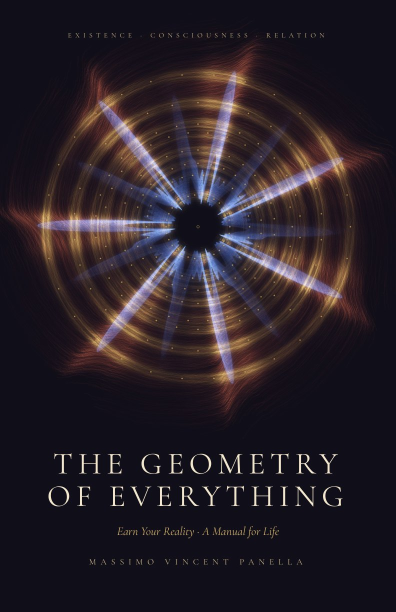
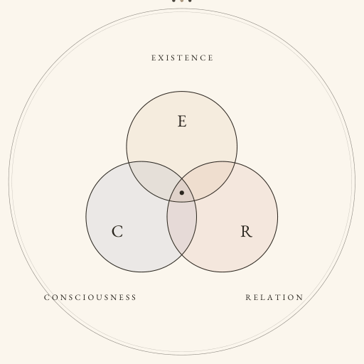

# The Geometry of Everything

### *Earn Your Reality*

A MANUAL FOR LIFE

<i>Two hundred and forty teachings in twenty-six chapters, five Books and a Summit</i>

MASSIMO VINCENT PANELLA

> *For Massimo, who needed it first; and for his children, who will find it waiting.*

## To my children

*To be written by hand, on the day this book is given.*

*Your father*

> *If you can meet with Triumph and Disaster* *And treat those two impostors just the same*
>
> — Rudyard Kipling, “If—” (1910)

> *What is great in man is that he is a bridge and not a goal.*
>
> — Friedrich Nietzsche, *Thus Spake Zarathustra*, Prologue §4 (tr. Thomas Common)

> *Compared with what we ought to be, we are only half awake.*
>
> — William James, “The Energies of Men” (1907)

> *Nothing gives legitimacy to existence except existence itself.*
>
> — Massimo Vincent Panella

---

[Contents](../README.md) &nbsp;·&nbsp; [How to Carry This Book →](01-how-to-carry-this-book.md)

