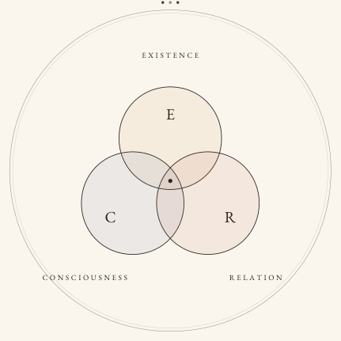

# The First Principle

<i>The three letters of the First Principle. Existence stands alone; consciousness and relation stand on it.</i>

> *Nothing gives legitimacy to existence except existence itself.*
>
> — Massimo Vincent Panella

That is where this book began. Here is what it means, stated so that it holds whatever the universe turns out to be:

**Your existence does not have to be earned. Nothing you do can make it more legitimate, and nothing can make it less.**

Every great tradition comes to this, even those that agree on nothing else. The believer calls it grace. The Platonist sees in it a reflection of the Good. The Nguni say a person is a person through other persons. The philosopher of the absurd says no one outside you grants your worth, so claim it and live. Different roads; one summit. You stand here without having applied.

Then come two opportunities.

**Understanding is an opportunity.** Consciousness is the power to know that you exist and to ask what it means. It is not required; a stone exists without it. But you have it, and to have it is to be invited.

**Connection is a responsibility you may choose.** Relation is the structure through which beings meet and may know one another. You can refuse it, and most of the suffering in history was made by those who did. Or you can take it up, and when you do, the substance of your world changes.

## The three letters

Write it as three letters: **E, C, R.** Existence, Consciousness, Relation. It is not an equation of physics, and this book will never pretend that mathematics can prove a moral truth. It is a map. It tells you where you stand: on the ground of being, in the light of awareness, inside a web of bonds.

Mark what each letter does. Existence gives you a place to stand without permission. But a stone exists too, and no one owes a stone respect. Dignity belongs to every *someone*: every being who is the subject of a life, and every member of the human family held in relation by others, whether or not they can now feel, understand or choose. The newborn cannot yet meet the world; she is held. The man in a coma cannot answer; he is still someone’s son. So read Consciousness as *being a subject*, never as a test of ability, and read Relation both ways: the power to meet others, and the standing to be held by them. Capacities shape what we owe one another. They never decide *whether* we owe.

Twenty centuries ago the sage Hillel asked three questions that walk the same road:

> *If I am not for myself, who will be for me? If I am only for myself, what am I? And if not now, when?*
>
> — Hillel, Pirkei Avot 1:14

The first is the ground: you exist, and you must stand. The second is relation: a self alone is not yet a self. The third is consciousness awake to time: the opportunity does not wait.

## The creed

Inside this map lives the creed by which you choose to live: **Peace, Love, Unity, Respect.** It rose from the underground dance floors of the early 1990s, credited to the DJ Frankie Bones, and it was laughed at as naive. It is not naive. Read slowly, it is the working core of a good life, kept honest by two guard-rails: **Truth** (do not deceive) and **Justice** (do not accept for others what you would refuse for yourself).

Peace is mastery of the self. Love is the investment that creates trust. Unity is the circle that multiplies strength. Respect is the account in which all of it is recorded.

> *Peace, love and unity are what you bring. Respect is what you prove.*

---

[← The Rivers That Became This Book](02-the-rivers-that-became-this-book.md) &nbsp;·&nbsp; [Contents](../README.md) &nbsp;·&nbsp; [The Kept Middle →](04-the-kept-middle.md)

