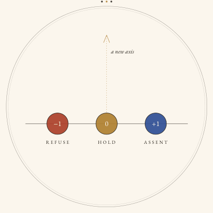

# The Kept Middle

<i>The three marks of balanced ternary, and the fourth direction that lies off their line.</i>

Most minds are drilled to think in twos: true or false, yes or no, friend or foe. This book thinks in threes, because life does.

## The three marks

At every moment you may **refuse** (−1), **hold** (0) or **assent** (+1). Mathematicians call a number system built on these three values *balanced ternary*, and a single digit of it a *trit*. It sounds a dry thing. It is the most practical thing in this book. Before any decision, know which mark you are making.

To hold is not to dodge. A held question is a deliberate act: *I do not yet know, and I will not pretend to.* Many a disaster was made by people who could only refuse or assent, and were forced to choose before the evidence came in.

## Three kinds of middle

Men mean three different things by “the middle,” and confusing them breeds endless trouble.

- **A degree.** A position on one line between two poles: warm lies between hot and cold. This is what fuzzy logic measures.
- **A waiting room.** An unknown that will settle into one pole or the other once more is known: the verdict not yet in.
- **A new axis.** A third possibility that does not lie on the original line at all. Asked whether you are strong or weak, the true answer may be neither: you are *learning*. Here lies the motto of the Wheels: *generate the third; do not select it.*

## Keep the middle in judgment; act cleanly

Hold the middle while you judge, then act without wavering. Engineers build controllers that reason in degrees and still put out one firm signal; the best decisions work the same way. Judge in shades. Act in one clean line.

## Both must pass; do not average

When two conditions both matter, such as honesty and kindness, or understanding and care, do not let a high mark on one buy pardon for a low mark on the other. In fuzzy logic an AND can never score higher than its weakest input: with honesty at 0.9 and kindness at 0.2, the strict rules score the pair at 0.2 or less, where a simple average would call it 0.55. People average high against low by nature. This book asks you not to. A cruel truth and a kind lie both fail.

---

[← The First Principle](03-the-first-principle.md) &nbsp;·&nbsp; [Contents](../README.md) &nbsp;·&nbsp; [The Floor and the Ceiling →](05-the-floor-and-the-ceiling.md)

