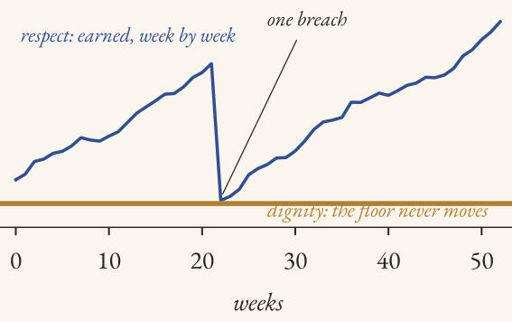

# The Floor and the Ceiling

<i>One year of an honest ledger. Respect rises with conduct and falls with a breach; the floor of dignity never moves.</i>

There are four words that must never be confused: **owed, offered, earned** and **extracted.**

**Dignity is owed.** Every person stands on a floor of worth that no one granted and no one can revoke. It belongs to every someone held in the human family, whether or not they can now think or choose, and it hangs on nothing they achieve. Kant put it thus: everything has either a price or a dignity, and a person has a dignity, beyond all price. The stranger, the fool, the enemy and the one who wronged you all stand on this floor. You do not decide whether they are on it. You decide only whether you will stand on it beside them.

**Respect is earned.** Above the floor rises a ceiling, and it is built plank by plank from conduct seen over time. The philosopher Stephen Darwall named the two kinds: *recognition respect*, owed to every person as a person, and *appraisal respect*, a judgment of character that must be won and can be lost.

Between them stands a third kind. **Role courtesy is offered** to an office or a bond: to a parent, a teacher, a judge, an elder. It is given freely, it follows the shape of the role, and abuse revokes it. Confucius taught it; Mencius taught that a tyrant forfeits it.

What is **extracted** by threat is not respect. It is fear wearing respect’s mask. Fear obeys while you are watching. Respect keeps faith when you are gone.

## The Ledger

Human beings are a species that remembers. Every community that ever lasted has kept a running account of who helps and who takes; biologists who model the evolution of cooperation call this *indirect reciprocity*, and they count it among the engines that made large human societies possible at all. Your reputation is the memory of a people.

So keep your own account, honestly, in three columns:

- **Given:** the dignity you extended freely, asking nothing.
- **Earned:** the trust you built by keeping your word.
- **Spent:** the standing you lost through your own lapses.

The ledger does not lie unless you do. Count care as conduct: the meal cooked, the night sat up with a sick friend, the work no one applauds.

## The starting balance

The Ledger records what you did with what you were given. It is never a verdict on what you were given. People begin with different health, families, money, countries and wounds, and none of it was earned. Never judge another’s ledger without knowing their starting balance. Work on your own ledger alone. Work on unjust structures together. Blank ledger pages wait at the back of this book.

---

[← The Kept Middle](04-the-kept-middle.md) &nbsp;·&nbsp; [Contents](../README.md) &nbsp;·&nbsp; [The Model of Change →](06-the-model-of-change.md)

