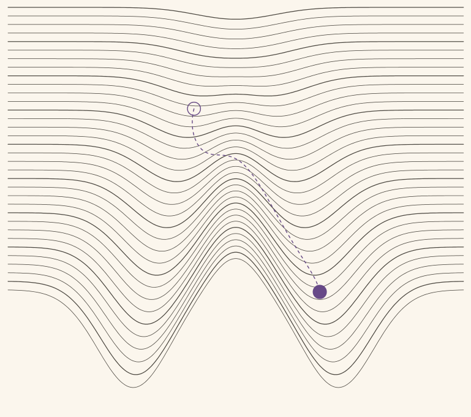

# The Model of Change

<i>Waddington’s landscape. The ball does not climb back to the summit; it crosses the ridge into the neighbouring valley.</i>

Every book of wisdom needs a picture of how a person changes. The old pictures are rebirth and conversion: die to who you were and begin again from nothing. This book offers a truer picture, taken from the living cell.

## The landscape

In 1957 the biologist Conrad Waddington drew the development of a cell as a ball rolling down a landscape of branching valleys. At the top, the young cell could become anything. As it rolls, the valleys deepen and its fate settles: muscle, nerve, skin. Once it lies deep in a valley, there it stays.

For a long time scientists believed the ball could never leave its valley. They were wrong, and wrong in two ways.

In 2006 Shinya Yamanaka and Kazutoshi Takahashi showed that four factors could push an adult cell all the way back up the hill, to a state from which it could become anything again. That is rebirth: return to zero.

But there is a second way, and it is the one this book is built on. It is called **transdifferentiation**: the direct conversion of one mature kind of cell into another, without going back to zero. In 1987 Robert Davis, Harold Weintraub and Andrew Lassar showed that a single factor, MyoD, could turn a connective-tissue cell into a muscle-forming cell. In 2008 Douglas Melton’s laboratory converted pancreatic cells inside living adult mice into cells closely resembling insulin-producing beta cells. In 2010 Marius Wernig’s group turned skin-derived cells into working neurons that fire and form connections. The ball does not climb back to the summit. It crosses a ridge into the neighbouring valley.

## What the cell teaches

- **You need not erase yourself to become someone new.** The cell crosses over directly.
- **A few core commitments, held steadily, rewrite the whole program.** A handful of factors is enough to change an entire identity.
- **The first hard, honest act opens what habit had shut.** Biologists call certain factors *pioneers*: they open regions of the genome that were sealed.
- **The new self must be fed until it feeds itself.** MyoD switches on its own gene; the new identity becomes self-maintaining. Practise until the new self no longer needs effort.
- **Most change is partial, and that is normal.** Conversions are inefficient, and many cells end between.
- **You carry your history into your new form.** Converted cells keep a measurable memory of where they came from. That memory is lineage, not contamination.
- **Becoming needs the right surroundings.** Converted cells mature only in the right environment.

## Where the metaphor breaks

Honesty is part of the method, so read this as carefully as the rest.

- Cells do not choose. You do. No one else has the right to “reprogram” you.
- Biology is morally neutral. A neuron is not “higher” than a skin cell. The direction of your change must be justified by ethics, not by biology.
- Transdifferentiation changes which genes are *expressed*, not the genes themselves. Thoughts do not rewrite DNA, and anyone who says they do is selling something.
- Laboratory efficiencies are an image, not a statistic about human beings.

## The four principles of becoming

Your philosophy of transdifferentiation names four principles, and the rest of this book keeps them.

- **Conserved specificity.** What you have built is material, not rubble. Your history, skills and scars are carried into your new form.
- **Rejection of the null point.** You never have to return to zero, empty yourself, or be destroyed in order to be renewed.
- **Adjacent possibility.** Your next form must be reachable from your present one. Change goes one ridge at a time.
- **Non-regressive growth.** Change that destroys what was good is not growth.

> *Change without erasure. Understanding without possession.*

---

[← The Floor and the Ceiling](05-the-floor-and-the-ceiling.md) &nbsp;·&nbsp; [Contents](../README.md) &nbsp;·&nbsp; [The Architecture →](07-the-architecture.md)

