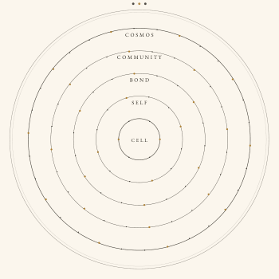

# The Architecture

<i>The five scales at which the book looks for its pattern: cell, self, bond, community, cosmos.</i>

Mathematicians use the word *isomorphism* for a strict thing: a map between two structures that preserves every relation, so that each part of one answers to exactly one part of the other and nothing is lost in the crossing. The book’s own isomorphism is its design: every chapter has the same nine movements, so the shape of one is the shape of all.

Across the scales of nature, the book claims something more modest and still astonishing: *structural analogy.* The same pattern, Existence, Consciousness, Relation, turns up again and again at very different sizes.

- **The cell** exists before it has a function; it senses signals; it becomes what it is through the tissue around it.
- **The self** exists without permission; it attends and knows; it is, as Kierkegaard wrote, a relation that relates itself to itself.
- **The bond** begins when two people meet; it lives in truly seeing the other; it becomes what Martin Buber called the meeting of an I and a Thou.
- **The community** exists as a people; it remembers and learns; it holds together, in the Nguni phrase, because a person is a person through other persons.
- **The cosmos** simply is; it is met with wonder; and one modern reading of quantum mechanics, Carlo Rovelli’s relational interpretation, describes physical properties as existing only in relation to other systems. It is one interpretation among several, not settled physics, and this book offers it as an image. Nagarjuna said something like it in the second century.

The old Hermetic tablet said *as above, so below*, and William Blake asked us to see a World in a Grain of Sand. Those are poetry, not proof; the systems theorist Ludwig von Bertalanffy found real “isomorphies,” the same equations of growth and competition in populations, chemistry and economics, and he warned against mere surface resemblance. This book keeps his warning. In each chapter the Five Scales show where the pattern holds, and the Reversal shows where it fails.

## The one rule about energy

This book speaks often of energy, and it obeys one rule: **science for claims, tradition for images, and never blur the two.**

Physics says energy is never made from nothing; it is received, transformed and directed. Physics also says that order decays unless it is fed: a body, a home, a friendship and a nation all need constant input to stay whole. Biology says your brain is about two percent of your body’s weight and uses about twenty percent of its oxygen, at a rate that barely changes whether you rest or strain.

The traditions speak of *qi* and *prana*, of vital breath and flood-like spirit. These are rich vocabularies for living well. No instrument has ever measured them as physical forces, and the book will not pretend otherwise.

---

[← The Model of Change](06-the-model-of-change.md) &nbsp;·&nbsp; [Contents](../README.md) &nbsp;·&nbsp; [The Ground →](../1-the-ground/README.md)

