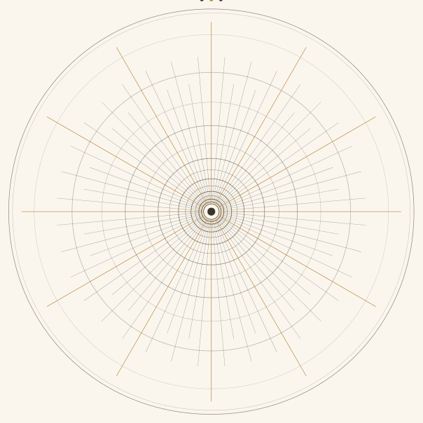

CHAPTER ONE

# Existence Needs No Permission

*Meaning*

<i>Seventy-two rays from one point. The centre asked no one’s leave to be there.</i>

> *The unexamined life is not worth living.*
>
> — Socrates, in Plato’s *Apology* 38a

> **RESPECT** · *Can I honour my own existence without asking anyone to justify it?*

## I · ◆ The Teaching

1. You did not apply for existence, and no one can turn the application down. You are here. That needs no defence, no papers and no applause. Stand on it every morning as a man stands on rock.
2. Meaning is not lying in the road waiting to be found. It is made as a road is made: by walking. Ask less often what life means. Ask what you will make it mean before nightfall.
3. Whoever has a *why* to live can bear almost any *how*. Find the why, and the how will bend its knee to it.
4. There are three doors to meaning that no jailer has ever locked: the work you do, the love you give, and the stand you take toward the suffering you cannot avoid. When two are barred, go through the third.
5. To the work you have a right; to its fruits, none. Do the work entire and let the outcome go, and you will never again be the servant of a result.
6. Do not wait for the universe to explain itself before you begin to live. It has explained itself to no one. The wise began anyway.
7. Examine your life, not to condemn it but to own it. The unexamined life is run by habit, by fear and by other people’s opinions. The examined one is yours.
8. The absurd is no enemy. A stone that must be pushed again tomorrow can still be pushed with a full heart. The struggle toward the heights is itself enough to fill a human heart.
9. Existence asks nothing of you. That is its gift and its hammer. Whatever you build upon it, you built.

## II · ◇ The Five Scales

|  |  |
|---|---|
| **CELL** | A cell exists before it has any function. Its being comes first; its office comes later. |
| **SELF** | You exist before you have achieved anything. Your worth is the floor, not the prize. |
| **BOND** | Every person you meet also exists without permission, and can feel and choose as you do. That is why dignity is owed to all. |
| **COMMUNITY** | A people need not justify being a people. It needs only to decide what it will become. |
| **COSMOS** | The universe offers no reason for itself. Being is simply given, and given to you. |

## III · The Witnesses

- ★ **Socrates** · Plato, *Apology* 38a  
  The unexamined life is not worth living: meaning begins in honest reflection.
- ★ **Bhagavad Gita** · 2.47  
  Your right is to the action alone, never to its fruits. It converges with the Stoic line between what is up to you and what is not.
- **Friedrich Nietzsche** · *Twilight of the Idols* (1889), “Maxims and Arrows” §12  
  “If we have our own *why* of life, we shall get along with almost any *how*.”
- **Viktor Frankl** · *Man’s Search for Meaning* (1946)  
  Meaning comes through what we create, what we love, and the attitude we take toward unavoidable suffering.
- **Albert Camus** · *The Myth of Sisyphus* (1942)  
  Facing a universe that gives no answers, we can still embrace the task: “one must imagine Sisyphus happy.”

## IV · ● The Tale

### *The Psychiatrist in the Camps*

Viktor Frankl was a psychiatrist in Vienna when the Nazis deported him in 1942. He passed through several camps, Auschwitz among them. His father, his mother, his brother and his wife died in the camps. He had carried with him the manuscript of a book, and it was taken from him.

In his own account of those years, Frankl set down what he saw: the prisoners who held on to some reason to go on, a person waiting for them, a task unfinished, were often the ones able to endure what seemed beyond enduring. He rebuilt his lost book on scraps of paper. After liberation he wrote *Man’s Search for Meaning* in a matter of days, and it went on to reach millions of readers.

Mark what he claimed and what he did not. Frankl never said that meaning guaranteed survival; many with every reason to live were murdered. He claimed something narrower and harder: that even when every outer freedom is taken, a person can still choose the attitude with which to meet what comes.

## V · ● The Energy

Meaning is the transformer of the soul. Physics says energy is never created, only converted from one form to another; in the same way, a clear purpose adds no hours to your day, but it converts scattered effort into directed force. Without a why, strength leaks away as worry and distraction.

## VI · The Reversal

> Making meaning can harden into denial. Not every loss carries a lesson, and not every suffering should be called a gift. Sometimes the honest answer to pain is grief, not interpretation. Let meaning come in its own time; do not force it onto a wound that is still open.

## VII · ◆ The Practice

|  |  |
|---|---|
| **DAILY** | Each morning, before you check anything, name one reason this day is worth living and one act that will serve it. |
| **WEEKLY** | Each week, write a single sentence: “This week my life meant \_\_\_ because I \_\_\_.” |

## VIII · The Ledger

|  |  |
|---|---|
| **PEACE** | Did I let the absence of answers rob me of calm today? |
| **LOVE** | Whom did I give a reason to go on? |
| **UNITY** | Did I treat anyone as if their existence needed my permission? |
| **RESPECT** | Did I honour my own being, or did I wait for someone else to justify it? |

## IX · The Song

*No warrant was writ for the rock or the rain,* 
*No licence was asked of the sea;* 
*The stars took their stations and never explained,* 
*And neither, my child, need ye.* 
*So stand where you stand, and build what you will,* 
*And answer to Heaven for this:* 
*Not whether you’re worthy of being at all,* 
*But what you will make of what is.*

---

[← The Ground](README.md) &nbsp;·&nbsp; [Contents](../README.md) &nbsp;·&nbsp; [The Vessel →](02-the-vessel.md)

