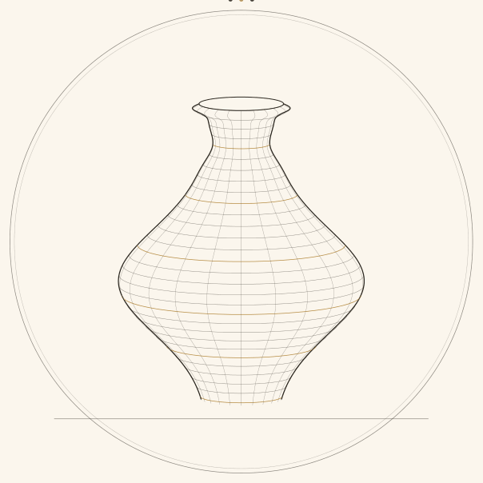

CHAPTER TWO

# The Vessel

*The Body, Discipline and Rest*

<i>A vessel turned on the wheel: thirty sections of one curve, the shape that holds.</i>

> *Remember the sabbath day, to keep it holy.*
>
> — Exodus 20:8 (KJV)

> **PEACE** · *Is my body a place of peace, or a battlefield I neglect?*

## I · ◆ The Teaching

10. Your body is not a vehicle you ride. It is the ground your whole life stands on. Every thought you think is paid for by it. Keep it as the vessel of everything you mean to become.
11. Too much and too little destroy alike: too much food and too little, too much training and too little, too much sleep and too little. The right measure preserves. Find your mean, and keep finding it as you change.
12. Discipline is not punishment. It is a promise kept to your future self. Each kept promise is a stone laid in a foundation that self will one day stand on.
13. Rest is not a wage you must earn. It is commanded. The oldest law codes on earth set aside a day on which no one, not the servant, not the stranger, not the ox, should labour. Rest belongs to the floor of dignity, not the ceiling.
14. Plain bread tastes like a feast to the hungry. Do not chase pleasures so rich that ordinary life tastes of ash. Keep your appetites simple and your joys will be many.
15. Move every day. Exercise the body in measure, then return quickly to the work of the mind. A strong body serves a clear head; an idle one fogs it.
16. Read the signals. Fatigue, pain and hunger are dispatches, not insults. A wise commander reads the reports from the field.
17. Order decays unless it is fed. Your health is not a possession; it is a practice, renewed daily or slowly lost.
18. You cannot borrow strength from tomorrow without paying interest. Sleep is the bank where tomorrow’s strength is kept.

## II · ◇ The Five Scales

|  |  |
|---|---|
| **CELL** | Every living cell keeps its order only by taking in energy and casting out waste. Stop the exchange and it falls apart. |
| **SELF** | Your body is the same: health is a steady traffic of food, movement and rest, never a finished state. |
| **BOND** | Bonds need rest too. People who never pause together end by performing for each other. |
| **COMMUNITY** | A people that never rests burns out its workers, its soil and its future. |
| **COSMOS** | Even stars live by balance: the inward pull of gravity matched by the outward push of their own fire. |

## III · The Witnesses

- ★ **Aristotle** · *Nicomachean Ethics* II.2  
  Too much or too little exercise or food destroys health; the proportionate amount produces and preserves it. The mean converges with the Buddha’s Middle Way and Maimonides’ rules of health.
- **Epicurus** · *Letter to Menoeceus*  
  Plain bread and water give the greatest pleasure when one is truly in need of them; simple habits make one ready for anything.
- **Seneca** · *Moral Letters* 15  
  Exercise the body, but briefly, and return quickly to the training of the mind.
- ★ **The Sabbath** · Exodus 20:8–10  
  Rest is commanded for all: children, servants, strangers and animals. Rest as dignity owed, not as wages earned.
- **Mencius** · *Mencius* 2A2  
  The “flood-like qi” is nourished by acting rightly: in the classical Chinese picture, vitality and integrity grow together.

## IV · ● The Tale

### *The Discipline of the Ice*

Hear now of a ship called *Endurance*, and of what endured when the ship did not. In 1915 the Antarctic pack ice gripped her and crushed her, and twenty-eight men were left on drifting floes with no hope of help from outside. Ernest Shackleton, who led them, understood one thing before all others: despair would kill them faster than cold.

So he kept a routine. Meals came at fixed hours; duties rotated; the men were kept busy; their spirits were watched as closely as the food stores. When the ice broke up, he led them in open boats to Elephant Island, and from there set out with five companions on a voyage of some eight hundred miles to South Georgia to bring help.

Every one of the twenty-eight came home. Order, fed daily by discipline, held them together in a place where nothing else could.

## V · ● The Energy

The brain is about two percent of the body’s weight, yet it consumes about a fifth of its oxygen, and that rate stays nearly constant whether you are resting or straining. Your thinking is a furnace that never goes out. Food, sleep and movement are not distractions from philosophy; they are its fuel line.

## VI · The Reversal

> Discipline can become its own tyranny. A body driven past its signals, starved for the sake of control, or punished for its limits is not being cared for; it is being conquered. If your habits around food, exercise or rest begin to feel like punishment or compulsion, talk to someone you trust and to a professional. Care is the aim. Control is not.

## VII · ◆ The Practice

|  |  |
|---|---|
| **DAILY** | Each day, do one thing for the vessel: a walk, a real meal, an early night. |
| **WEEKLY** | Each week, take one stretch of true rest: a sabbath of a few hours in which you produce nothing. |

## VIII · The Ledger

|  |  |
|---|---|
| **PEACE** | Did I heed my body’s signals, or override them? |
| **LOVE** | Did I care for myself as I would care for someone I love? |
| **UNITY** | Did I rest with others, not only labour beside them? |
| **RESPECT** | Did I keep the small promises I made to my own body? |

## IX · The Song

*The ship may be lost and the stores may run low,* 
*And the ice may close in at the door;* 
*But the watch shall be kept and the meal shall be shared,* 
*And the deck shall be swept as before.* 
*For the body’s a vessel, and order’s its keel,* 
*And the sea takes the ship that is slack:* 
*So feed it and rest it and work it in measure,* 
*And it will carry you back.*

---

[← Existence Needs No Permission](01-existence-needs-no-permission.md) &nbsp;·&nbsp; [Contents](../README.md) &nbsp;·&nbsp; [The Appointment →](03-the-appointment.md)

