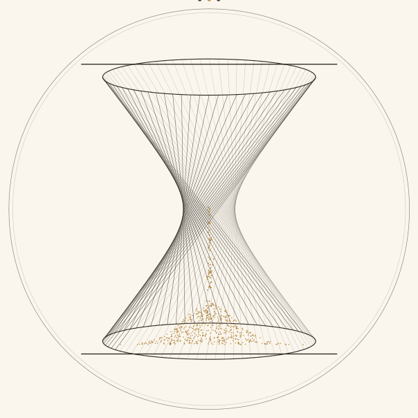

CHAPTER THREE

# The Appointment

*Death and Mortality*

<i>An hourglass ruled from straight lines alone: a hyperboloid, whose narrow waist every falling grain must pass.</i>

> *So teach us to number our days, that we may apply our hearts unto wisdom.*
>
> — Psalm 90:12 (KJV)

> **LOVE** · *If this were my last week, whom would I call?*

## I · ◆ The Teaching

19. You have an appointment that cannot be moved. Do not spend your life pretending it was cancelled. Whoever remembers death lives twice as awake.
20. Do not act as if you will live ten thousand years. Whatever good you mean to do, do it while it is still in your power.
21. Death is not the opposite of life. It is the border that gives life its shape. A song without an ending is only noise.
22. Where death is, you are not; where you are, death is not. Fear the wasted life, not the ending.
23. Every power you hold is borrowed against this appointment: rank, strength, wealth and youth. Hold them as a steward holds the master’s keys.
24. Grief is the price of love, and the price is worth paying. Do not shrink your love to make your grief smaller.
25. Speak the important words now. The apology, the thanks, the confession of love: these do not keep. The grave is full of sentences that were saved for later.
26. The wise have called philosophy itself a rehearsal for dying. Not because they longed for death, but because whoever has made peace with the ending is free in the middle.
27. Live so that when your name is spoken after you are gone, people remember what you gave, not what you took.

## II · ◇ The Five Scales

|  |  |
|---|---|
| **CELL** | Cells in your body die by the billions each day, on purpose, by an orderly program, so that the body can live. |
| **SELF** | Your life is finite, and its finitude is what makes each choice real. |
| **BOND** | Every bond ends, by parting or by death. Love that knows this is more tender, not less. |
| **COMMUNITY** | Generations pass. A people endures only by handing on what it values. |
| **COSMOS** | Even stars die, and the heavy elements in your body were forged in stars that died before the sun was born. |

## III · The Witnesses

- **Epicurus** · *Letter to Menoeceus*  
  “Death is nothing to us”: where we are, death is not; where death is, we are not.
- ★ **Plato** · *Phaedo* 64a  
  Those who practise philosophy rightly are practising for dying. It converges with Montaigne, Seneca and the Psalmist.
- **Marcus Aurelius** · *Meditations* 4.17  
  “Do not act as if thou wert going to live ten thousand years.” (Long)
- **Zhuangzi** · Chapter 18  
  When his wife died, Zhuangzi was found drumming on a pot. He explained that after his grief he saw her return to the great turning of things, as the seasons turn.
- ★ **The Psalmist** · Psalm 90:12  
  “So teach us to number our days, that we may apply our hearts unto wisdom.”

## IV · ● The Tale

### *Two Endings*

Alexander of Macedon died at Babylon in June of 323 BCE, at thirty-two, with no adult heir and an empire held together by nothing but his own will. His generals spent some forty years tearing it apart. He had conquered as though he would live for ever, and he left nothing that could outlive him.

In March 1953, Joseph Stalin collapsed in his dacha outside Moscow. His guards were under orders not to enter unbidden, and they had learned what disobedience could cost. A light came on in his rooms in the evening; hours passed before the staff dared go in and found him on the floor. Even then they telephoned the security chiefs, not a doctor. Physicians came the next morning. He died on March 5, surrounded by people who had obeyed him absolutely and loved him not at all.

Two of the most powerful men of their ages. Neither had readied the world, or the people around him, for his own ending.

## V · ● The Energy

The second law of thermodynamics says that order, left to itself, runs down. Death is that law written on a body. But living things are the places where the universe locally reverses the drift, taking in energy and building order for a while. Your life is a brief, bright countercurrent. Spend it on something.

## VI · The Reversal

> Remembering death is meant to wake you up, not weigh you down. If thoughts of death become constant, frightening or inviting, they are no longer philosophy; they are pain asking for help. Speak to someone you trust, and to a professional, without delay. The aim of this chapter is to make your life more precious to you, never less.

## VII · ◆ The Practice

|  |  |
|---|---|
| **DAILY** | Each night ask: if this had been my last day, what would I wish I had said or done? Then do it tomorrow. |
| **WEEKLY** | Each week, say one thing to someone that you would regret leaving unsaid. |

## VIII · The Ledger

|  |  |
|---|---|
| **PEACE** | Did I spend today’s hours as though they were unlimited? |
| **LOVE** | Did I say what matters to someone who matters? |
| **UNITY** | Did I leave something that will outlast me, however small? |
| **RESPECT** | Did I live today in a way I would want remembered? |

## IX · The Song

*The sand runs down in the narrow glass,* 
*And none may stay its fall;* 
*The king and the clerk and the cabin-boy* 
*Must keep one hour, and all.* 
*Then say the word that you meant to say,* 
*And mend what you meant to mend,* 
*For the glass is turned but the once, my child,* 
*And it does not wait for the end.*

---

[← The Vessel](02-the-vessel.md) &nbsp;·&nbsp; [Contents](../README.md) &nbsp;·&nbsp; [Starry Heavens →](04-starry-heavens.md)

