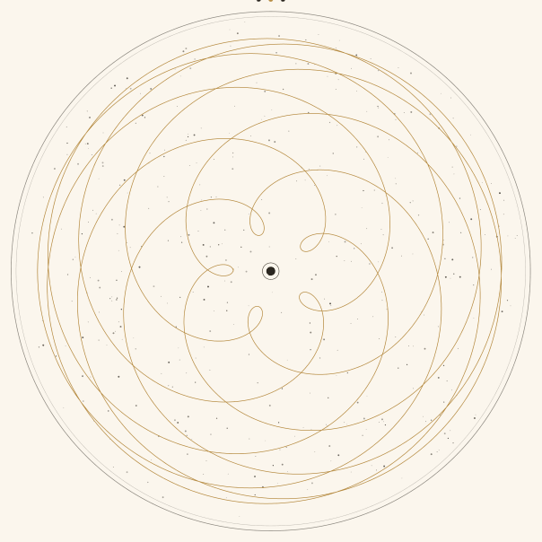

CHAPTER FOUR

# Starry Heavens

*The Sacred, Wonder and the Infinite*

<i>The path of Venus as seen from Earth across eight years: five loops, drawn by two orbits and nothing else.</i>

> *To see a World in a Grain of Sand, And a Heaven in a Wild Flower.*
>
> — William Blake, “Auguries of Innocence”

> **UNITY** · *When did I last feel part of something larger than myself?*

## I · ◆ The Teaching

28. Philosophy begins in wonder. The day you stop being astonished that anything exists at all is the day you begin to die inside.
29. Look up at night. Some of the light entering your eyes left its star before your grandparents were born. You are standing in an ocean of time.
30. Two things are worth a lifetime of awe: the vast order of the heavens, and the moral law that rises in the human heart. Keep both in view.
31. The heart is restless until it rests in something larger than itself. Do not stuff that restlessness with noise. Let it lead you somewhere.
32. Every tradition that has looked deep has found the same thing at the bottom of its looking: that everything is bound to everything else. Call it God, Nature, the Tao, or the web of relations. The binding is real.
33. Keep a heart capable of every form. The truth is larger than any single house built to hold it.
34. Wonder is not certainty. You need not know what the infinite is in order to stand before it with reverence.
35. Humility is not thinking little of yourself. It is seeing yourself at the right scale: one bright point in a sky of points, each irreplaceable, none at the centre.
36. Take time each day to be small before something vast. It heals the pride that makes you cruel and the despair that makes you weak.

## II · ◇ The Five Scales

|  |  |
|---|---|
| **CELL** | A single cell holds a thread of DNA about two metres long, folded with exquisite order into a space too small to see. |
| **SELF** | Your inner life is its own infinity: no one has ever reached the bottom of a human mind. |
| **BOND** | Every person you meet is a universe you will never fully explore. |
| **COMMUNITY** | A people is held together by what it holds sacred: the shared things it will not sell. |
| **COSMOS** | A universe of hundreds of billions of galaxies, and in it a creature able to wonder at it. |

## III · The Witnesses

- ★ **Plato and Aristotle** · *Theaetetus* 155d; *Metaphysics* I.2  
  Wonder is the feeling of the philosopher, and philosophy begins in wonder.
- **Immanuel Kant** · *Critique of Practical Reason* (1788), Ak. 5:161  
  Two things fill the mind with ever new and increasing admiration and awe: the starry heavens above and the moral law within.
- **Baruch Spinoza** · *Ethics* IV, Preface  
  *Deus sive Natura*, God or Nature: the sacred understood as the whole of what is.
- **Ibn Arabi** · *Tarjuman al-Ashwaq*, poem 11  
  His heart had become capable of every form: an open reverence wider than any single creed.
- **Augustine** · *Confessions* I.1  
  “Our heart is restless, until it repose in Thee.” (Pusey)

## IV · ● The Tale

### *The Pale Dot*

On February 14, 1990, as the Voyager 1 spacecraft sped outward past the planets, it turned its camera back toward home and took a last series of pictures. From about six billion kilometres away, the Earth showed as a single pale point of light, smaller than a pixel, caught in a beam of scattered sunlight.

Every war, every empire, every love affair and every philosopher in this book happened on that dot. Many who have seen the picture describe the same answer rising in them: a kind of tenderness. It is harder to hate once you have seen how small the home is, and how shared.

## V · ● The Energy

Awe has a measurable effect in modern psychology: people who have just felt it tend to report a smaller sense of self and greater generosity toward others. The old traditions said the same thing in their own tongue. Wonder spends nothing and returns much: it lowers the pressure of the ego and widens the circle of care.

## VI · The Reversal

> Wonder is not evidence. A feeling of cosmic connection proves no particular doctrine, and it can be exploited by those who sell certainty. Let awe make you humble and open, never gullible. The sacred is honoured by honesty, not by credulity.

## VII · ◆ The Practice

|  |  |
|---|---|
| **DAILY** | Each day, spend one minute looking at something vast: the sky, the sea, a tree, a sleeping face. |
| **WEEKLY** | Each week, spend an hour in silence somewhere larger than you: outdoors, at night, or in a place others hold sacred. |

## VIII · The Ledger

|  |  |
|---|---|
| **PEACE** | Did I let something vast quiet my small worries? |
| **LOVE** | Did I see someone today as a universe, not an obstacle? |
| **UNITY** | Did I remember that everyone I met lives on the same pale dot? |
| **RESPECT** | Did I treat what others hold sacred with care, even where I do not share it? |

## IX · The Song

*The Morning Star goes round her road* 
*In five slow loops of light,* 
*And every eight years comes again* 
*To the place she stood tonight.* 
*She asks no thanks; she keeps her time;* 
*She does not need to know* 
*That someone small upon a dot* 
*Looked up, and loved her so.*

---

[← The Appointment](03-the-appointment.md) &nbsp;·&nbsp; [Contents](../README.md) &nbsp;·&nbsp; [The Light →](../2-the-light/README.md)

