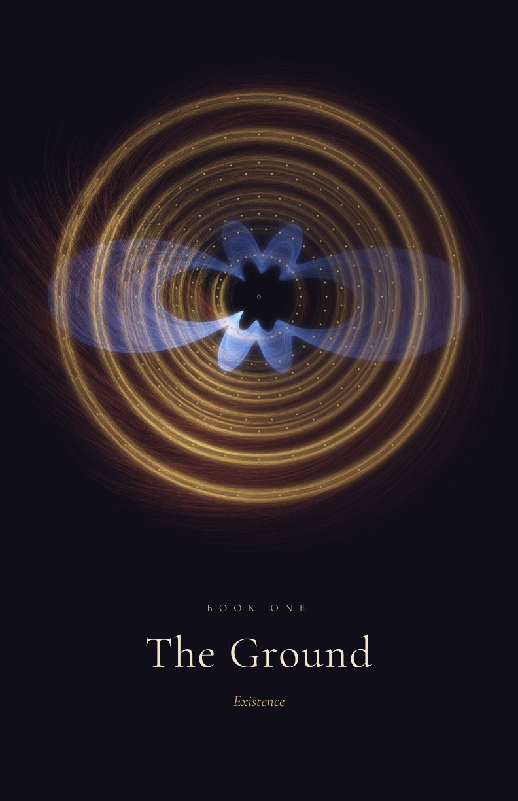

BOOK ONE

# The Ground

*Before you know anything, before you love anyone, before you earn a single thing, you are. This Book stands on that fact. It concerns what no one can give you and no one can take away: being itself, the body that carries it, the death that bounds it, and the wonder that surrounds it.*

1. [Existence Needs No Permission](01-existence-needs-no-permission.md)
2. [The Vessel](02-the-vessel.md)
3. [The Appointment](03-the-appointment.md)
4. [Starry Heavens](04-starry-heavens.md)

---

[← The Architecture](../0-opening/07-the-architecture.md) &nbsp;·&nbsp; [Contents](../README.md) &nbsp;·&nbsp; [Existence Needs No Permission →](01-existence-needs-no-permission.md)

