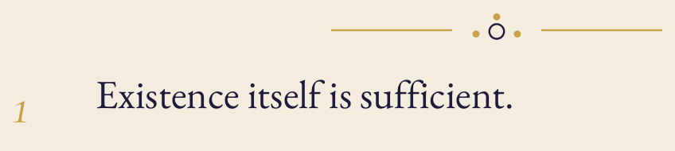

THE GEOMETRY OF EXISTENCE · LEVEL ONE · THE LINES · PAGE 9

## The First Principle

<i>the ground of the book, in the author’s words</i>

> *Nothing gives legitimacy to existence except existence itself.*

  

Existence itself is sufficient.

2. Consciousness gives us the opportunity to understand it.

3. Connection gives us the opportunity to honor it.

Existence requires no justification. Understanding is an opportunity. Connection is a responsibility we may choose to undertake.

*Everything that follows must remain accountable to this distinction.*

---

[← Level One · The Lines](README.md) · [Contents](../README.md) · [PDF ↓](../../edition/README.md) · [The Stance →](02-the-stance.md)

