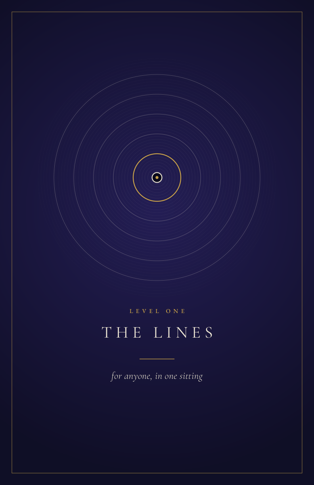

THE GEOMETRY OF EXISTENCE · LEVEL ONE · THE LINES · PAGE 8

  

LEVEL ONE

# The Lines

> *for anyone, in one sitting*

<!-- level-strip -->
## In this level

<table>
<tr><td align="center" valign="top" width="25%"><a href="01-the-first-principle.md"><b>The First Principle</b></a> p. 9</td><td align="center" valign="top" width="25%"><a href="02-the-stance.md"><b>The Stance</b></a> p. 10</td><td align="center" valign="top" width="25%"><a href="03-in-plain-words.md"><b>In Plain Words</b></a> p. 11</td></tr>
</table>
<!-- /level-strip -->

---

[← How This Book Is Built](../0-front/02-how-this-book-is-built.md) · [Contents](../README.md) · [PDF ↓](../../edition/README.md) · [The First Principle →](01-the-first-principle.md)

