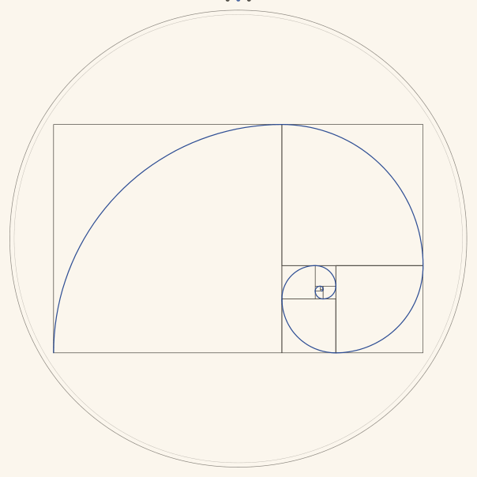

CHAPTER FIVE

# Know the One Who Knows

*Self-Knowledge and Identity*

<i>Cut a square from a golden rectangle and what is left is the whole figure again, smaller: the golden spiral, a shape that contains itself.</i>

> *He who knows other men is discerning; he who knows himself is intelligent.*
>
> — *Tao Te Ching* 33 (Legge)

> **RESPECT** · *Do I respect the person I actually am, not only the one I perform?*

## I · ◆ The Teaching

37. Know yourself. It was carved over the door of the temple at Delphi, and it is still the first door. Everything else you learn is seen through an eye that does not yet know itself.
38. You are not a thing. You are a relation that relates itself to itself: a council between who you have been, who you are, and who you are choosing to become. Keep the council honest.
39. Look for yourself and you will find a moving river of perceptions, moods and memories. Do not panic. A river is no less real for moving. Your identity is a heading, not a statue.
40. Better to walk your own road badly than another’s road well. Borrowed lives fit poorly, however fine the cloth.
41. To study the self is to forget the self. The deepest self-knowledge comes not from staring inward for ever, but from losing yourself in work, in love, in the world, and noticing who you are while you do.
42. Your history is not your prison. It is your lineage. The cell that changes its kind still carries the memory of what it was. So will you, and there is no shame in it.
43. Watch what you do when no one is watching. That is your character. Everything else is reputation.
44. Beware the dye of your office. Titles, uniforms and screens seep into the soul. Do not become the costume.
45. Every evening, ask who you were today. Not who you meant to be: who you were. The gap between the two is tomorrow’s lesson.

## II · ◇ The Five Scales

|  |  |
|---|---|
| **CELL** | A cell’s identity is a stable pattern of active genes, held in place by the cell’s own regulation. It is a valley, not a cage. |
| **SELF** | Your identity is the same: a stable pattern of habits, loves and choices, deep enough to hold you, never fixed for ever. |
| **BOND** | In a true bond you discover who you are by being seen, and by seeing. |
| **COMMUNITY** | A people knows itself by the stories it tells of where it came from and what it refuses to become. |
| **COSMOS** | Through creatures like you, the universe has grown a way to know itself. |

## III · The Witnesses

- ★ **The Delphic Maxim** · Plato, *Phaedrus* 229e–230a  
  “Know thyself”: Socrates says he cannot investigate other things until he knows himself. It converges with *Tao Te Ching* 33 and the Sufi teaching that whoever knows himself knows his Lord.
- **Søren Kierkegaard** · *The Sickness unto Death* (1849), Part One, A  
  The self is a relation that relates itself to itself.
- **David Hume** · *A Treatise of Human Nature* 1.4.6  
  When he looked inward he found no fixed self, only “a bundle or collection of different perceptions.”
- **Dōgen** · *Genjōkōan* (1233)  
  To study the self is to forget the self; to forget the self is to be confirmed by all things.
- **Bhagavad Gita** · 3.35  
  Better one’s own duty, though imperfectly done, than the duty of another well performed.

## IV · ● The Tale

### *The Emperor’s Notebook*

Marcus Aurelius ruled the Roman Empire from 161 to 180 CE, with power that was, in practice, nearly absolute. In private he kept a notebook, written in Greek and addressed to no one but himself. We call it the *Meditations*.

In one entry he warns himself not to be turned into a Caesar, not to be dyed with that dye, “for such things happen.” He knew the throne could stain the man. So he wrote down, again and again, the person he meant to remain: simple, good, pure, serious, a friend of justice, kind, strong for his proper work.

Self-knowledge, for him, was not one discovery made once. It was a daily act of remembering who he was beneath the purple.

## V · ● The Energy

Self-deception is expensive. It costs constant effort to maintain a story that does not match what you do, and the mind pays that cost in tension and defensiveness. Honest self-knowledge is cheaper in the long run: there is nothing to guard.

## VI · The Reversal

> Self-examination can rot into self-absorption, an endless inward spiral that never acts. Know yourself in order to live better among others, not instead of living. And no one fully knows themselves alone: ask the people who love you what they see.

## VII · ◆ The Practice

|  |  |
|---|---|
| **DAILY** | Each evening, write one honest line: “Today I was \_\_\_.” |
| **WEEKLY** | Each week, ask one trusted person, “What do you see in me that I might not see?” and listen without defending. |

## VIII · The Ledger

|  |  |
|---|---|
| **PEACE** | Was I at peace with who I actually was today? |
| **LOVE** | Did I let someone see the real me? |
| **UNITY** | Did I play a part so long that I forgot the person beneath it? |
| **RESPECT** | Did my private conduct match my public face? |

## IX · The Song

*There’s one who you are when the door is shut,* 
*And one that the market knows,* 
*And one that you meant to be, years ago,* 
*When you set your face to the snows.* 
*Now call them to council at close of day,* 
*And set them a table for three;* 
*And the one who is truest shall carve the bread,* 
*And the others shall learn to agree.*

---

[← The Light](README.md) &nbsp;·&nbsp; [Contents](../README.md) &nbsp;·&nbsp; [The Instrument →](06-the-instrument.md)

