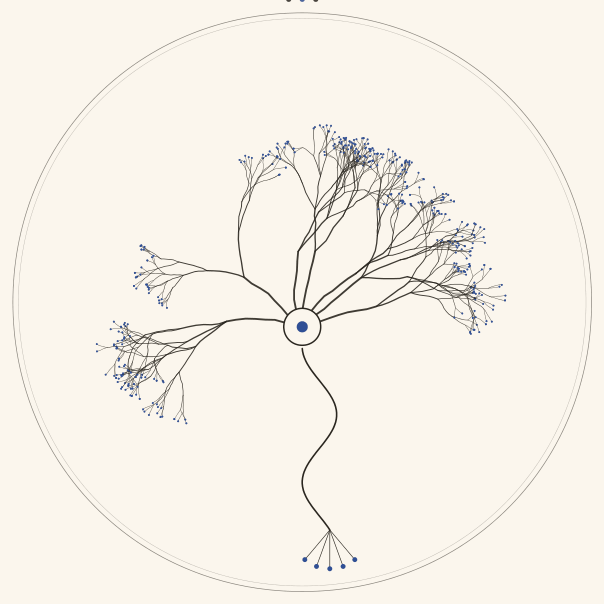

CHAPTER SIX

# The Instrument

*The Brain and How It Builds Experience*

<i>A neuron: thousands of inputs gathered on branching dendrites, one judgment sent down a single axon.</i>

> *The mind is its own place, and in itself* *Can make a Heav’n of Hell, a Hell of Heav’n.*
>
> — John Milton, *Paradise Lost* I.254–255

> **PEACE** · *Where is my home base, and how quickly can I return to it?*

## I · ◆ The Teaching

46. Your brain does not record the world. It predicts it. Every moment it guesses what is out there and corrects the guess against the senses. What you experience is the best guess, not the raw feed.
47. Because experience is built from expectation, expectation changes experience. The same pill eases more pain when you believe in it; the same wine tastes better from the dear bottle. Know this of yourself, and of everyone who is selling you something.
48. Memory is not a recording. It is rebuilt each time you call it up, and it can be rebuilt wrong. Hold your surest memories with a little humility, above all in a quarrel.
49. You see far less than you think. People busy counting passes in a game can miss a gorilla walking through it. Your attention is a lantern, not the sun.
50. Emotion is the body’s forecast. A racing heart is the brain readying you for what it predicts is coming. Name the feeling, and you begin to choose what it means.
51. Sleep is when the instrument is tuned. Most adults need at least seven hours; seven to nine is the common counsel. No philosophy survives chronic exhaustion.
52. Home base is the steady state from which you can see and choose: breath slow, attention placed, body settled. You will leave it a hundred times a day. Mastery is not never leaving. It is coming back quickly.
53. Breathe in for about four counts and out for about six. Near six breaths a minute, heart and breath tend to fall into step, and many people feel the body settle. It is the shortest road home.
54. Treat your mind as an instrument you are learning to play: not a master to obey, and not an enemy to fight.

## II · ◇ The Five Scales

|  |  |
|---|---|
| **CELL** | A single neuron sums thousands of inputs and decides whether to fire: the smallest act of judgment in your body. |
| **SELF** | Your brain is a prediction engine, and your sense of self is partly the prediction it makes about you. |
| **BOND** | In conversation, two brains predict each other’s next words. Good listening is updating your guess. |
| **COMMUNITY** | A culture is a shared set of expectations. Change the expectations and you change what people see. |
| **COSMOS** | Every instrument humans have built, from the telescope to the particle detector, extends the same act: predict, then correct against the world. |

## III · The Witnesses

- **Hermann von Helmholtz** · *Handbook of Physiological Optics*, vol. 3 (1867)  
  Perception as “unconscious inference”: the mind concludes what must be out there from incomplete signals.
- **Daniel Simons and Christopher Chabris** · “Gorillas in our midst,” *Perception* 28  
  *(1999)* Inattentional blindness: what we do not attend to, we often do not see at all.
- ★ **Frederic Bartlett and Elizabeth Loftus** · *Remembering* (1932); Loftus and  
  *Palmer (1974)* Memory is reconstructive: rebuilt at each recall and shaped by later questions. A large multi-laboratory replication of the 1974 study was being organized in 2026, with more than seventy-five laboratories committed. It converges with the Buddhist teaching that the mind constructs its world.
- **Anil Seth** · *Being You* (2021)  
  Perception as a “controlled hallucination”: a leading framework, predictive processing, which scientists still debate.

## IV · ● The Tale

### *The Gorilla in the Room*

In 1999 the psychologists Daniel Simons and Christopher Chabris asked people to watch a short film of two teams passing basketballs and to count the passes made by the team in white.

Partway through, a person in a gorilla suit walked into the middle of the game, faced the camera, thumped its chest and walked off. About half the viewers never saw it.

They were not careless. They were doing exactly what they had been asked, with their whole attention. That is the lesson: the brain spends its light on what you point it at, and leaves the rest in the dark.

## V · ● The Energy

Prediction is thrift. A brain that processed every signal from scratch would be swamped; by predicting, it spends attention chiefly on surprises. That is why a chaotic place wears you out and a calm one restores you: surprise is where the mind’s energy goes. Build a life with fewer needless surprises, and you will have more strength for the ones that matter.

## VI · The Reversal

> Predictive processing is a leading scientific framework, not a finished theory; researchers still argue over how much it explains. And understanding how the mind works is not the same as being well. If your mind is in lasting distress, the right instrument is a qualified professional, not a book.

## VII · ◆ The Practice

|  |  |
|---|---|
| **DAILY** | Three times a day, return to home base for one minute: in for four, out for six, attention on the breath. |
| **WEEKLY** | Each week, notice one prediction you made that turned out wrong, and write down what it taught you. |

## VIII · The Ledger

|  |  |
|---|---|
| **PEACE** | How often did I return to home base today? |
| **LOVE** | Did I remember that others are living inside their own predictions? |
| **UNITY** | Did I check a memory before using it as a weapon? |
| **RESPECT** | Did I give my instrument the sleep and care it needs? |

## IX · The Song

*The mind is a lamp that a sentry holds* 
*At the edge of a darkened plain;* 
*It shows him the road where he means to look,* 
*And the rest is dark again.* 
*So set it with care, and trim it with sleep,* 
*And breathe when the shadows start;* 
*For the world that you see is the world you light,* 
*And the light is the work of your heart.*

---

[← Know the One Who Knows](05-know-the-one-who-knows.md) &nbsp;·&nbsp; [Contents](../README.md) &nbsp;·&nbsp; [Where Attention Goes →](07-where-attention-goes.md)

