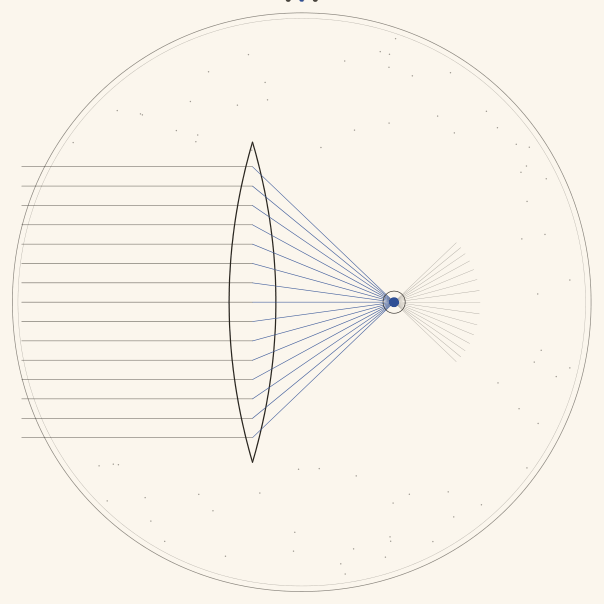

CHAPTER SEVEN

# Where Attention Goes

*The Mind: Attention, Thought, Emotion*

<i>A lens takes parallel rays and brings them to one point. What the lens does not take in stays scattered.</i>

> *Men are disturbed not by the things which happen, but by the opinions about the things.*
>
> — Epictetus, *Enchiridion* 5 (Long)

> **PEACE** · *Who is holding the reins of my attention right now?*

## I · ◆ The Teaching

55. Of all things, some are up to you, some are up to us together, and some are up to no one. Your judgments, intentions, effort and response are yours: work on those alone. Work on the second kind together. Let the third pass like weather.
56. It is not the event that troubles you. It is the story you tell about the event. Change the story and the same event weighs less.
57. All that you are is shaped by what you have thought. Suffering follows a poisoned mind as the wheel follows the foot of the ox. Joy follows a clear one, like a shadow that never leaves.
58. Your experience is what you agree to attend to. Whoever owns your attention owns your life. Do not hand it to every bright thing that asks for it.
59. Attention is the rarest and purest form of generosity. Give someone your whole attention and you have given more than money.
60. Hold your aims firmly and your outcomes lightly. The archer who shoots for a clay tile shoots with all his skill. Promise him a brass buckle and he grows nervous. Promise him gold and he can barely see the target. His skill has not changed; only the weight he hung on the outcome.
61. Emotion is information, not instruction. The surge tells you that something matters. It does not tell you what to do.
62. There is no quieter retreat than your own mind. You need no mountain and no monastery: only a few breaths and the decision to come back to yourself.
63. Train your mind as you train your body: a little, every day. A mind left untrained is not free. It is merely owned by its habits.

## II · ◇ The Five Scales

|  |  |
|---|---|
| **CELL** | A cell answers only to the signals it has receptors for. What it can sense shapes what it becomes. |
| **SELF** | You become what you repeatedly attend to. Attention is the receptor of the soul. |
| **BOND** | To love someone is, in large part, to pay attention to them. |
| **COMMUNITY** | A people becomes what it collectively notices and ignores. |
| **COSMOS** | Astronomers see only what their instruments are pointed at. The universe a mind knows is the universe it attends to. |

## III · The Witnesses

- ★ **Epictetus** · *Enchiridion* 1 and 5  
  Some things are in our power and others are not; we are disturbed by our opinions about events. It converges with the Gita’s teaching on action and its fruits.
- **The Buddha** · *Dhammapada* 1–2  
  Mind precedes all states; suffering follows an impure mind “as the wheel follows the foot of the ox.”
- **William James** · *The Principles of Psychology* (1890), ch. 11  
  “My experience is what I agree to attend to.”
- **Simone Weil** · Letter to Joë Bousquet (1942)  
  Attention is the rarest and purest form of generosity.
- **Marcus Aurelius** · *Meditations* 4.3  
  Nowhere can a man retire with more quiet than into his own soul.

## IV · ● The Tale

### *The Last Hole*

On July 18, 1999, at Carnoustie in Scotland, the golfer Jean van de Velde stood on the final tee of the Open Championship with a three-stroke lead. He needed only a double-bogey six to win one of the great prizes of his sport.

He played boldly where he needed only to play safe. His ball struck a grandstand, then found deep rough, then the water. He made a triple-bogey seven and fell into a four-hole playoff, which he lost to Paul Lawrie, a man who had begun the final round ten strokes behind.

Some twenty-three centuries earlier, the book of Zhuangzi told the story of the archer who loses his eye when the prize turns to gold. The skill is the same. What changes is the weight laid on the outcome. The author Vadim Zeland calls this “excess importance”; take it as a picture of the mind, not as physics, and it is a true one.

## V · ● The Energy

Attention behaves like a limited capacity: you cannot pour it everywhere at once, and what you spend on one thing is not there for another. Modern research does not support the popular idea that willpower is a fuel tank that literally runs dry, so do not blame an empty tank. Blame the leaks: the notifications, the grudges, the replays of old arguments. Seal the leaks and you will find more strength than you knew you had.

## VI · The Reversal

> The line between what is and is not up to you can be misused as an excuse for idleness: “it is not up to me,” said of things that partly are. Your vote, your voice and your effort are up to you even when the outcome is not. And some states of mind are not choices at all: depression, anxiety and trauma are not failures of attention, and they deserve real care, not slogans.

## VII · ◆ The Practice

|  |  |
|---|---|
| **DAILY** | Each day, before you react to anything that stings, ask: is this up to me? If not, let it pass. If so, act. |
| **WEEKLY** | Each week, take back one hour of attention from something that has been stealing it. |

## VIII · The Ledger

|  |  |
|---|---|
| **PEACE** | Where did my attention go today, and did I send it there? |
| **LOVE** | To whom did I give my full attention? |
| **UNITY** | Did I listen, or only wait to speak? |
| **RESPECT** | Did I let an outcome I could not control steal my composure? |

## IX · The Song

*Shoot for the tile and your hand is sure;* 
*Shoot for the brass, and it shakes;* 
*Shoot for the gold, and the target swims* 
*In the haze that the hunger makes.* 
*The bow is the same and the arm is the same,* 
*And the arrow is still the same;* 
*It’s only the weight that you hang on the shot* 
*That loses or wins the game.*

---

[← The Instrument](06-the-instrument.md) &nbsp;·&nbsp; [Contents](../README.md) &nbsp;·&nbsp; [The Open Door →](08-the-open-door.md)

