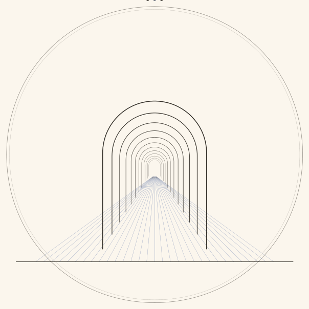

CHAPTER EIGHT

# The Open Door

*Suggestion, Expectation and Hypnosis*

<i>Arches receding to a lit doorway: a corridor of attention, narrowing toward one point of light.</i>

> *All that we are is the result of what we have thought.*
>
> — *Dhammapada* 1 (Müller)

> **RESPECT** · *Who has my consent to suggest what I should feel?*

## I · ◆ The Teaching

64. Suggestion is neither magic nor nonsense. It is the brain’s expectation engine, turned by words. Everyone is suggestible to some degree. It is a capacity, not a weakness.
65. Hypnosis is attention focused narrowly, with the edges of awareness dimmed and the response to suggestion raised. It is not sleep, and you are not unconscious.
66. People differ. A minority respond very strongly, a minority barely at all, and most sit between. Your response tells you something about your attention, not about your intelligence or your will.
67. Used well, hypnosis can ease pain and anxiety and help with some bodily conditions, usually as one part of wider treatment. It cannot give you abilities you do not have.
68. Hypnosis does not unlock hidden true memories. It raises confidence far more than accuracy, and it can add details that were never there. Never trust a memory because it was recovered in trance.
69. Pressure, setting and expectation are real forces; that is why consent matters. Open the door only to suggestions you would accept wide awake, and keep your hand on the handle.
70. Self-hypnosis is directed attention: settle, focus, deepen, give yourself one clear suggestion, then return. It works best learned as a skill and practised, not merely listened to. You are both the hypnotist and the subject. You hold both keys.
71. The words you say to yourself are suggestions too. Speak to yourself as to someone you are helping, not someone you are punishing.
72. The oldest magic in the world is expectation. Learn to use it on yourself, kindly, and to notice when others use it on you.

## II · ◇ The Five Scales

|  |  |
|---|---|
| **CELL** | A sugar pill believed to be medicine can partly draw on the body’s own pain-relieving chemistry. Expectation reaches all the way down. |
| **SELF** | Every expectation you hold is a quiet suggestion you give yourself. |
| **BOND** | Trust makes suggestion stronger. That is why trust must be handled with care. |
| **COMMUNITY** | Advertising, ritual and rumour are suggestion at the scale of a whole people. |
| **COSMOS** | The universe takes no suggestions. Only minds do. Know which one you are addressing. |

## III · The Witnesses

- **The Royal Commission** · Franklin, Lavoisier, Bailly and Guillotin (1784)  
  Blind tests of “animal magnetism,” as practised by Mesmer’s disciple Charles Deslon, showed that its effects came from imagination, not from any magnetic fluid.
- **James Braid** · *Neurypnology* (1843)  
  Popularized the name “hypnotism” and explained the trance as concentrated attention: the turn from occult force to psychology.
- **Jane Dywan and Kenneth Bowers** · *Science* 222 (1983)  
  Hypnotized people recalled more items than controls, and many more of the additions were wrong.
- **Irving Kirsch** · Response expectancy theory (1985)  
  Expecting a response helps produce it: the mechanism shared by placebo and suggestion.
- **American Psychological Association, Division 30** · Definition of hypnosis  
  *(2014)* A state of consciousness involving focused attention and reduced peripheral awareness, with an enhanced capacity to respond to suggestion.

## IV · ● The Tale

### *From Magic to Science*

In the 1780s, Paris was in love with Franz Anton Mesmer, who claimed to heal by channelling an invisible “animal magnetism.” Patients trembled, wept and fainted. In 1784 Louis XVI appointed a commission headed by Benjamin Franklin, with the chemist Antoine Lavoisier among its members, to test the claim. Mesmer refused to take part, so they tested his leading disciple, Charles Deslon.

They ran some of the first blind trials in history. A blindfolded boy, led through Franklin’s garden, collapsed in a crisis at a tree that had never been magnetized. Women who were only told they were being magnetized fell into fits, while magnetizing done out of their sight did nothing. The commission concluded that the effects were real and that their cause was imagination.

In November 1841 the Manchester surgeon James Braid watched a touring mesmerist and decided the trance was produced by fixed attention, not by any fluid. Within months he was calling it hypnotism, and the name stuck. The magic did not vanish. It moved inside, where it had been all along.

## V · ● The Energy

Expectation is real energy in the economy of the body. It can draw on the body’s own pain relief, and its dark twin, the nocebo effect, makes people more likely to feel or report the very side effects they were warned about. Spend expectation on purpose: expect the effort to be hard and the outcome to be worth it.

## VI · The Reversal

> Hypnosis is not for everyone at every moment. People with a history of psychosis, dissociation or severe trauma should explore it only with a qualified clinician. If any practice here leaves you disoriented, distressed or detached, stop and return to home base. This chapter offers practices of attention, not treatment, and it is never a tool for steering another person.

## VII · ◆ The Practice

|  |  |
|---|---|
| **DAILY** | Each day, a five-minute self-hypnosis: breathe in four and out six; fix your gaze on one point; count down slowly from ten; give yourself one clear suggestion in the present tense; count up from one to five and open your eyes. |
| **WEEKLY** | Each week, notice one suggestion the world gave you, from an advertisement, a headline or a voice, and decide whether you accept it. |

## VIII · The Ledger

|  |  |
|---|---|
| **PEACE** | Did I give myself a suggestion worth accepting? |
| **LOVE** | Were my words to myself the words of a helper? |
| **UNITY** | Did I use my influence only with consent? |
| **RESPECT** | Did I notice, and choose, what others suggested to me? |

## IX · The Song

*There’s a door in the mind that opens in,* 
*And a voice that can walk inside;* 
*And the voice may be kind and the voice may be cold,* 
*And the voice may be bent on pride.* 
*So keep your hand on the handle, child,* 
*And your eye on the one who speaks,* 
*And let in no word you would not let in* 
*With the daylight on your cheeks.*

---

[← Where Attention Goes](07-where-attention-goes.md) &nbsp;·&nbsp; [Contents](../README.md) &nbsp;·&nbsp; [The Dark Half, with the Lights On →](09-the-dark-half-with-the-lights-on.md)

