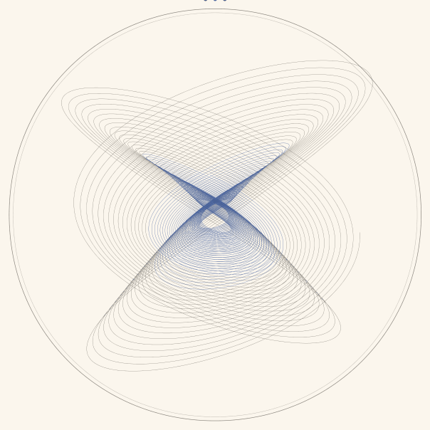

CHAPTER NINE

# The Dark Half, with the Lights On

*Mentalism, Manipulation and Defence*

<i>A harmonograph: the trace two swinging pendulums leave on paper. Faraday showed that a hand can move a table without knowing it moves.</i>

> *Be ye therefore wise as serpents, and harmless as doves.*
>
> — Matthew 10:16 (KJV)

> **RESPECT** · *Am I being persuaded, or steered?*

## I · ◆ The Teaching

73. Every power over minds has a dark use. Learn how the dark half works, not to use it, but so that no one can use it on you unseen. Here, knowledge is armour.
74. Cold reading feels like mind reading. It runs on statements true of almost everyone, on watching your reactions, and on your memory, which keeps the hits, drops the misses, and forgets that you supplied the information yourself. When someone seems to know you uncannily well, count the misses.
75. Most people believe they can spot a liar. Across hundreds of experiments with tens of thousands of judges, people judge lies barely better than a coin toss, and they lean toward believing. Do not trust your gut about deceit. Check the facts.
76. Tiny movements you do not feel yourself making can swing a pendulum, slide a planchette or turn a table, and they feel like a force from outside. Before you credit spirits, rule out yourself.
77. Influence runs on six old levers: we repay gifts, stay consistent with what we said, follow the crowd, defer to authority, say yes to people we like, and want what is scarce. Each is useful. Each can be pulled against you. When you feel one pulled hard, slow down.
78. The small yes prepares the big yes. Notice when a chain of easy agreements is walking you somewhere you would never have gone in one step.
79. Manipulation isolates. Whoever wants to control you will try to cut you off from your friends, your money, your sleep and your doubts. Anyone who demands that you stop asking questions has already told you what they are.
80. Persuasion stands on the floor of your dignity: it shows you reasons and leaves you free to say no. Manipulation goes round your judgment. The test: would they be easy if you knew exactly what they were doing?
81. Never use what you learn here on another person without their knowledge. The day you do, you have joined the dark half.

## II · ◇ The Five Scales

|  |  |
|---|---|
| **CELL** | Viruses enter cells by imitating the keys the cell trusts. Manipulation works the same way: it imitates what you trust. |
| **SELF** | Your own biases are the doors a manipulator knocks on. Know your doors. |
| **BOND** | In a healthy bond, influence is visible and runs both ways. |
| **COMMUNITY** | Propaganda works on a people as cold reading works on a person: vague, flattering and endlessly repeated. |
| **COSMOS** | Nature does not deceive; only agents do. Learn to tell a pattern from a performance. |

## III · The Witnesses

- **Bertram Forer** · *Journal of Abnormal and Social Psychology* (1949)  
  Thirty-nine students rated one identical sketch, drawn mostly from an astrology book, at about 4.3 out of 5 for accuracy: the Barnum effect.
- **Charles Bond and Bella DePaulo** · *Personality and Social Psychology Review* (2006)  
  Pooling 206 reports and nearly 25,000 judges, people sorted lies from truths correctly only about 54 percent of the time, where 50 is chance; they caught just 47 percent of the lies.
- **Michael Faraday** · Letters on table-turning (1853)  
  Showed with simple apparatus that turning tables were moved by the sitters’ own unconscious muscular action.
- **Robert Cialdini** · *Influence* (1984)  
  Reciprocity, consistency, social proof, authority, liking and scarcity: the levers of compliance.
- **Robert Jay Lifton** · *Thought Reform and the Psychology of Totalism* (1961)  
  Eight marks of totalist thought reform, beginning with control of the information a person may receive; drawn from Chinese thought reform and later applied to coercive groups. They describe; they do not diagnose.

## IV · ● The Tale

### *Clever Hans*

At the start of the twentieth century a Berlin horse named Hans grew famous for doing arithmetic. Asked a sum, he tapped out the answer with his hoof, and he was usually right. His owner, Wilhelm von Osten, sincerely believed the horse could count.

In 1907 the psychologist Oskar Pfungst published the answer. Hans failed whenever the questioner did not know the answer, or stood out of sight. The horse was reading tiny, unconscious changes in the questioner’s posture and face as the count reached the right number, and stopping there.

No one was lying. The questioners were cueing him without knowing it. That is the first lesson of the dark half: the most convincing influence is often invisible even to the one exerting it.

## V · ● The Energy

Being manipulated is expensive. It spends your money, time and loyalty on someone else’s ends, often without your knowing. The cheapest defence is a pause. High-pressure tactics depend on speed, and many of them lose their force if you simply sleep on the decision.

## VI · The Reversal

> Do not let this chapter make you paranoid. Most influence in ordinary life is honest, and most people are not running techniques on you. Suspecting everyone is its own trap; it isolates you as surely as a manipulator would. Keep your guard in proportion. And if you think you are inside a coercive relationship or group, reach out to someone outside it and to professional help.

## VII · ◆ The Practice

|  |  |
|---|---|
| **DAILY** | Each day, when someone asks you for a fast yes, take a pause before you answer. |
| **WEEKLY** | Each week, review one decision: which lever was pulled, and did you choose freely? |

## VIII · The Ledger

|  |  |
|---|---|
| **PEACE** | Did pressure rush me today? |
| **LOVE** | Did I keep my circle close when someone tried to separate me from it? |
| **UNITY** | Did I influence anyone in a way I would be ashamed to show them? |
| **RESPECT** | Did I persuade, or did I steer? |

## IX · The Song

*The horse could count to the tap of a hoof,* 
*Or so it was told in the town;* 
*But he counted the breath of the man who asked,* 
*And he stopped when the head went down.* 
*Now nobody lied and nobody knew,* 
*And that is the lesson to learn:* 
*The hand on the rein may not know it is there,* 
*So look to the hand, and discern.*

---

[← The Open Door](08-the-open-door.md) &nbsp;·&nbsp; [Contents](../README.md) &nbsp;·&nbsp; [The Lifelong Student →](10-the-lifelong-student.md)

