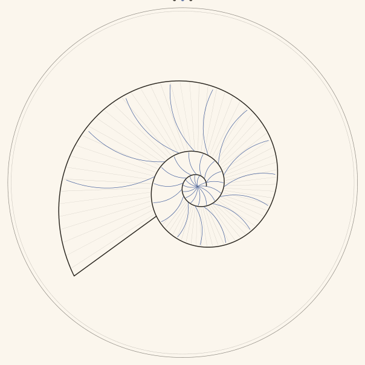

CHAPTER TEN

# The Lifelong Student

*Learning and School*

<i>The nautilus grows by building each new chamber a little larger, and carries every chamber it has outgrown.</i>

> *When you know a thing, to hold that you know it; and when you do not know a thing, to allow that you do not know it: this is knowledge.*
>
> — Confucius, *Analects* 2.17 (Legge)

> **UNITY** · *Who is my teacher today, and will I let them teach me?*

## I · ◆ The Teaching

82. The wisest man in Athens was wise in one way only: he did not think he knew what he did not know. Begin there, and every day will teach you something.
83. Who is wise? The one who learns from every person. The janitor, the child, the enemy and the fool each carry a lesson you can get nowhere else.
84. Do not be ashamed to ask. The shame of a question lasts a moment. The shame of ignorance can last a lifetime.
85. Learning is not filling a jar. It is turning the whole soul toward the light. Whoever has turned cannot unsee what he has seen, and answers for what he now knows.
86. Consult the ignorant as well as the wise. The limits of any craft have never been reached, and no one has ever learned it all.
87. School is a season. Learning is a life. Stay in the classroom you have chosen and finish what you began, but never let a diploma be the end of your education.
88. Learn by doing. You become a builder by building, a writer by writing, a just person by doing just acts. Knowledge that never touches your hands is only rumour.
89. Seek out the teacher who disagrees with you. The one who only confirms what you think has nothing to give you.
90. When you learn something true, carry it to someone else. Knowledge hoarded rots. Knowledge shared multiplies.

## II · ◇ The Five Scales

|  |  |
|---|---|
| **CELL** | Certain factors in the cell act as pioneers: they open regions of the genome that were sealed shut, so new programs can be read. |
| **SELF** | A real lesson does the same: it opens a part of you that habit had closed. |
| **BOND** | The best bonds make both people students of each other. |
| **COMMUNITY** | A society that punishes honest questions stops learning, and a society that stops learning starts dying. |
| **COSMOS** | Science is humanity’s long apprenticeship to the universe, and the universe has never run out of lessons. |

## III · The Witnesses

- ★ **Socrates** · Plato, *Apology* 21d  
  He was wiser only in this: he did not think he knew what he did not know. It converges with *Analects* 2.17.
- **Pirkei Avot** · 4:1  
  “Who is wise? One who learns from every person.”
- **Ptahhotep** · *The Maxims of Ptahhotep*, Maxim 1  
  Do not be proud of your knowledge; consult the ignorant as well as the wise, for the limits of art are never reached.
- **Plato** · *Republic* VII  
  The Allegory of the Cave: education turns the whole soul from shadows toward the light.
- **Confucius** · *Analects* 1.1  
  Is it not pleasant to learn, and to practise what one has learned at due times?

## IV · ● The Tale

### *A Hundred Flowers*

In 1956 and 1957 Mao Zedong invited China’s intellectuals to criticize the Communist Party under the slogan “let a hundred flowers bloom.” The criticism, when it came, was sharper than the leadership expected.

From June 1957 the regime launched the Anti-Rightist Campaign. By official count at least 550,000 people were branded “rightists”; some estimates run far higher. The lesson spread through the whole system: telling the truth upward was dangerous.

Within two years, during the Great Leap Forward, officials reported impossible harvests while a famine took somewhere between fifteen and forty-five million lives, depending on the historian. A nation that had punished its teachers could no longer learn even from its own hunger.

## V · ● The Energy

Learning is dear at first and cheap for ever after. The first time you do a hard thing, the mind labours; by the hundredth time, the work is carried by habit. Every lesson truly learned is strength saved for the rest of your life.

## VI · The Reversal

> Endless study can become a way of hiding from life. There comes a point where you know enough to act, and more reading is only fear dressed as diligence. Learn, then do; the doing will teach you what no book can.

## VII · ◆ The Practice

|  |  |
|---|---|
| **DAILY** | Each day, learn one thing from someone you would not normally learn from. |
| **WEEKLY** | Each week, teach one thing you know to someone who needs it. |

## VIII · The Ledger

|  |  |
|---|---|
| **PEACE** | Did I admit what I did not know, without shame? |
| **LOVE** | Did I help someone learn? |
| **UNITY** | Did I let someone unexpected be my teacher? |
| **RESPECT** | Did I keep my commitment to my own education today? |

## IX · The Song

*The shell builds out in a widening turn,* 
*And never a chamber is lost;* 
*Each one is a little more room than the last,* 
*And each one was paid at a cost.* 
*So build, little scholar, and carry your rooms,* 
*The small with the great, as you go;* 
*For the sea is too deep for the ones who are full,* 
*And wide for the ones who don’t know.*

---

[← The Dark Half, with the Lights On](09-the-dark-half-with-the-lights-on.md) &nbsp;·&nbsp; [Contents](../README.md) &nbsp;·&nbsp; [The Last Freedom →](11-the-last-freedom.md)

