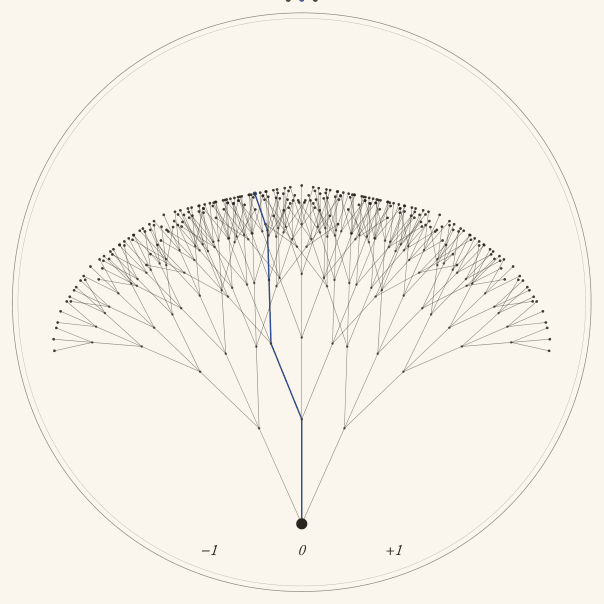

CHAPTER ELEVEN

# The Last Freedom

*Freedom and Choice*

<i>Every node divides three ways: refuse, hold, assent. Five choices deep there are two hundred and forty-three ends, and one path taken.</i>

> *I have set before you life and death, blessing and cursing: therefore choose life.*
>
> — Deuteronomy 30:19 (KJV)

> **RESPECT** · *Am I choosing, or am I being chosen?*

## I · ◆ The Teaching

91. Everything can be taken from a person but one thing: the freedom to choose the attitude with which to meet what comes. That freedom is the last, and it is the first.
92. Choose life. It sounds obvious. It is not. Every day offers small deaths: bitterness, numbness, cruelty, despair. Choose against them, one moment at a time.
93. Freedom is not doing whatever you like. One ruled by every appetite is a slave with many masters. Freedom is understanding the forces that move you, so that you can move on purpose.
94. Life is understood backwards but lived forwards. You will never have all the information. Choose anyway, and let understanding catch up.
95. No teacher, no book and no god worth worshipping will take your choice from you. Even the greatest of the scriptures, having given all its wisdom, hands the warrior back his freedom: reflect fully, then act as you choose.
96. Not choosing is also a choice, and often the worst. The door you refuse to walk through closes anyway.
97. Choose with your whole self or not at all. Half-made choices make half-lived lives.
98. When you have chosen, own the consequences without complaint. That is what parts a free person from a merely wilful one.
99. The strongest choice is the one you can make again tomorrow. Freedom is not a single act. It is a practice.

## II · ◇ The Five Scales

|  |  |
|---|---|
| **CELL** | A cell does not choose. It answers to signals. Here the metaphor of this book breaks, and you must mark where. |
| **SELF** | You can answer to the signals, or you can step back and choose which to obey. That gap is your freedom. |
| **BOND** | Love that is coerced is not love. Every real bond is renewed by two free choices. |
| **COMMUNITY** | A free people is one that can change its course by deliberate choice rather than by force. |
| **COSMOS** | Whatever the universe is, it has produced beings who can deliberate. That is worth wondering at. |

## III · The Witnesses

- ★ **Epictetus** · *Enchiridion* 1  
  Our opinions, impulses, desires and aversions are in our power; nothing outside us is. It converges with Frankl’s last human freedom.
- **Moses** · Deuteronomy 30:19  
  “Therefore choose life.”
- **Bhagavad Gita** · 18.63  
  After the whole teaching, Krishna tells Arjuna to reflect on it fully, and then to do as he chooses.
- **Baruch Spinoza** · *Ethics* V  
  Freedom grows as we understand the causes that move us.
- **Søren Kierkegaard** · *Journals* (1843)  
  Life can only be understood backwards, but it must be lived forwards.

## IV · ● The Tale

### *The Farewell*

By 1796 George Washington had served two terms as the first President of the United States. Nothing in the Constitution required him to step down, and many wanted him to stay for life.

He chose otherwise. His Farewell Address, dated September 17 and published two days later in a Philadelphia newspaper, was never spoken aloud. In it he declined to be considered for a third term and warned the young nation against faction and permanent foreign entanglements.

The choice set a precedent that held for nearly a century and a half and was in the end written into the Constitution. A man with every chance to keep power used his freedom to give it away, and so showed his country what freedom was for.

## V · ● The Energy

Indecision is one of the great drains on human strength. An unmade choice keeps running in the background of the mind, eating attention like a program that never closes. Choose, even imperfectly, and you free that strength for living.

## VI · The Reversal

> Not every constraint is a failure of will. Poverty, illness, injustice and other people’s choices are real limits, and telling a suffering person that everything is a choice can be cruel. Freedom of attitude is real; it is no substitute for freedom from oppression. Fight for both.

## VII · ◆ The Practice

|  |  |
|---|---|
| **DAILY** | Each day, make one decision you have been putting off. |
| **WEEKLY** | Each week, name one place where you have let circumstance choose for you, and take back one small piece of it. |

## VIII · The Ledger

|  |  |
|---|---|
| **PEACE** | Did I make peace with a choice I had already made? |
| **LOVE** | Did I let someone else choose freely, even when I wanted to decide for them? |
| **UNITY** | Did I use my freedom in a way that left others freer? |
| **RESPECT** | Did I own the consequences of my choices without blaming anyone? |

## IX · The Song

*They may take the house and the horse and the field,* 
*And the coat from the back of your frame;* 
*They may take the light and the bread and the road,* 
*And the honour that went with your name.* 
*But there’s one thing left that was always your own,* 
*And it stands at the end of the line:* 
*The word that you say to the thing that befalls,* 
*And the word is “I choose. It is mine.”*

---

[← The Lifelong Student](10-the-lifelong-student.md) &nbsp;·&nbsp; [Contents](../README.md) &nbsp;·&nbsp; [The Bond →](../3-the-bond/README.md)

