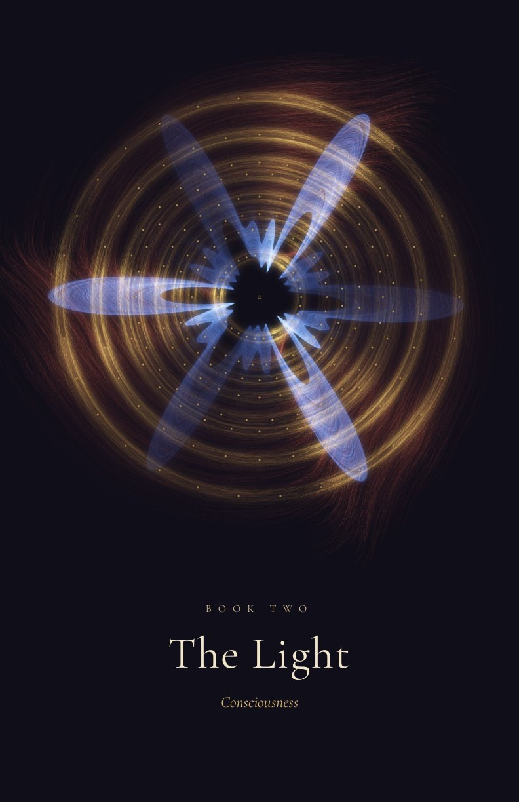

BOOK TWO

# The Light

*Consciousness is the opportunity existence hands you: the power to know that you are, to see what stands in front of you, to learn, and to choose. This Book concerns the light by which you see: who you are, how the mind builds the world, where your attention goes, how it can be led and misled, how you learn, and the freedom no one can take.*

5. [Know the One Who Knows](05-know-the-one-who-knows.md)
6. [The Instrument](06-the-instrument.md)
7. [Where Attention Goes](07-where-attention-goes.md)
8. [The Open Door](08-the-open-door.md)
9. [The Dark Half, with the Lights On](09-the-dark-half-with-the-lights-on.md)
10. [The Lifelong Student](10-the-lifelong-student.md)
11. [The Last Freedom](11-the-last-freedom.md)

---

[← Starry Heavens](../1-the-ground/04-starry-heavens.md) &nbsp;·&nbsp; [Contents](../README.md) &nbsp;·&nbsp; [Know the One Who Knows →](05-know-the-one-who-knows.md)

