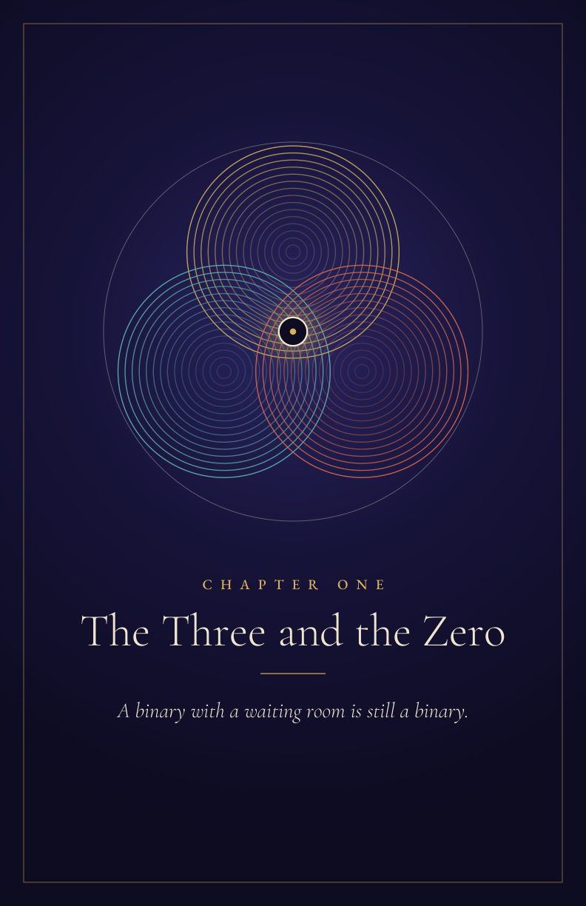
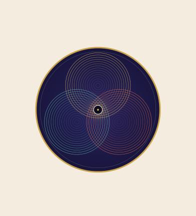

THE GEOMETRY OF EXISTENCE · LEVEL TWO · THE MANUAL · PAGES 15–18

  

CHAPTER ONE

# The Three and the Zero

> *A binary with a waiting room is still a binary.*

  

You have been taught that the world comes in pairs. Yes and no. In and out. Us and them. Fight or flight. On or off. You were not taught this because it is true. You were taught it because it is *cheap to store*, and everything that is cheap to store eventually disguises itself as the shape of reality.

It is not the shape of reality. It is a compression of it, performed by someone, at a time, under a constraint that was usually reasonable — and which then hardened into a floor and was mistaken for bedrock.

Here is the first fact of this manual, and everything else stands on it:

**Three is the minimum rich structure.**

Not three as “both sides plus a compromise.” A compromise still accepts the line the binary drew. It picks a point on the line and calls the choice free. The third this manual means is underneath the line — a position that is *unavailable from within the pair*, one that answers a question the pair never asked.

And inside the three, there is a citizen almost nobody counts.

The zero.

You have been taught that zero is a hole. Absence. The empty set. The “other” box on the form. The null in the database. The pause before the real answer. In every one of those places, the zero was *implemented as a refusal*, and you were told the refusal was a state.

It is not. A null is not a third option. A null is the binary’s way of letting you wait.

The zero this manual teaches is different. It is not the absence of the two. It is the *ground* of them — the middle that holds its own weight, the place from which both sides can be seen, the state a system is *in*, not the state it is *between*. Where the two shout, the zero listens. Where the two pull, the zero balances. Where the two exhaust themselves against each other, the zero does the only thing that ever produces anything new: it stays, and it holds, and it lets the tension work.

You already know this from your own life, though the vocabulary was kept from you.

You have been in an argument where both positions were wrong and you could feel the wrongness of the *question* — that feeling was the zero, offering itself. You have been in grief where “moving on” and “holding on” were both obscene, and something in you refused both — that refusal was the zero, insisting on its citizenship. You have been in rooms where the choice was submit or leave, and you stayed and built a third thing, and the room never understood what happened to it — that was the zero, constructed. Not found. *Built.*

The zero is not passive. This is the part the two will never tell you, because it requires them to admit the ground under their fight is alive and belongs to no one.

A system — a mind, a marriage, an institution, a life — that implements its third option as null, escape, deferral, or “it depends” has not implemented a third option. It has implemented a binary with a waiting room, and it will spend the rest of its existence wondering why nothing ever changes.

You will be offered two options today. Count on it. The world runs on pairs the way old machines ran on vacuum tubes — not because two is true, but because two was easy, once, for someone who is no longer in the room.

Your work, every time the pair presents itself, is threefold:

See the pair as a pair. (Most people never do.)

Refuse the midpoint. (Most people who see the pair stop here, at a nicer-sounding position on the same line.)

Build underneath. (Almost nobody pays this cost. This manual is for the ones who do.)

The zero is where the building happens. It is the only ground that holds. Everything else is a floor someone is renting you.

> **▲ Practice**
>
> Today, once, when the either/or arrives — and it will — write the two options as one sentence, out loud or on paper. Then ask: *what question is this pair both answering?* Do not answer. Just ask, and stay in the asking for one full minute. That minute is the zero. Notice that you are *in* something, not between things.

> **◆ Audit**
>
> Where in your own life have you implemented a null and called it a third option? The “later.” The “it depends.” The unfilled box. The deferred decision that has been deferred so long it became the architecture. Name one, honestly, and notice whether the naming loosens it. If it does not, that is data too. This manual does not require you to win. It requires you to stop pretending the waiting room is a room you chose.

---

[← Part I · The Ground](part-1-the-ground.md) · [Contents](../README.md) · [PDF ↓](../../edition/README.md) · [The Given →](02-the-given.md)

