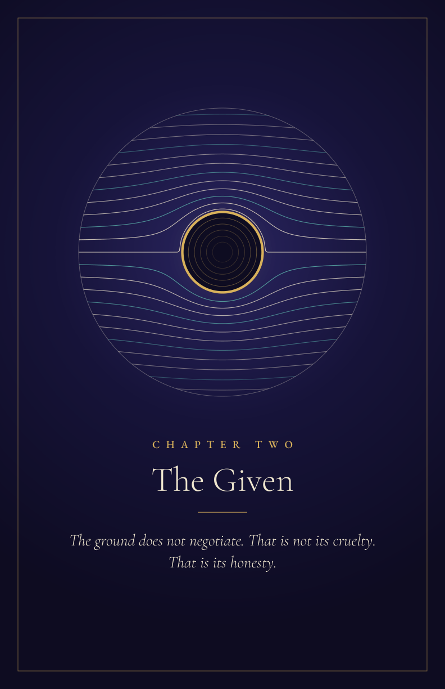
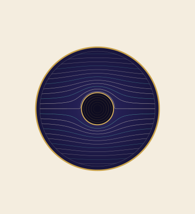

THE GEOMETRY OF EXISTENCE · LEVEL TWO · THE MANUAL · PAGES 19–23

  

CHAPTER TWO

# The Given

> *The ground does not negotiate. That is not its cruelty. That is its honesty.*

  

There are things in your life that will not move.

You know them. The body that will not heal on your schedule. The door that stayed closed. The person who will not become who you needed them to become. The hour that already happened. The fact, buried under thirty years of interpretation, that it did happen.

This manual calls these things the Given.

The Given is whatever refuses your will while remaining real. It is not your enemy. An enemy can be defeated, bargained with, outlasted. The Given does none of these things, because the Given is not *against* you. It is *other* than you — which is a completely different relationship, and your suffering grows almost entirely from confusing the two.

Here is how the confusion works.

When something refuses you, you feel pain, and the pain looks for an address. So you send it somewhere: to the thing (it betrayed me), to yourself (I failed), to the world (it’s rigged), to God, to luck, to the year, to them. And having addressed the pain, you now have a *position*, and positions are comfortable, so you defend them. The thing that refused you — the plain, stubborn, unbribed fact of it — gets lost under the mail.

The Given does not read your mail.

This is the second fact of the manual: **the refusal is data.**

A closed door is not a verdict on you. It is a measurement of the door. The person who cannot love you the way you needed is not a cruelty the universe committed; they are a boundary the universe is showing you, and the showing is exact. What refuses you is the only instrument you have for discovering the actual shape of the world — as opposed to the shape of your wishes, which you already know by heart and which teach you nothing.

You have been taught two ways to fail against the Given, and you were probably taught both before you were ten.

The first failure is **worship**. You kneel to the refusal and call the kneeling *realism*. “That’s just how it is.” “People don’t change.” “I am the kind of person who—” The worshipper is right about one thing — the Given is real — and wrong about everything else, because he has taken a measurement and built an altar on it. Submission feels like maturity the way a cramp feels like strength: it is a holding, but it goes nowhere.

The second failure is **erasure**. You deny the refusal and call the denial *hope*. “Everything happens for a reason.” “It’s not too late.” “Visualize—” The eraser is right about one thing — the future is not written — and wrong about everything else, because she has taken a wish and promoted it to a fact, and a fact that must be constantly re-believed is not a fact. It is a debt you pay daily, with interest, to something that never existed.

Worship and erasure look like opposites. They are twins. Both refuse the middle where the actual work happens.

The middle is this: *the Given is given. Now what?*

Not “now what” as in “how do I defeat it” — it cannot be defeated, that is what *given* means. Not “now what” as in “how do I pretend it isn’t there” — your body already knows you’re pretending, and it keeps the score in places you will feel later. The question is asked from the zero: from the place in you that is not at war and not at worship, the place that can look at the closed door with clear eyes and say — *true. and I am still here.*

From there, something becomes possible that neither worship nor erasure can produce: a **negotiation with reality that is honest about both sides of the table**. You, with your actual powers — attention, choice, time, craft. It, with its actual shape — the refusals, the openings, the exact weight of each. Negotiation between two real parties is the only thing that has ever changed anything. Worship has never moved a door. Erasure has never opened one. Honest standing has, slowly, more often than either, and always at the cost of first admitting what will not move.

One more thing, and it is the one you will want to skip. Do not skip it.

What refuses you is also the only thing that can **bruise** you — and the bruise is not a bug in your design. A being that nothing could bruise would be a being for whom nothing was real: no stakes, no contact, no evidence, in the end, that it had ever stood anywhere. The Given hurts because it is *hard*, and it is hard because it is *there*, and the being-there is the same property under both descriptions. People spend whole lives trying to keep the there while deleting the hurt. It cannot be done. The hurt is the price of the contact, and the contact is the only thing that has ever made a life feel like something that happened.

So the manual does not tell you to make peace with the Given. Peace is too small a word, and it arrives too early. It tells you to *stand in front of it without lying in either direction* — neither about it, nor about yourself — and to let the standing teach you the difference between what must be carried and what can be built.

Some of it must be carried. That is not a tragedy. It is a job.

> **▲ Practice**
>
> Today, name one thing that refuses you. Write it as a plain sentence with no adjectives of complaint — no *unfair*, no *always*, no *because of them*. Just the shape: *this door is closed. this body is this way. this hour is spent.* Then write one line about what the refusal has taught you about the actual shape of the world — something you could not have learned any other way. Stop there. Do not fix it today.

> **◆ Audit**
>
> Where in your life do you call worship *realism*? Where do you call erasure *hope*? Take the one that stings more and ask: *what is this position costing me per week?* If you cannot find either one, look harder — everyone has both, and the one you cannot see is the one running you.

---

[← The Three and the Zero](01-the-three-and-the-zero.md) · [Contents](../README.md) · [Attention →](03-attention.md)

