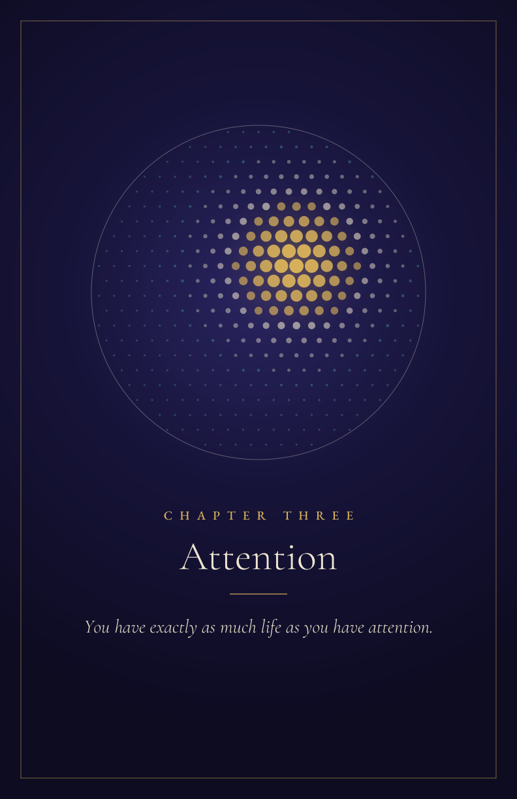
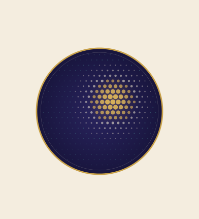

THE GEOMETRY OF EXISTENCE · LEVEL TWO · THE MANUAL · PAGES 24–29

  

CHAPTER THREE

# Attention

> *You have exactly as much life as you have attention.*

  

You do not have time. Nobody has time. Time is not a possession; it is a measure, the way a ruler is not a thing you own but the way you find out how long things are.

What you actually have — the only substance you spend directly, personally, irreversibly — is attention.

This is easy to say and hard to hold, so hold it a moment longer: *attention is the currency. Everything else is priced in it.* An hour with a dying friend and an hour scrolling in bed are the same hour. They are not the same attention. One will be in you in thirty years. The other is already gone, and some part of you knew it was going while it was going, and kept going anyway.

Now the mechanism, because the mechanism is the moral.

**What you attend, you thicken.**

Attention does not just observe a thing. Attention *feeds* it. Whatever you rest your attention on becomes more detailed, more load-bearing, more repeated inside you. Attend to insults and the world grows insulting; you will find them everywhere, because you have trained yourself to manufacture them on demand. Attend to your losses and your life becomes a ledger of them. Attend to one craft, one person, one question, with real persistence — and after a while there is more of it in the world, because you were there, attending, and things that are attended get built, get finished, get transmitted.

This is not a metaphor, and it is not positive thinking. It is the plainest observation available: you become the shape of what you look at.

Which means the only serious question about your inner life is not *what do I believe* or *what do I feel* or *what do I intend* — those are outputs. The question is: **where does the attention go?** Track that for a week and you can skip the self-deception entirely. The beliefs, the feelings, the intentions will be sitting right there in the schedule of the attention, doing exactly what they were always doing, in plain sight, while the speeches played.

Here is where it turns dangerous, so read slowly.

Your attention can be taken.

Not stolen in the night — *captured*, in daylight, by design. Every screen you own is an attention pump, and the honest ones admit it: the business model is the capture. Outrage is the strongest hook, because outrage simulates significance; fear is second, because fear simulates stakes; and then the softer hooks — comfort, novelty, the small number going up. None of this is an accident, and none of it is new. What is new is the machinery, which has never been better at holding the hook.

Now connect it to the thickening. If attention feeds whatever it rests on, then whoever holds your attention’s reins is feeding whatever *they* want thickened in you. Not you — *them*. Your outrage is someone else’s engagement metric. Your despair is someone else’s morning numbers. You are not the customer of that transaction, whatever you have been told. You are the substance being transacted.

This is why the old language of attention — prayer, contemplation, study, devotion — treated attention as *sacred*. Not because it was pious. Because it was accurate. The ones who guard the attention of a whole population never have to argue with the population. The argument was settled in the schedule.

So the practical rule, the one this manual insists on:

**Attention is yours to place, or it is someone else’s to harvest. There is no third state.**

You already know the feeling of the third state, because you have been calling it *relaxing*. Half-watching, half-scrolling, half-there. It is not rest. It is the attention still being spent — the currency still flowing — with none of the receipt coming back to you. The exhaustion you feel after three hours of it is the exhaustion of having paid for something you never wanted. Rest that restores is a different thing, and it has a different shape, and the shape is this: *attention released on purpose, to something that does not ask anything of it.* A horizon. A fire. A person you love who is not a problem to be solved. The zero.

Because here is the part the harvesters will never tell you, since it is the part that ends their business: **the zero is the place attention returns to.** The middle. The unfilled minute. The silence between one thing and the next. Attention cannot live in the hooks forever; it was built with a home to come back to, and when you refuse it the home — when you fill every gap, every elevator ride, every silence with the pump — it comes back anyway, degraded, dimmer each time, like a tide being fought.

Keep the zero. Not as a luxury. As the reservoir.

One more distinction, because everything in this chapter gets misused without it: **attending is not the same as caring, and not attending is not the same as abandoning.**

You cannot attend to everything, and the guilt that says you should is itself an attention-sink — it spends the currency on self-reproach and leaves nothing for the world it claims to love. You care about far more than you can attend. That is fine. That is what delegation is: you attend to your own craft, your own circle, your own square yard — and you fund, vote, pray, teach, or trust the rest to people who are attending *there*. A society of people each attending their square yard honestly would out-build every empire of the distracted. It is not a soft proposal. It is a structural one.

The rule of placement, then:

Attend to what you are building. Attend to who is in front of you. Attend to the thing you claim to value — actually attend it, on the calendar, in the body — and let your cares beyond your reach be carried by trust or by others.

And when you catch your attention in a hook — you will, today, probably within the hour — do not punish it. Punishment is another hook. Just name where it went, and place it again. The placement is the whole practice. The naming is the whole honesty.

> **▲ Practice**
>
> Today, take one thing you would normally do while split — a meal, a conversation, a page — and give it the whole attention. Ten minutes is enough. When the pull comes to split it (it will come; it is not a failure, it is the pump’s reflex), just notice the pull, name where it wanted to go, and come back. That comingback, done once, deliberately, is worth more than a week of good intentions.

> **◆ Audit**
>
> Two lists, five minutes, no mercy. First: what has been thickening in you lately that you never chose to feed? Second: what do you claim to value that has received no real attention — not intention, *attention* — in the last month? The gap between those two lists is not a character flaw. It is a map of who currently holds the reins. Look at it. Ownership starts with being willing to see the deed.

---

[← The Given](02-the-given.md) · [Contents](../README.md) · [Witness →](04-witness.md)

