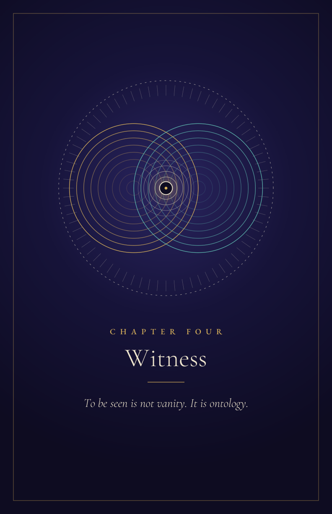
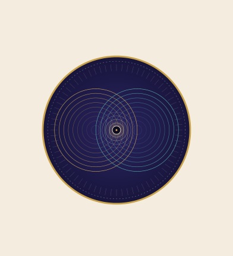

THE GEOMETRY OF EXISTENCE · LEVEL TWO · THE MANUAL · PAGES 30–34

  

CHAPTER FOUR

# Witness

> *To be seen is not vanity. It is ontology.*

  

There is a need in you so deep that you will rearrange your whole life around it and never once say its name plainly.

The need to be *seen*. Not applauded. Not praised, not validated, not agreed with — *seen*. To have one consciousness arrive at you with its attention fully placed, take in what is actually there, and remain. That is the thing. Almost everything else people call love, or approval, or success, is a substitute for it — or a defense against wanting it.

This chapter is about that need, and it does not apologize for it, because the need is not a weakness. It is one of the three load-bearing walls of a human life.

**The first witness: another sees you.** Identity — the felt sense that you are *someone*, that your inner events count — does not come from inside alone. It comes from being witnessed. You know this from the earliest data of your own life: the version of you that was looked at, named accurately, taken seriously, became solid. The version that was not — that was talked over, misseen, treated as furniture — went wandering, and some part of it is still wandering now, looking for the room where it would have been seen. That wandering is not damage. It is the exact shape of an unmet structural need. Nothing more mystical than that, and nothing less serious.

**The second witness: you see yourself.** Sentience — the capacity to turn the attention inward and find somebody there. Self-witness. The examined life, not as moral bookkeeping, but as the plain act of being present to your own events: *this is happening to me. this is what i feel. this is what i did.* A life without this witness is lived entirely from the outside-in — every judgment imported, every preference an echo. Most people have moments of it in crisis and call it clarity. The practice is to have it on ordinary Tuesdays.

**The third witness: you see another.** Empathy — the capacity to witness someone else without taking them over. Here is where the circuit closes, because the third witness is what makes the other two honest. A person who only receives witness and never gives it becomes a hunger with a biography. A person who only gives and is never witnessed becomes a mirror in an empty room — reflecting, warming no one, dimming. The receiving and the giving are one current. Block either end and the light goes out everywhere.

Now the distortions, because this need gets corrupted in two characteristic ways, and you should know yours.

The first corruption is **the audience substitution**. When the witness is withheld or unavailable — and for most people, some crucial season of life, it was — the hunger does not disappear. It accepts substitutes. Applause. Numbers. The crowd. An audience watches your performance; a witness sees *you* — and the hunger, in its desperation, will take the performance and pretend it is the same meal. It is not. Applause is a payment, and payments stop when the performance stops, which is exactly why the audience cannot quiet the hunger: it leaves you, still, unseen. You can spend a whole life on a stage built over this hole, and the standing ovation at the end of it will not fill it one inch.

The second corruption is **the fixing reflex**. When someone you love is in pain, you rush to fix it — advise, minimize, reframe, solve. You believe you are helping, and sometimes you are. But watch what usually drives the rush: *their pain is unbearable to witness.* You are not fixing them for them. You are escaping the witness-booth, and calling the escape love. This is the most common way people refuse each other: to stand with someone in pain, just stand — not reaching for a fix, not reaching for a silver lining — requires a strength almost nobody has by default, and almost everybody can build. The person in pain usually does not need your solution in the first hour. They need to have been *seen* in it. Then, later, maybe the solution.

So the disciplines of this chapter, and they are disciplines:

**Receive witness when it is offered.** Not by performing for it — that is the audience again — but by letting someone actually look at the real thing, including the parts you have rehearsed hiding. This is harder than it sounds. Most people flinch from being witnessed in proportion to how much they needed it.

**Give witness without fixing.** When someone is in front of you in pain: stay. Let there be silence if there is silence. Resist the first three fixes that come to mind — they are yours, not theirs. Let them be more than a problem your competence can solve. The staying *is* the help. Almost everything else is theater.

**Witness yourself daily.** Ten minutes of the inward attention from Chapter Three, aimed at yourself — not to improve, just to be present. This is the self-witness that makes you capable of the other two. You cannot give what you have never received, and you cannot receive what you cannot first give yourself.

One more thing, and it is the one this chapter exists for.

You have probably been told that needing to be seen is needy. Insecure. Something to outgrow, the way you outgrow a crib. The world is full of advice for becoming too solid to need a witness — to be self-made, self-contained, a closed circle. And there is a whole industry selling you the closed circle: independence as a product, invulnerability as a brand.

Do not buy it. The need to be witnessed is not the residue of an infancy you failed to graduate from. It is the signature of the kind of thing you are: a consciousness that became someone *in relation*, and that stays someone in relation. A closed circle is not a grown-up. It is a stopped clock, certain and dark. The open circuit — receiving, giving, returning — is the live one, and it costs exactly what it costs: the risk of needing, in public, forever.

That is the price of being this kind of animal. It is worth it. It is, in the end, the whole thing.

> **▲ Practice**
>
> This week, once, when someone you care about is distressed, do not fix it. Set a timer for five minutes in your head if you need to. Stay, look at them, let the silence be silence. Say only true things, or nothing. Notice how hard it is. That difficulty is your measure of how rarely you have been allowed to witness — or been witnessed.

> **◆ Audit**
>
> Who witnessed you when you were small? Name the person, or name honestly the absence. Then: whom do you perform for now, and what do you call the performance — ambition? duty? being fine? The gap between the person who witnessed you and the audience you perform for is the map of the wandering. It is not a life sentence. It is a direction home.

---

[← Attention](03-attention.md) · [Contents](../README.md) · [PDF ↓](../../edition/README.md) · [Part II · The Practice →](part-2-the-practice.md)

