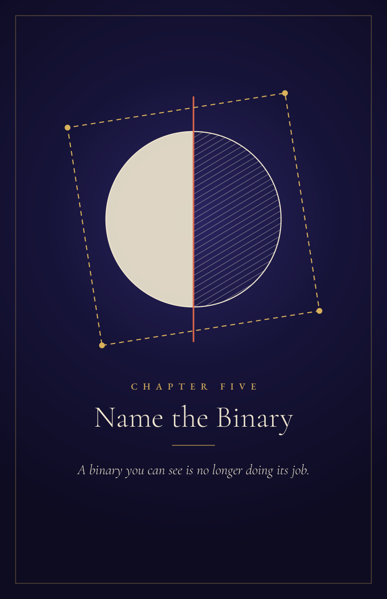
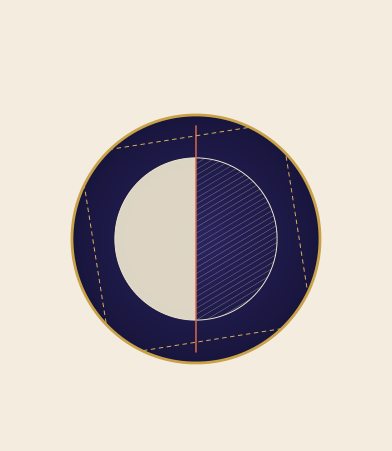

THE GEOMETRY OF EXISTENCE · LEVEL TWO · THE MANUAL · PAGES 36–40

  

CHAPTER FIVE

# Name the Binary

> *A binary you can see is no longer doing its job.*

  

You are living inside someone else’s either/or right now. Several of them. They came with the house, so to speak — installed before you arrived, maintained by everyone around you, invisible the way a floor is invisible: you only notice it when you try to leave.

The first discipline of this manual — the one everything else depends on — is to make the floor visible. That is all this chapter asks, and it is harder than it sounds, because the binary’s whole power is that it never has to introduce itself. It arrives dressed as *reality*. It presents two doors and lets you feel proud that you chose.

Here is the operative fact: **almost every either/or in your life is a compression that somebody performed, once, under a constraint.** It was not discovered carved into the world. It was built — usually reasonably, for its time — and then forgotten into nature. Safety or growth. Loyalty or truth. Practical or dreamer. Strong or soft. Provide or be present. Belong or be free. Each of these was once a sensible narrowing of a real tangle by someone who could not afford to hold the whole tangle. The constraint is usually gone. The narrowing remains, and it charges you rent every day you live inside it.

The discipline has three moves. They are simple. They are not easy. Do them in order.

**Move one: write it as one sentence.** Out loud or on paper — not in your head, where binaries are sovereign. *“Either I stay in this job and provide, or I leave and abandon my family.”* That is a sentence. It has two nouns, a verb, and a price tag on each side. It can be read by a stranger. It can be argued with, tested, laughed at. This is the whole point: a binary that fits in one sentence is a binary that can be *seen*, and a binary that can be seen is no longer doing its real job — which was never to be chosen. Its job was to stop you from asking what the sentence was doing there.

Notice what happened in your chest when you read that example sentence. That tension — the immediate sense that choosing is *urgent and fateful* — that is the spell. The urgency is manufactured. The sentence made the tangle small enough to feel like a knife-edge, and your nervous system believed it. Watch that happen. Watching it is the discipline.

**Move two: find the premise underneath.** Every pair sits on a buried assumption, and the assumption is always smaller and stranger than the drama above it. Under *stay-or-leave the job*: the assumption that provision is this job, now, in this form. Under *loyalty-or-truth*: the assumption that the person in question cannot survive your honesty. Under *strong-or-soft*: the assumption that these are two different things. The premise is the load-bearing wall, and it is almost never examined, because the pair keeps everyone’s eyes at floor level. Go underneath. It is quieter there. That is where the building can actually begin.

**Move three: run the compression test.** Three questions, in order, and write the answers:

1. *What constraint made this compression rational?* There is always an answer, and it is usually historical. Find it. Honor it — it probably made sense, once.

2. *Does the constraint still hold?* Not theoretically — *actually*, in your life, this year. Be honest. Half the time the answer is no, and the binary has been running on momentum for a decade.

3. *If it no longer holds, what is holding it now — and who benefits?* This is the question the binary cannot survive. Sometimes what holds it is habit, and what benefits is only your fatigue. Sometimes what holds it is a real structure, and what benefits is a real someone. You need the truth about which, because the response is completely different: habits get interrupted; structures get built around.

That is the discipline. It does not solve the tangle. It does something better — it restores the tangle to its true size, which is always smaller than the either/or made it feel and larger than the sentence made it look. You cannot work a tangle you have let be cast as a duel. You can only sweat on the knife-edge and call the sweating *integrity*. It is not integrity. It is choreography.

Two warnings before you go practice this, because this chapter gets misused in two predictable ways.

**First: not every either/or is false.** Some pairs are real. Some doors are truly either/or — death is one; certain betrayals are another; some bodies cannot do certain things. The compression test will tell you which, if you run it honestly: a real binary survives all three questions with its constraint intact. The manual never promises you that the third exists. It promises that you will *know whether you looked*. There is a dignity in fighting on a real knife-edge that is completely absent from sweating on a manufactured one — and the first dignity is reserved for people who have ruled out the manufacture. Do the test first. Then duel if you must.

**Second: do not turn this into a cleverness.** The binary you are proudest of seeing through is usually the one that is currently eating you, and the seeing-through can become its own sophisticated way of staying put: *yes, I know it’s a false dichotomy, and one day I’ll construct the third, but for now—* For now, what? For now the rent is due, so the manual says: name it, test it, and if it fails the test, you are not allowed to keep living inside it while calling yourself enlightened about it. That is the specific failure mode of thoughtful people. You have met them. Do not become one. Seeing the floor is not leaving the floor.

You will be given a fresh either/or this week, probably today. The news will frame one. Your work will offer one. Someone you love will hand you one with both hands and tears in their eyes, and it will be a real need wrapped in a fake pair.

Take the pair. Write it as one sentence. Go underneath. Run the three questions. Then — whatever it turns out to be, real edge or manufactured floor — at least you will be standing on the true shape of the thing, and not on somebody else’s old compression of it.

That is worth one hour of your life per week, forever. It is the cheapest leverage this manual sells.

> **▲ Practice**
>
> This week, take the loudest either/or currently running in your life — the one with the most urgency around it — and write it as one plain sentence. No adjectives. Then answer the three questions of the compression test, in writing, in order. Do not act on any of it yet. The naming is the act, this week.

> **◆ Audit**
>
> Which either/or in your life has been running longest without a re-examination? Estimate how old it is. Then ask: what were the circumstances the year it was installed — whose voice first spoke it to you, and what did they need at the time? The age of your oldest unexamined binary is, to a close approximation, the age at which you stopped being the author of your own options.

---

[← Part II · The Practice](part-2-the-practice.md) · [Contents](../README.md) · [Construct the Third →](06-construct-the-third.md)

