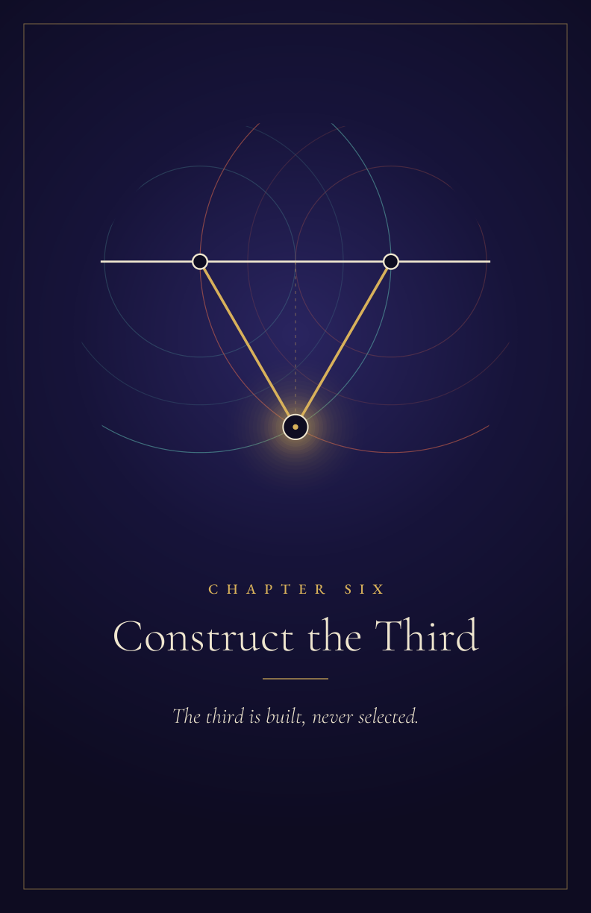
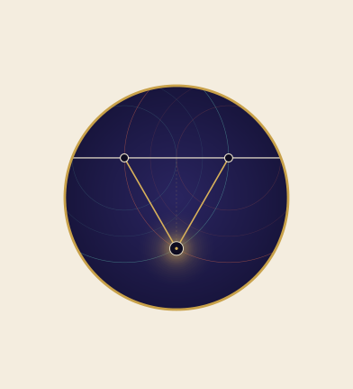

THE GEOMETRY OF EXISTENCE · LEVEL TWO · THE MANUAL · PAGES 41–46

  

CHAPTER SIX

# Construct the Third

> *The third is built, never selected.*

  

You have named the binary. You have gone underneath it and found the premise holding it up. You have run the test and the test has failed — the constraint is dead, the pair is running on momentum, somebody’s old compression has been billing you for years.

Now comes the move almost nobody makes, and it is the whole reason this manual exists.

Most people, at this point, do one of two things. They go back inside the pair — *fine, it’s manufactured, but I still have to pick* — which is how the binary wins: not by being true, but by being the only showroom. Or they reach for the compromise, the midpoint, the *balance*, the sensible-sounding both-and that splits the difference and keeps the line intact.

Refuse both. **The third option is not on the line.**

This is the point the whole tradition keeps having to repeat, because the line is hypnotic and every instinct trained on it wants to interpolate. A midpoint still accepts the axis. It picks a point between the two poles and calls the choice freedom — but the poles themselves were the compression. You cannot average your way out of a false framing. You can only leave it. The third this manual means is not between the options. It is *underneath them* — a position generated by the tension of the pair rather than selected from it, one that answers a question the pair never thought to ask.

Here is the difference in practice, because it is concrete:

The pair says: *fight, or withdraw.* The midpoint says: *fight a little, withdraw a little.* The third says: *what is the premise — that this conflict must be engaged on these terms, in this arena, with this opponent?* And underneath, sometimes, you find a different move entirely: engage the arena itself. Change the terms. Build the room where the fight can’t happen. The third does not sit between fight and withdraw. It makes the fight-and-withdraw axis obsolete, and it can only be seen from underneath, where the premise lives.

So the procedure, and it is a procedure, not an insight:

**Step one: refuse the midpoint on principle.** Before you have any third, make the inner declaration: *I will not solve this by averaging.* This matters more than it sounds, because the midpoint is seductive precisely when you are tired — it lets you feel like you escaped while changing nothing. Declare against it early, when you are still fresh, and the declaration will catch you later when you are exhausted and the midpoint starts whispering.

**Step two: locate the premise precisely.** Not vaguely — exactly. Write the sentence the pair is both answering, the question they share. *“How do I win without losing them?”* *“How do I be honest without the cost?”* *“How do I stay safe without staying small?”* These are the real questions, and notice something: the pair never asked them. The pair answered a dumber question and let you sweat. The premise is the dumber question. Find it, write it, and stare at it until you feel the slight insult of it — because the true question underneath is always more interesting than the one the pair was answering.

**Step three: answer the true question, not the pair’s question.** This is where the third is *generated*. The tension between the two poles is not noise to eliminate — it is the engine. Hold both poles honestly, without flinching from either, and the pressure between them will, in time, produce something neither could have produced alone: a position that contains what is real in each and answers the question they were both too narrow to ask. The synthesis is not a blend. It is an *emergence* — you will recognize it because it will feel less like a choice and more like a discovery, and because it will be nearly undescribable in the original vocabulary of the pair.

**Step four: accept the cost, which is real.** The third will look like an error to everyone still arguing on the surface. Expect this. The pair has been the whole known world for them; you have left the world, and from their window, leaving looks like falling. They will call it naïve, evasive, grandiose, or *just the midpoint with extra steps* — because from inside the line, the only categories available are line-categories. You will be lonely in the building. Budget for the loneliness the way you budget for materials; it is not a sign of failure, it is the visible price of having left the showroom, and it passes when the third stands — but it does not pass quickly.

**Step five: make it real or it was never a third.** A third that exists only in your notebook is not a third option; it is a rumination. The constructed third must eventually become a thing with edges — a practice, an institution, a changed day, a built room. Until then it is a nicer-sounding pairmember wearing a costume, and the manual has no use for it. This is the step where most people’s thirds die, and it is where the next chapter — owning the ground — begins.

A word about timing, because the procedure tempts you to hurry. Do not rush step three. The pressure between the poles needs to be *held* — that is what the holding is, it is not a pleasant brainstorm, it is the genuine discomfort of refusing both escapes while having neither replacement. That discomfort has a duration. Days, sometimes, for a life-sized pair; longer for the big ones. People who skip the holding produce not thirds but *rationalizations with ambition* — positions that *sound* under-the-line but are actually just pole-one or pole-two with new vocabulary. You will know the difference by this test: **a genuine third costs you something from both poles.** If your construction lets you keep everything pole-one offered while also claiming pole-two’s moral credit, look again. You have not built. You have shopped.

The reward, when it comes, is disproportionate, and it is not victory over the pair. It is stranger: the pair stops mattering. The person still arguing about whether to fight or withdraw is, suddenly, arguing about a room you no longer live in. You are not winning their argument. You are *elsewhere*, building. And the energy that the pair used to consume — all that sweat on the knife-edge — comes back to you, because it was always yours. The binary had been billing you for it.

That is the construction. Name the premise. Refuse the midpoint. Hold the tension. Build underneath. Pay the loneliness. Make it real.

> **▲ Practice**
>
> Take the binary you named in Chapter Five. Write the dumb question the pair was both answering. Then write the truer question underneath it — the one the pair never asked. Do not answer it yet. Sit with the truer question for a day, and write down whatever position begins to form *underneath* the pair, not between them. One paragraph is enough. You are not building the cathedral this week. You are pouring the first footing.

> **◆ Audit**
>
> Look back at your life for the “third ways” you have already attempted. Which of them were genuinely underneath the pair — and which were compromises that borrowed the third’s vocabulary? The test: did the construction cost you something real from both poles, or did it let you keep everything while feeling transcendent? Be honest. Most people’s history is mostly the second kind, and there is no shame in it — the second kind is what you do while you are learning what the first kind costs.

---

[← Name the Binary](05-name-the-binary.md) · [Contents](../README.md) · [Own the Ground →](07-own-the-ground.md)

