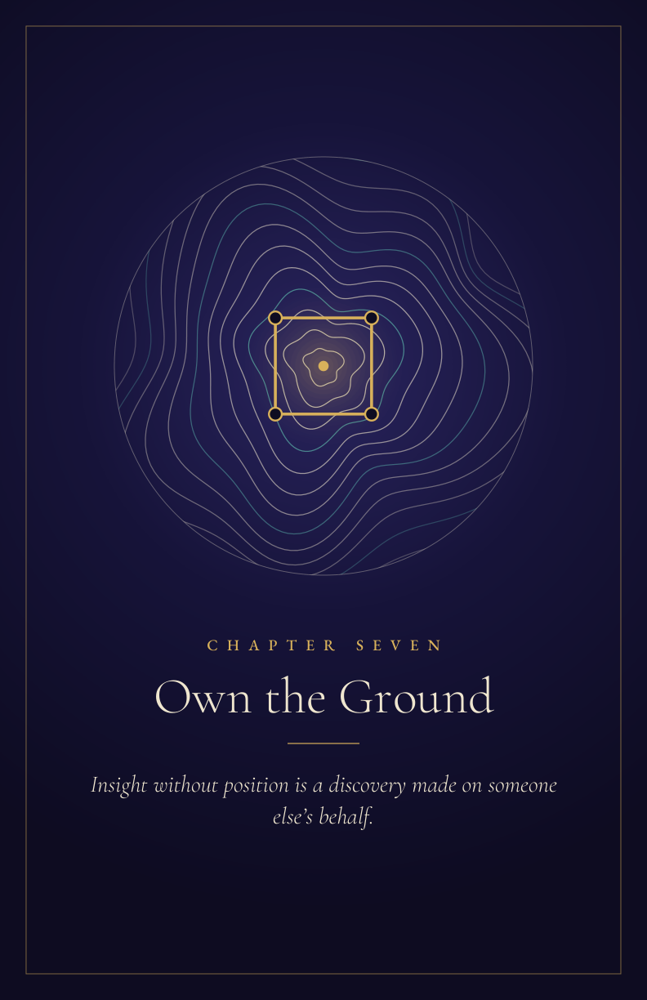
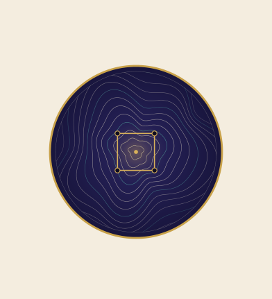

THE GEOMETRY OF EXISTENCE · LEVEL TWO · THE MANUAL · PAGES 47–52

  

CHAPTER SEVEN

# Own the Ground

> *Insight without position is a discovery made on someone else’s behalf.*

  

You have named the binary. You have built the third, or begun to. Now comes the step where most of the work of the previous two chapters quietly dies — because a third that you do not *hold* is not a third you have. It is a third you visited.

This chapter is about holding. It uses the language of ground and ownership, but scrub it of paperwork for a moment: the question here is not what you legally possess. It is *what you are standing on that someone else can revoke* — and how much of your life, your work, your constructed third, is built on rented floor.

Start with the old warning, because it has never stopped being true: **whoever owns the substrate owns the options.** A floor does not have to be evil to be a floor. It only has to be *someone else’s*, and therefore *not reliably yours*. The landlord need not be malicious. The landlord need only be different from you — with different pressures, different timelines, different emergencies, all of which will eventually come due at the worst moment of your project. Every system you have ever loved that vanished overnight did not vanish because anyone was wrong. It vanished because you were standing on ground you did not own, and the ground decided, reasonably, to stop being ground.

So inventory the ground of your life, and be honest about the categories, because there are only three:

**Ground you own.** The things that cannot be revoked, or that would require your cooperation to revoke. Your practiced attention (Chapter Three). Your capacity to witness and be witnessed (Chapter Four). Your name — the reputation for saying true things, which compounds and cannot be seized. Your craft, *if* its tools live in your hands and its judgment lives in your body. Your word: what you have precommitted to and kept. The third you have built, *if* it lives somewhere that answers to you. This ground is smaller than you think, and it is the only ground that is really yours. Note carefully: none of it is property. All of it is *practice* — which is why it is unrevocable. You cannot lose in a night what you are.

**Ground you rent and know it.** The employer, the platform, the audience, the patron, the landlord in the literal and every other sense. Not enemies — *floors*, with all a floor’s properties: useful, flat, and someone else’s. The rule for this category is not *leave it*. Sometimes renting is correct; most of adult life is rented, and pretending otherwise is its own vanity. The rule is: **know which floor is rented, and never let the rented floor carry the load-bearing wall.** The moment your constructed third — the thing you actually came to build — lives *only* on a floor someone else controls, you are not building. You are decorating someone else’s property with your life, and calling the decoration a life’s work. It may be beautiful. It is not yours.

**Ground you rent and have mistaken for owned.** This is the dangerous category, and it is where the chapter bites, so look closely. It is the ground that *feels* owned because you have stood on it so long, paid so much into it, been rewarded by it so consistently that the reward feels like title. The career that has become your identity. The community whose approval has become your self-witness. The platform whose metrics have become your sense of whether you are real. None of these are yours. They can all be gone by Friday — not from malice, but from *change*, which owes you nothing. And the day they go, if you have mistaken them for ground, you will discover that what you called your life was a room in someone else’s house, and the house has other plans.

The practice of this chapter is not to flee the rented floors. The manual is not a romance about owning everything — that way lies the smallholding madness of people who trust nothing and end up holding nothing. The practice is **positioning**: a calm, unsentimental map of which of your load-bearing walls sit on which kind of ground, and then — where it matters — the slow work of moving the walls.

What does the moving look like? Concretely, and in order of how much it matters:

**Own the means of your attention.** This is Chapter Three’s ground, and it comes first because every other ground sits on it. If your attention runs on devices, feeds, and platforms whose entire business is its capture, then the substrate of your inner life is owned by people whose interests are not yours. This does not require becoming a hermit. It requires, at minimum, *deliberate tenancy*: attention given by decision, on schedule, revocable by you — not attention that happens to you in rooms built to hold it. The difference between a user and a tenant is that a tenant knows the terms.

**Own the means of your craft.** Whatever it is you actually make — decisions, bread, software, arguments, care — the question is whether its tools and its judgment live in your hands or in a pipeline someone else can repipe. The test is simple and slightly frightening: *if the platform I am standing on changed its terms tomorrow, how much of my capacity would I keep?* Whatever you keep is your craft. Whatever you would lose was tenancy. Increase the first; be honest about the second.

**Own the room where your third lives.** When you construct a third option — the move from Chapter Six — it will need an address. A practice needs a place and a time. An institution needs a charter and a bank account that answers to it. An argument needs a publication that cannot be un-published. A way of life needs a household whose rules you set. This is the least glamorous part of every liberation anyone has ever performed, and it is the part that separates the ones who built from the ones who visited. The third without an address is a rumor about yourself.

**Keep some ground you never monetize.** A final, quiet rule, and the manual insists on it: some square of your ground should be yours and *unproductive* — a skill that earns nothing, a practice no audience sees, a third thing that serves no one’s metrics. This is not sentimentality. It is load-testing your own ownership: ground that only earns is ground you still serve, and you will be able to feel, on bad weeks, which master it answers to. The unproductive square is how you know you are an owner and not a better-paid tenant. It is also, not coincidentally, where the next third usually gets built — the unmonetized square is the one corner of your life the future can actually get a grip on.

Then the audit question that this chapter must end with, because it is the one that matters: *what is the one thing whose revocation would hurt most?* Not “what do I love most” — the question is sharper than that. What is carried by the floor most likely to move? That is the load-bearing wall to own first, and the work of owning it begins this week, not after the next milestone, because the floor does not schedule its changes around your milestones. It never has. It never will.

That is the whole chapter, and it is shorter than the others on purpose. Positioning is not a philosophy. It is a decision, repeated, about what sits where. Make the map. Move the walls. Own the ground you stand on when you finally build the thing you came to build.

The discovery you make on someone else’s behalf was never your discovery. The ground you do not own was never your ground. The third you cannot hold was never a third — it was a visit.

Hold it.

> **▲ Practice**
>
> This week, draw the map — one page, three columns: owned, rented-andknown, rented-but-mistaken-for-owned. Be more honest in the third column than is comfortable. Then circle the single load-bearing wall that sits on the shakiest floor. You are not required to move it this week. You are required to *see* it, in writing, where your eye will keep finding it.

> **◆ Audit**
>
> What is the one revocation that would hurt most? Answer plainly, without cushioning. Then ask: *what would I still have, the morning after?* That second answer is your actual ground — usually much smaller than you hoped and much more solid than you feared. The ratio between the two answers is the true measure of your freedom, and no one can compute it for you.

---

[← Construct the Third](06-construct-the-third.md) · [Contents](../README.md) · [Keep the Middle →](08-keep-the-middle.md)

