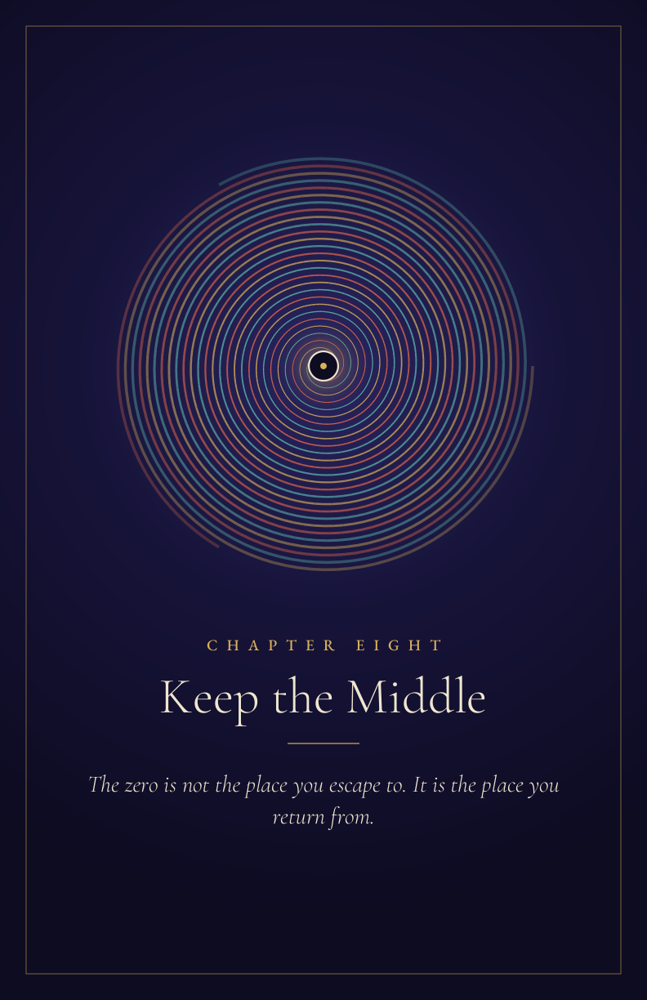
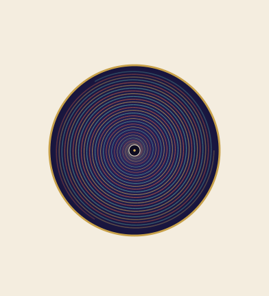

THE GEOMETRY OF EXISTENCE · LEVEL TWO · THE MANUAL · PAGES 53–57

  

CHAPTER EIGHT

# Keep the Middle

> *The zero is not the place you escape to. It is the place you return from.*

  

By now you have the pieces: the three layers, the Given, attention, witness, the named binary, the constructed third, the owned ground. This chapter is the hinge they all hang on, and it is the easiest one to misread, so the manual will be plain.

The zero — the middle, the inviolate place, the ground you have been building this whole time — is not a refuge. If you use it as a refuge, you have already lost it, and the manual says so on page one of this chapter so you cannot claim otherwise later.

Here is the difference, and it is everything:

**Retreat** is when the world becomes too much and you go somewhere inside to stop feeling it. Retreat is real and sometimes necessary — the body does it under overload, and the body is not wrong. But retreat has a signature: the world shrinks, the feelings flatten, the questions stop. What is left is a smaller you in a smaller room, and the door you came in by is not labeled. If you have ever “gone numb” in a hard season, you know the room. It is not the zero. It is the Given wearing the zero’s clothes — the refusal that has come inside and set up as a way of life.

**The zero** is the opposite motion. In the zero, the world does not shrink — it *clarifies*. The feelings do not flatten — they *organize*. The questions do not stop — they *line up*, and for once you can see all of them at once without any of them eating you. The zero is not the absence of the three layers. It is the *place from which all three are reachable* — the Given that must be endured, the middle that must be negotiated, the imagined that must be built. From the zero you can move to any of them. From retreat you can move to none. That is the whole test, and you can run it on any given afternoon: *from where I am standing right now, can I reach all three?* If yes, you are in the zero. If no — if only one layer is available, if the others feel impossible or far away — you are somewhere else, and you should know its name.

Why the middle has to be *kept* is the subject of the rest of the chapter. Three forces take it from you, every day, in this order:

**The first force is the loud layer.** Whatever is most urgent — the bill, the fight, the diagnosis, the feed — pulls the attention to its layer and locks the door. You know the experience: three days inside one problem, and the rest of your life went somewhere you can’t quite remember. You were not idle. You were *captured* — the loud layer was paying attention for you, on its terms. The zero is what returns the choice.

**The second force is the identity.** At some point you decided what kind of person you are — the responsible one, the struggling one, the builder, the exile — and the identity is a layer too, a very sticky one, and it edits the available options before you ever see them. People lose the middle not in crisis but in *character*: slowly, politely, one consistent self at a time, until the three layers have narrowed to the one the identity can survive.

**The third force is the fatigue.** The zero takes energy to hold. It is not heavy, but it is *awake*, and on the days when you are spent, the layers stop being reachable because you simply cannot reach. This force is not an enemy and should not be fought. It is the signal of the reservoir from Chapter Three: the attention has been spent without returning to the zero, and the zero is now charging you for the debt. The response to this force is not discipline. It is rest — real rest, the released kind, the kind that does not perform rest for an audience. The zero and real rest are the same substance seen from two sides.

So: the keeping. It is not dramatic. It is a tending, in three short movements a day, and the manual names them plainly:

**Morning scan.** Before the day takes the attention — and something will take it, count on it — spend five minutes with the three questions, in order: *What today is Given?* (What will refuse me; name it, and it loses the power of surprise.) *What today must be negotiated?* (Where the middle will be fought for.) *What today could be built?* (One thing, however small, in the layer that is wholly yours.) Five minutes. Three questions. This is not a mood. It is a positioning.

**Through-day checks.** When you catch the loud layer taking you — the capture has a feeling, a slight narrowing behind the eyes — you do not fight it. You ask one question: *which layer am I in, and is it the one I chose?* If yes, continue. If no — and here is the discipline — you do not have to *leave* the layer. Sometimes the bill genuinely needs the day. You only have to *touch the zero once*: one breath, one step back, one look at the whole board. The touch is enough. The zero does not demand residency. It demands contact.

**Evening review.** Three minutes before sleep. *Where did the attention actually go today?* Not where it was supposed to go — where it *went*. Then: *did I reach all three layers from the middle at least once?* If yes, the day counts, whatever the scoreboard said. If no, the day still counts — but tomorrow’s morning scan gets an extra question: *what took the middle, and is it the usual suspect?*

That is the whole practice. Fifteen minutes a day of positioning, and the middle stays kept.

The manual will close the chapter with the warning it owes you, because every discipline in this book can be corrupted into the identity it was meant to guard against, and this one corrupts fastest. The person who keeps the middle can quietly become the person who *performs* keeping the middle — the calm one, the centered one, the one above the fray, and the performance is just another layer, and not the inviolate one. You will know the corruption by this sign: your calm requires other people to notice it. Real zero is quiet even about being quiet.

Keep the middle. Not as a brand. As a floor.

> **▲ Practice**
>
> Install the three movements today, exactly as written — five minutes in the morning, the touch-check when you catch the capture, three minutes at night. Do not improve them yet. Do them badly for a week first. A kept middle built on a perfect week is a greenhouse plant; a kept middle built on a bad week is a field crop, and the manual is only interested in field crops.

> **◆ Audit**
>
> Which of the three forces takes your middle most often — the loud layer, the identity, or the fatigue? Name your usual thief. Then ask the sharper question: *what does the thief cost me per month, in the layer I never reach because of it?* You do not have to fix it this week. You have to stop calling it personality.

---

[← Own the Ground](07-own-the-ground.md) · [Contents](../README.md) · [PDF ↓](../../edition/README.md) · [Refuse the Waiting Room →](09-refuse-the-waiting-room.md)

