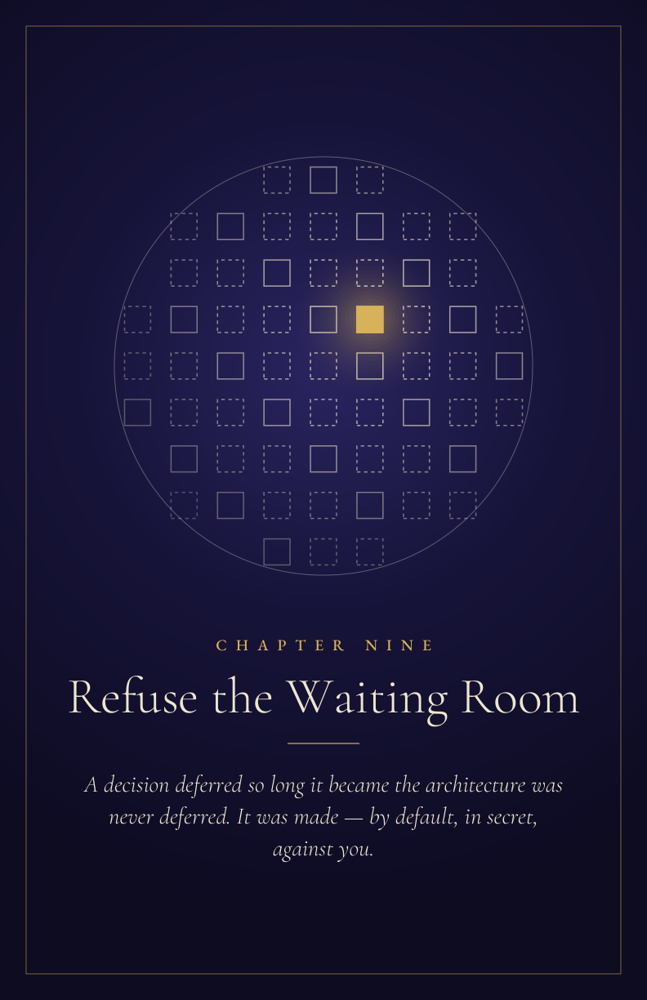

THE GEOMETRY OF EXISTENCE · LEVEL TWO · THE MANUAL · PAGES 58–63

  

CHAPTER NINE

# Refuse the Waiting Room

> *A decision deferred so long it became the architecture was never deferred. It was made — by default, in secret, against you.*

  

Back in Chapter One, the manual told you its first fact: a binary with a waiting room is still a binary. You have spent eight chapters building the alternative — the constructed third, the owned ground, the kept middle.

Now the uncomfortable chapter. The one about your own house.

Because somewhere in your life — probably several somewheres — you have built a waiting room and called it a third option. You did not do this out of weakness. You did it the way everyone does it: one reasonable deferral at a time, each one defensible, none of them felt like architecture, until the deferrals hardened into a floor and the floor became the house. The manual is not interested in blaming you for the house. It is interested in whether you are willing to see it.

The signature of the waiting room is specific, and once you can see it you will see it everywhere — in yourself first:

**The unfilled box.** The form that has an “other” and you never use it. The blank that stays blank. The option that exists on paper but has never once been exercised. If the third slot on your own form has never been chosen, you do not have a third option. You have a binary that learned to be polite.

**The vocabulary of suspension.** Listen to your own speech this week. *Later. Eventually. It depends. Once things calm down. When I have more energy. After the next milestone.* Each of these can be a legitimate, timestamped, trigger-armed patience — or it can be a null. The difference is not the words. The difference is whether there is a *question the words are waiting on*. A real deferral is waiting for an answer: *until the lease is up. until the test results come back. until I have saved this much.* It has a date or a condition, and when the date arrives or the condition is met, the deferral ends and the decision is faced. A null is waiting for nothing. It is the decision’s way of never happening while wearing the costume of *responsible patience*. The costume is very well-made. Almost everyone you know is wearing some version of it right now.

**The arrangement that outlived its reason.** The job you stayed in “temporarily” for four years. The relationship you are not in and not out of. The project that is permanently *almost ready to start*. The conversation that is perpetually *not the right moment for*. These are not situations. They are structures — load-bearing structures, with load on them, engineered entirely out of not-deciding — and they hold up far more of your life than the decisions you actually made. That is the arithmetic of the waiting room: the defaults carry more weight than the choices, because there are more of them and they never get reviewed.

So the discipline of this chapter, and the manual will keep it short, because the seeing is the hard part and the seeing was most of Chapters Five and Six:

**Run the null audit.** Not on your decisions — on your deferrals. The list of everything currently waiting. For each item, one question: *what is this waiting on?* If the answer is a date, a condition, a named event — legitimate. If the answer is a shrug, a mood, *the right time*, or nothing at all — it is a null, and it has been quietly making your decisions for you, in your name, against your stated will, for as long as it has been waiting.

Then the harder half of the audit, the half nobody wants to do: for each null, ask *who benefits from this not being decided?* Sometimes the answer is you — the null protects you from a real cost, and the protection has been worth the rent, and that is honest and the manual will not shame you for it. Sometimes the answer is someone else — the employer, the partner, the family, the fear itself — and the null has been paying *them* with *your* years, and calling the payment *responsibility*. You need the true answer, because the response differs completely: honest protection gets kept on purpose, with open eyes; silent subsidy gets ended, even slowly, even at real cost, because a life paying secret tribute is not being lived by its stated author.

Then the refusal itself, which is one of the two honest moves available:

**Decide.** Face the thing, choose, pay the price. The manual will not pretend this is easy; Chapter Ten exists precisely because the costs are real and asymmetric. But decide, and the waiting room closes.

**Or kill it — on purpose, in writing.** Some deferrals should not be decided; they should be *released*. The project you will never start. The version of you that was going to. The door that has been “still possibly open” for six years. Write the null a death certificate: *this is not being decided, because I am choosing for it not to be.* Say it out loud once, to one witness if you can manage one. The relief this produces is out of proportion to the act, and the manual will tell you why: the null was spending your attention every single day — Chapter Three’s currency, flowing to a waiting room — and the written death is the faucet finally closing. Most people who do this audit for the first time report the strange experience of getting *energy back* from a thing they had not thought about in months. That is the attention coming home.

The manual owes you two cautions before it lets this chapter go, because this audit gets misused twice, every time:

**Caution one: do not confuse the waiting room with the reservoir.** Chapter Eight’s zero, the kept middle, the legitimate rest — these look like deferrals from the outside and are nothing like them. The zero is contact with all three layers; the null is absence from the decision. The reservoir releases attention; the waiting room spends it. You will know your own zeros from your own nulls by the energy audit: the zero leaves you *more* able to act; the null leaves you less. Do not let this chapter talk you out of your middle.

**Caution two: do not turn the audit into another null.** The most sophisticated waiting rooms in human experience are the ones built out of *self-improvement* — the perpetual *working on myself*, the endless preparation for the decision that will finally be made by the fully healed, fully ready person who never quite arrives, because the preparation has become the address. If this chapter becomes one more thing you are *almost ready to do*, the manual has failed you and you should say so. The audit takes one evening. Do it this week, badly if necessary, in pencil if necessary. The waiting room does not require a renovation. It requires a door.

Every null you close this week returns to you the attention it was silently billing. Every one you keep, you keep on purpose, with open eyes, as a chosen protection rather than a secret architecture. That is the whole difference between a life that is being lived and a life that is being waited out.

Refuse the waiting room. Not all at once. One door at a time, starting with the one that has been closed longest while pretending to be open.

> **▲ Practice**
>
> The null audit, this week, one page. Left column: everything currently waiting. Middle column: what each is waiting on — date, condition, or nothing. Right column: who benefits from the not-deciding. Then close one. The smallest one first — the manual suggests the smallest, because the point this week is to feel the faucet close, and the smallest null closes loudest. Write its death certificate in one sentence. *I am not doing this, on purpose, and here is why.* Sign it with your actual name.

> **◆ Audit**
>
> Which of your nulls is the oldest? Estimate its age. Then ask: *what would the person I was when this null was born think of me still paying its rent?* Do not answer quickly. The answer is usually the truest sentence you will write this year, and most people cannot write it without sitting down first.

---

[← Keep the Middle](08-keep-the-middle.md) · [Contents](../README.md) · [PDF ↓](../../edition/README.md) · [Part III · The Weight →](part-3-the-weight.md)

