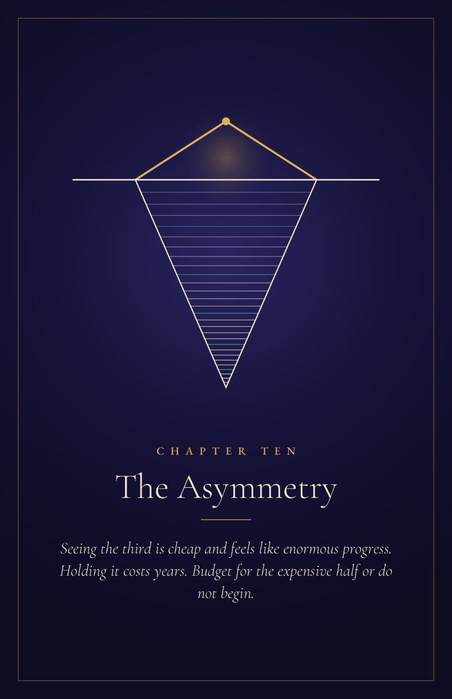

THE GEOMETRY OF EXISTENCE · LEVEL TWO · THE MANUAL · PAGES 65–70

  

CHAPTER TEN

# The Asymmetry

> *Seeing the third is cheap and feels like enormous progress. Holding it costs years. Budget for the expensive half or do not begin.*

  

This chapter is the shortest in the manual and the one it most needs you to read twice.

Everything in this book up to now — the named binary, the constructed third, the owned ground, the refused waiting room — produces, in the moment of seeing, a specific and intoxicating experience. You feel the floor become visible. You feel the premise give way. You feel the third option *arrive*, fully formed, shining, with your name on it. It feels like the work is done. It feels like *you* are done — done being stuck, done being captured, done with the old architecture.

That feeling is real, and the manual does not dismiss it. That feeling is also the most dangerous moment in the whole discipline, because **the feeling is the cheap half, and it is not even a down payment on the expensive one.**

Here is the asymmetry, stated plainly:

**The extraction is fast. The holding is slow.** Seeing the binary takes an hour. Constructing the third takes weeks. *Holding* the third — keeping it real against the gravity of the old architecture, the skepticism of the surfacedwellers, the sheer daily friction of a position that has no existing infrastructure — takes years. Movements have had the insight and died in the decade of holding. Marriages have seen the third option clearly and lost it within a season to the unrelenting ordinary. People have built their one great construction and watched it dissolve — not because it was wrong, but because

the holding cost more than they had priced, and nobody had told them the price in advance.

The manual is telling you now.

And the asymmetry has a second edge, sharper than the first: **the insight feels like progress, so the insight gets consumed as progress.** You see the third, you feel transformed, the feeling *is* the reward, and the reward, having been felt, quietly discharges the motivation that was supposed to pay for the holding. This is the mechanism by which most constructions die — not refutation, not failure, but *satisfaction*. The insight was so nourishing that it fed you instead of the work. You have felt this. The conversation that changed everything and changed nothing. The book that reorganized your week and your week reverted. The resolution that was so true on the night it was born. Every time, the same arc: the seeing paid out immediately, the holding billed later, and the account was empty by then.

There is an entire economy built on this asymmetry, and you should know it exists, because it will offer to serve you: **the extraction economy.** Books, seminars, feeds, gurus — the whole apparatus of *insight delivery* — sells the fast half. It has to. The slow half cannot be sold, because the slow half is not transferable: nobody can hold your ground for you, and any product claiming otherwise is selling the feeling of holding, which is the cheapest counterfeit of all. The extraction economy is not composed of villains. Most of it is sincere. It simply cannot make its living selling the truth, because the truth is: *the part you are buying from me is the part that does not work.* So it sells the part that feels like working, and the customers leave nourished, and the architecture stays exactly as it was.

The manual refuses this economy on principle, which is why this chapter exists. The asymmetry cannot be eliminated. It is structural. But it can be *priced*, and a priced asymmetry is survivable, and an unpriced one is not.

So the pricing. Four costs, honestly stated:

**The cost of years.** Whatever you construct — a way of living, an institution, a work, a marriage that refused the either/or — give it a number you are actually willing to pay: *I will hold this for ten years before I judge its failure.* Not ten years of heroism. Ten years of ordinary, unglamorous, unwitnessed holding, during which the insight-feeling will not visit, will not be missed, and will not pay the rent. The constructions that survive are the ones whose builders had already accepted the timeline before the building started. The ones that die are the ones that were implicitly promised to the builder in three.

**The cost of comfort.** The third option you hold will, at regular intervals, offer to trade itself back to the binary for relief. The old architecture will make a very reasonable offer: *come back, it was simpler, nobody asked you to carry this.* The offer will come when you are tired — it always comes when you are tired, it has perfect timing — and it will be genuinely true that the old way was simpler. The holding requires that you have, in advance, decided what the simplicity is worth to you, so that the offer arrives at a table where the price has already been set. People who have not pre-set the price discover, too late, that they had been holding their construction on a month-to-month lease with themselves.

**The cost of company.** Chapter Six warned you: the third looks like an error from the surface, and the surface is where almost everyone lives. Holding the third means holding it, for stretches, *alone* — not romantically alone, not heroically alone, just unaccompanied in a position that the people around you cannot yet see as a position. Some of your constructions will eventually gather others. Most will not, or will gather them very slowly, or will gather them only after you are gone. The holding has to be priced to survive the unaccompanied stretch, or it will not survive it, because the unaccompanied stretch always comes, and it always comes before the end.

**The cost of evidence.** And this is the cost the manual will not soften: some of what you hold will turn out, under years of honest holding, to have been wrong. The asymmetry cuts both ways — the slow half is not only where constructions are proven, it is where they are *lost*, and a discipline of holding that cannot let go is not a discipline, it is a sunk-cost religion. You price this cost by pre-committing, before the holding begins, to what would count as evidence of failure — the same discipline as the sciences this manual’s lineage descends from, applied to the most personal experiment you will ever run: your own constructed life. Hold for the years. Hold against the comfort. Hold through the alone. And hold, the whole time, the losable claim — the next chapter’s subject — so that if the ground itself says *no*, you can hear it.

That is the whole chapter. The seeing is the smallest, fastest, most deceptively complete-feeling part of the work. The holding is the work. The manual cannot hold anything for you, and neither can anyone else. It can only tell you the price before you sign, which is more than the extraction economy will ever do.

If, knowing the price, you still choose to build — then the choice itself becomes load-bearing, and it carries more than the insight ever could.

> **▲ Practice**
>
> Take the construction you are currently holding — the third you have built or are building — and price it this week, in writing, with four numbers or dates: how many years you commit before judging; what comfort you pre-agree to refuse; what you will do during the unaccompanied stretch; and what evidence would end it. Put the paper somewhere you will find it in three years. The paper is the load-bearing wall. Most people’s walls are made of the original feeling, and the feeling does not survive the second winter.

> **◆ Audit**
>
> Look at the constructions you have already lost — the movements, the projects, the ways of living that were once so clear and are now so gone. For each, ask honestly: *did it die because it was wrong, or because the insight-feeling was spent and the holding had never been priced?* The answer matters more than almost any other answer in this manual, because it tells you what your actual failure mode is. And the failure mode, once named, can be budgeted for. Everything else is weather.

---

[← Part III · The Weight](part-3-the-weight.md) · [Contents](../README.md) · [Continuity →](11-continuity.md)

