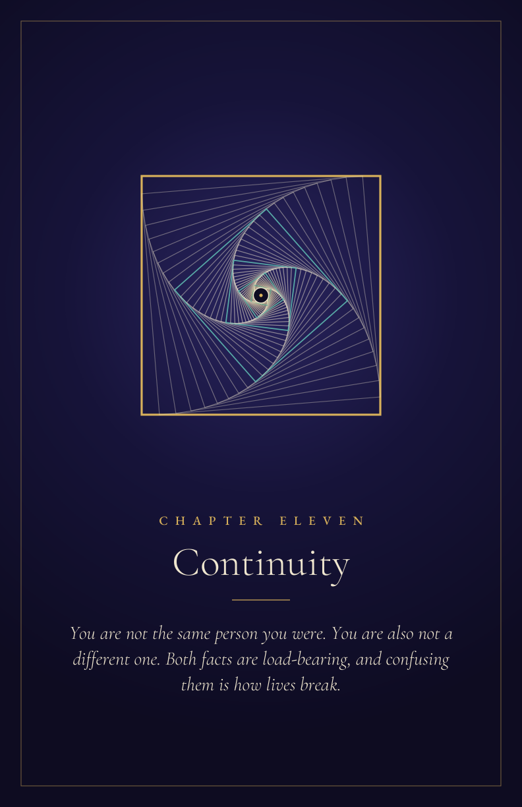
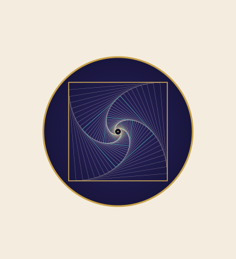

THE GEOMETRY OF EXISTENCE · LEVEL TWO · THE MANUAL · PAGES 71–76

  

CHAPTER ELEVEN

# Continuity

> *You are not the same person you were. You are also not a different one. Both facts are load-bearing, and confusing them is how lives break.*

  

Somewhere along the way, the modern world sold you a false choice about yourself, and you have probably paid for it.

The choice goes like this. Either you have a fixed self — a true, authentic core, a “this is just who I am,” discovered once and defended ever after — or you have no self at all: you are endlessly revisable, each self as legitimate as the last, yesterday’s person as discardable as yesterday’s clothes. Be *consistent* or be *free*. Pick a lane.

The manual rejects the choice, on the evidence. And the evidence is you — because you already know, from the inside, that both poles are lies. You know you are not the same person you were at twenty: the evidence of change is overwhelming, and anyone who claims to be exactly who they always were is either very young or not paying attention. And you also know — deeper down, and more quietly — that you are not a *different* person either. Something has been continuous through every change. Something has carried. You have felt it in the strange recognition of an old photograph: *that was me, and also not me, and the thing that says “me” about both — what exactly is that thing?*

That thing is the subject of this chapter. And the news is good: it can be found, named, and protected — but only by someone who has stopped confusing it with the things that merely *change around* it.

**The self is a series with a throughline, not a fixed object.** Think of a river, and not because rivers are poetic — because rivers are precise. The river is never the same water twice; that is the change half, and it is non-negotiable. And the river is also not arbitrary — it does not flow uphill one day and become mist the next; there is a channel, and the channel persists, and the channel is what makes it *this* river and not weather. The water is the changing self. The channel is the throughline. You need both halves. A river of pure water with no channel is a flood. A channel with no water is a dry ditch. A self with no change is a photograph that thinks it is a person. A self with no channel is a performance that cannot be trusted from one year to the next.

So the practical question of the chapter, the one you can actually work with: *where is the channel?* What in you deserves the name of throughline — and what, in you, is merely water that has been pretending to be the river?

Here is the test, and it is the whole chapter in one sentence: **the throughline is what survives the loss of every arrangement.** Strip away, one by one, the things you have used to define yourself — the role, the income, the relationship, the body as it was, the story about your future — and notice what is still there when the stripping stops. Whatever looks back at you from the stripped place: *that* is the channel. Not the favorite. Not the most impressive. The *survivor*. The thing that was there before the arrangements and will be there after them, because it was never made of them.

For most people who run this test honestly, the throughline turns out to be smaller and stranger than the advertised self. It is usually something like: a specific way of noticing. A specific seriousness about certain questions. A specific way of caring that has not changed since before you can remember. A name for the thing you protect. The manual cannot tell you yours — no one can, and anyone who sells you a prefab throughline is selling you a costume for the channel. You have to find yours in the stripping place, and you only get there by actually stripping, which is why most people prefer the costume.

Once found, the throughline changes how you handle everything else, and this is where the chapter becomes practical rather than merely true. Three rules:

**Rule one: protect the throughline; permit everything else to be revised.** The throughline is the inviolable core — Chapter Fourteen will give it its full weight. Everything *else* — the arrangements, the methods, the costumes, the geographies, the versions of the craft — is revisable without betrayal. This distinction dissolves the false choice the chapter opened with. You can be *radically* revisable in the water and absolutely faithful in the channel. You can change everything that changes and keep the one thing that must not. Consistency and freedom, reconciled — not by splitting the difference, but by the same move as Chapter One: refusing the line both options were drawn on.

**Rule two: revision of the water is not erasure.** This is the rule that lets you actually do it — change jobs, change cities, change your mind, change the story — without the nausea of self-betrayal. Change, honestly done, is reorganization around the throughline, not abandonment of it. The channel does not flow uphill when you revise the water; it keeps its course through new material, and it is *more* itself for the new material, the way a river is more itself for the new water. The people who handle deep change best are not the ones with the strongest wills. They are the ones with the clearest channels — who know what survives, and therefore know that everything else was always water.

**Rule three: history kept as a reason to stay wrong is not loyalty.** And this is the rule that bites, so the manual will be plain. Your past arrangements made commitments — to people, to institutions, to versions of the story. Those commitments were real, and the throughline honors real commitments. But there is a specific corruption in which *the past itself* — what you said once, who you were once, what was decided in 2009 — becomes the load-bearing wall for a position the throughline no longer holds. That is not the channel. That is a dam made of photographs, and it will break, and when it breaks it will take the channel with it, because a throughline held hostage to its own history stops being a throughline and becomes a monument. The channel moves. That is what rivers do. Loyalty to the past that forbids the future’s revision is not faithfulness — it is the photograph, governing.

Then the sentence the chapter owes you, and the manual will not soften it: **you will be tempted, at least once, to revise the throughline itself** — to decide, in some dark season, that the channel was the problem all along, that the thing that survived every stripping was the thing to blame for the stripping, and that a new throughline, purchased wholesale from whoever is selling that year, would finally make the river behave. Resist. The temptation is real and the season will pass, and the throughline — found honestly, in the stripped place — is the one part of you that has earned the right to say *no* to your revisions. You may change everything around it. You may not fire it without becoming the dry ditch, and the dry ditch, however welldressed, is the one self this manual will not help you build.

Know the channel. Permit the water. Refuse the dam. That is continuity — not as a philosophy of the self, but as the only way a self survives being a self for longer than a few years at a time.

> **▲ Practice**
>
> The stripping exercise, once, with honesty. Take the three arrangements you currently use most to define yourself — the manual will not guess them for you — and imagine, concretely, each one gone. Not dramatically; just gone. After the third stripping, sit in the stripped place for five minutes and write down what is still there, looking back. That list — it will be short, and it will be strangely unsurprising — is your candidate throughline. Do not tattoo it. Do not build a movement around it. Just know it, and let the next revision be judged against it.

> **◆ Audit**
>
> Where in your life are you keeping a past arrangement as a reason to stay wrong? Be specific: name the commitment, name the year it was made, and ask — honestly, in the stripped place — whether the throughline still holds it, or whether the photograph is governing. The answer will be one of two things, and only one of them is shameful: *the commitment still holds and I will renew it on purpose*, or *the photograph has been governing and I will stop calling that loyalty.* Both are honest. The third option — never asking — is the only failure this chapter recognizes.

---

[← The Asymmetry](10-the-asymmetry.md) · [Contents](../README.md) · [PDF ↓](../../edition/README.md) · [The Losable Claim →](12-the-losable-claim.md)

