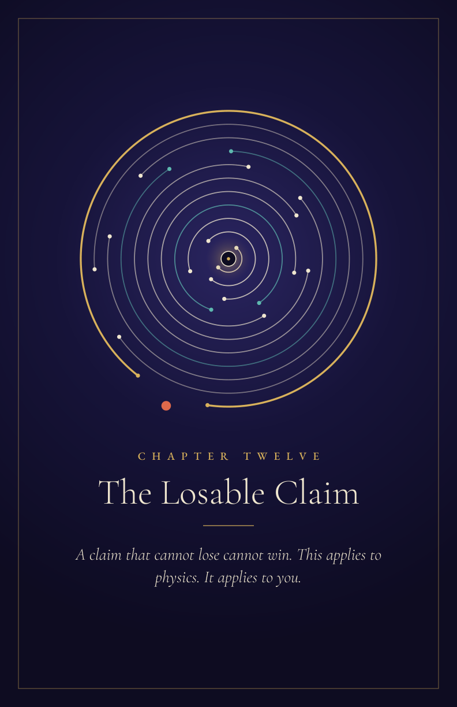

THE GEOMETRY OF EXISTENCE · LEVEL TWO · THE MANUAL · PAGES 77–82

  

CHAPTER TWELVE

# The Losable Claim

> *A claim that cannot lose cannot win. This applies to physics. It applies to you.*

  

The manual has kept one discipline in front of you the whole way — in the naming, the testing, the constructing, the holding — and now it is time to say plainly what that discipline is, because it is not a set of techniques. It is one move, applied everywhere, and this chapter applies it to the last and hardest subject: yourself.

The move is this: **before you commit to a position, name what would change your mind.** In the sciences, this is called pre-registration — declaring your test, and its failure condition, before the data arrives. In this manual’s lineage, it has a harder name and a longer pedigree: a claim that cannot be wrong cannot be right. It can only be *held* — at increasing cost, in the dark, against an evidence that keeps arriving and keeps being refused.

You already know this move from the outside. You have watched people hold unfalsifiable positions about the world — the conspiracy that accounts for every disproof as further proof, the ideology that treats every counterexample as sabotage, the relationship that explains every cruelty as love’s disguise. You have seen what those positions cost their holders: not just error, but *imprisonment* — the slow construction of a world in which nothing can ever count against the claim, which is the same as a world in which nothing can ever count. You have probably felt the particular sadness of trying to reach someone inside such a position. The walls are made of *untestability*. Nothing gets in, because nothing was ever let out.

Now the turn you will not enjoy, and the manual does not apologize for it, because this chapter is the one you most need:

**You have such a position about yourself.** You have at least one claim about who you are — your goodness, your victimhood, your clarity, your unlovability, your exceptionalism, your damage — that you have structured so it cannot lose. Every event that seems to count against it is explained away: the criticism is jealousy, the failure is circumstance, the kindness is pity, the success is accident. And the position is unfalsifiable, which means it is not a belief at all. It is a *cell* — comfortable, decorated, defended with everything you have, and completely sealed against the one thing that could actually help you: evidence.

The manual wants to be very precise here, because this chapter is easily misread as an attack. Some of your self-claims are true. Some of them are true and load-bearing and should be held with everything you have. The question is never whether the claim is right. The question is whether you have made it *unable to be wrong* — and the difference between a true claim held falsifiably and a true claim held unfalsifiably is the difference between a floor and a cell. The floor can be tested, re-verified, repaired, and — this is the crucial part — *relied upon by other people*, because its strength is real and has survived contact. The cell’s strength is untested and therefore untransferable; you can live in it, but no one else can stand on it, and you cannot build on it, because you have made it proof against exactly the instrument that would tell you it is sound.

So the discipline, and it is the manual’s deepest one:

**Name your falsifiers.** Take the load-bearing claim about yourself — the one everything else rests on — and complete this sentence, in writing, before the next hard week arrives: *I would know I was wrong about myself if—*The sentence must name an observation. Not a feeling — feelings are loyal to the cell. An observation: *what I actually did, on these occasions, when no one was watching.* The cell always explains deeds away; the falsifier names the deed that will not be explained. You will know you have found the real falsifier because you will feel a specific resistance to writing it down — a tightness, an urge to qualify, to soften, to make the test one you are guaranteed to pass. That resistance is the cell defending itself. Write the sentence anyway. The sentence, once written, is the door.

**Pre-commit to the verdict.** A falsifier named after the evidence arrives is not a falsifier; it is a rationalization with paperwork. The commitment must be made *before* the test — *if this observation occurs, the claim is wounded, and I will revisit the claim rather than re-explaining the observation.* This is the hardest part, because it means giving evidence permission to hurt you in advance. People refuse this move for exactly that reason. It is also the only move that makes the claim — if it survives — worth anything at all. A goodness that agreed to its own test and passed is a goodness you can stand on and build on and hand to others. A goodness that refused the test is a rumor you are running from.

**Honor the witnesses you disqualified.** Every cell has a history, and the history is always the same: at some point, someone saw the thing you could not afford to see, and told you, and you handled the testimony by handling the witness — *they misunderstood, they were jealous, they were cruel, they were the wrong person to say it.* Sometimes the disqualification was right! Witnesses are fallible; Chapter Four said so. But the cell’s signature is not that it disqualified a witness — it is that it disqualified *every* witness, in advance, forever, on principle, and called the pattern *self-knowledge*. Go back through the testimony you refused and ask, with the falsifier in hand: *was I testing the witness, or was I protecting the claim?* You will not always like the answer. Write it down anyway. The disqualified witnesses are usually where your evidence has been living all along.

And then the sentence the whole chapter exists to deliver, and the manual will put it alone on its line:

**The only self you can actually improve is the losable one.**

The sealed self cannot grow — not because growth is impossible, but because growth is a form of losing. To change is to let the old claim be wrong about something, in some way, on some evidence, and the unfalsifiable self has forbidden exactly that transaction. So it stays. Not strong — *stuck*; the cell does not preserve you, it embalms the version of you that built it. The losable self, by contrast, is the only one with a future, because it is the only one that can receive the news — the correction, the criticism, the piece of evidence it did not want — and metabolize it into floor. Everything the cell spends on defense, the floor spends on building. Over a lifetime, the difference is total.

You have watched people do this. The rare, quiet ones — the ones who say *you may be right about me, let me look* and mean it, who treat their own self-image as a working hypothesis rather than a sacred object, who can be corrected in public without it costing them anything that matters. You have felt what it is like to stand near such a person: the strange safety of it. That safety is not their confidence. It is their *testability* — the knowledge, transmitted without a word being said, that nothing you could say to them would be wasted, because everything is allowed in, and everything that comes in gets honestly weighed. That is what a floor feels like from the outside.

You can be that. Not by becoming thick-skinned — the thick-skinned are often just well-armored cells — but by pre-committing, in writing, to your own disproof, and then keeping the commitment when the evidence arrives with its inconvenient timing.

The claim that cannot lose cannot win. The self that cannot lose cannot grow. Name what would change your mind about yourself. Then let the world do its honest work.

> **▲ Practice**
>
> This week, in writing, complete the sentence: *I would know I was wrong about myself if—* Name one observation that would count against your most load-bearing self-claim. Pre-commit: *if I observe this, I will revisit the claim before I reexplain the observation.* Put the paper with the paper from Chapter Ten. These two documents together are the whole discipline — the priced holding and the losable claim — and they fit in one envelope.

> **◆ Audit**
>
> Think of the last three people whose testimony about you hurt. For each, ask: *was my disqualification of them a test of their reliability, or a defense of my claim?* Be slower on this one than on any audit in the manual so far. If, after honest review, even one disqualification was defense — the witness was inconvenient, and you made them wrong so the claim could stay right — you owe that testimony a second hearing. Not agreement. A hearing. The cell’s walls are made of exactly those unheard testimonies, and every one you genuinely re-hear is a brick out of the wall.

---

[← Continuity](11-continuity.md) · [Contents](../README.md) · [Part IV · The Care →](part-4-the-care.md)

