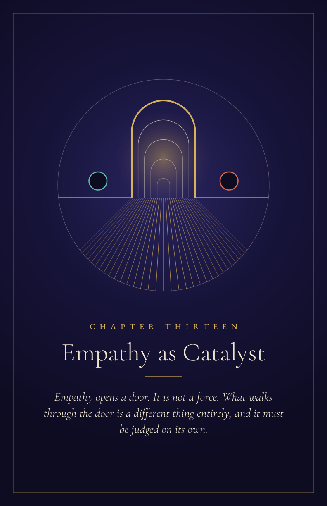
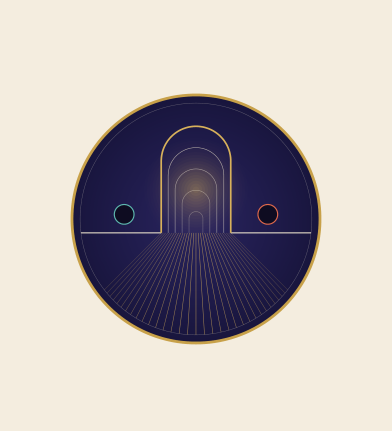
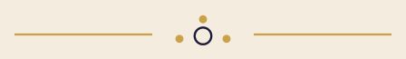

THE GEOMETRY OF EXISTENCE · LEVEL TWO · THE MANUAL · PAGES 84–89

  

CHAPTER THIRTEEN

# Empathy as Catalyst

> *Empathy opens a door. It is not a force. What walks through the door is a different thing entirely, and it must be judged on its own.*

  

The world has made a great noise about empathy in your lifetime. It has been promoted as the cure for cruelty, the solvent of conflict, the missing ingredient in every broken system — the answer, in one word, to most of the human question. And the manual will say, carefully, that this is half true, and the half that is true is precious, and the half that is false is dangerous, and confusing the two has done real damage that this chapter exists to prevent.

Here is the precise claim, and everything else follows from it: **empathy is a catalyst, not a force.**

A catalyst, in the old chemistry, is the thing that opens a reaction — makes it *available* — without being consumed by it and without determining its product. The catalyst does not push. It does not choose what gets built. It does not guarantee the outcome. It lowers a barrier, and then the actual forces — the real energies of the system — do whatever they were going to do, faster, or more honestly, or at all.

That is what empathy does, and only what empathy does. It opens the door between one interior and another — makes another person’s actual experience *available* to your understanding, in their terms rather than in your projection of their terms. And then whatever you build with that understanding — a bridge, a boundary, a compromise, a war conducted without dehumanization, a decision to walk away that the other person can actually hear — is built by *other* instruments. Judgment builds. Craft builds. The willingness to pay costs builds. Empathy opens the door, and stands aside, and does not get to take credit for what walks through.

This precision matters, because the confusion runs in both directions, and both corruptions do harm.

**The first corruption: empathy mistaken for a force.** This is the promotional corruption — the belief that empathy *does* something, on its own, if there is enough of it. That if both sides just *felt* enough, the conflict would dissolve; that if the cruel person truly *saw* their victim, cruelty would end; that the door is the same as the walking-through. It is not, and the evidence of history is exhaustive. People who feel genuinely, accurately, achingly — and then do nothing. People who weep at the suffering they then decline to inconvenience themselves for. Empathy without the instruments that walk through it produces *understanding* — which is real, and which matters, and which is not action. The world is full of people who understand everything and change nothing, and most of them were promised that understanding was the hard part. Understanding is the door. The hard part is still the hard part.

**The second corruption: empathy mistaken for the destination.** This is the subtler one, and the manual is more worried about it, because it lives closer to home. It is the use of empathy — the *feeling* of empathy, the performance of empathy — as the measure of one’s own goodness, rather than as an instrument toward the other person’s actual welfare. You have felt this corruption from the inside, if you are honest: the warmth of *really getting* someone’s pain, the satisfaction of the tear sincerely shed, the sense of being, in that moment, a good person. And the warmth is real. But notice whose benefit the warmth serves. The warmth is *yours*. The other person is still in the pain. Empathy consumed as self-image is empathy spent on the self — the door opened, admired, closed — and the person on the other side of it is left exactly where they were, plus the strange aftertaste of having been *felt at*.

Which brings the manual to the discipline this chapter actually teaches, the one that keeps empathy honest, and it is a two-column discipline:

**Column one: accuracy.** Did you actually understand — in *their* terms, with their map, their history, their constraints — or did you understand your own projection of them, warmed up and served back? This is the column almost nobody checks, because the feeling of understanding is so convincing from the inside. The test is behavioral: *can you state their position — their actual position, not the weakest version — in words they would sign?* Not agree with. *Sign.* If you cannot pass that test, you have not opened the door; you have opened a mirror, and the warmth you feel is your own reflection. Chapter Four’s witness is the precondition: you cannot catalyze what you have not genuinely seen.

**Column two: welfare.** Given that you understand — what does the other person’s actual situation require? Not what would make you feel helpful. Not what would make them feel better this afternoon at the cost of next year. What does their welfare, honestly assessed, with the throughline of their life in view, actually call for? Sometimes it calls for comfort. Sometimes it calls for the hard thing said kindly. Sometimes it calls for boundaries that feel, in the moment, like cruelty — the refusal that protects what they cannot yet protect themselves. Empathy that refuses the welfare column is empathy performing itself; it has opened the door and then stood in it, admiring the view, while the house on the other side stays on fire.

And here is the sentence the chapter must not skip, because it is the one that separates this manual’s empathy from the promotional version: **accuracy and welfare are scored separately, and both must pass.** Accuracy without welfare is the cruelty of the clear-eyed — the surgeon who sees everything and cuts for their own convenience. Welfare without accuracy is the tyranny of the warm-hearted — the rescuer whose help is really a project, whose “for your own good” is really a map of their own needs. The door is only a door. What matters is what you build through it, and the building requires both columns, and the manual will not let you average them.

One more thing, and it is the chapter’s quiet heart: **empathy is also owed to the people you oppose.** Not as a tactic — the tactical version is manipulation with a halo, and everyone on the receiving end can smell it. As a discipline. The position you are fighting against was built by a human interior, with its own history and its own load-bearing walls, and you cannot fight it honestly — cannot fight the *actual* position rather than a caricature that makes the fighting easy — until you have passed the sign-test on *them*: *I understand what they are protecting. I understand what the position costs them to hold. I understand what they would lose by letting it go.* This is not sympathy. You may still oppose them, completely, at full strength. But opposition that has passed through the door is opposition that can actually *land* — that addresses the real structure rather than the straw one — and opposition that refuses the door is theater, and usually produces only a more defended enemy.

That is the whole teaching. The door is sacred. The door is not the house.

Open it honestly. Build through it carefully. Keep the two columns. And do not mistake the warmth of standing in the doorway for the much harder, much colder work of walking through it and doing what the other person’s actual welfare — not your feelings about their welfare — requires.

> **▲ Practice**
>
> This week, take one person you are in real conflict with — small conflict is fine; the practice scales — and write their position as they would sign it. Not the caricature. Their version, with their history, in their terms, to their satisfaction. You will know you have it when reading your own paragraph makes you slightly uncomfortable — because it is fair, and fairness to the other side always stings a little. That discomfort is accuracy arriving. Then, and only then, decide what their welfare actually requires of you, and do the harder of the two columns.

> **◆ Audit**
>
> When you have felt most proud of your own empathy — the moments you would cite as evidence of your goodness — whose benefit was the warmth actually serving? Look at the last three times. If even one of them was the door opened, admired, and closed — the feeling consumed as self-image, the other person’s situation unchanged — do not flinch from it. Almost everyone who reads this chapter will find at least one. The finding is not the failure; the *keeping* is the failure. Empathy that knows it is a catalyst stops performing and starts working.

---

[← Part IV · The Care](part-4-the-care.md) · [Contents](../README.md) · [The Inviolate →](14-the-inviolate.md)

