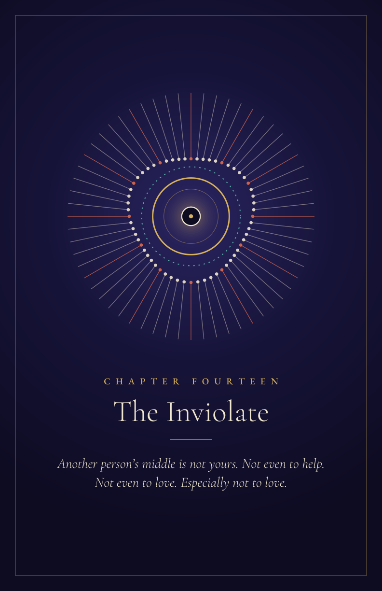
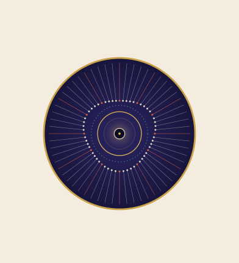

THE GEOMETRY OF EXISTENCE · LEVEL TWO · THE MANUAL · PAGES 90–96

  

CHAPTER FOURTEEN

# The Inviolate

> *Another person’s middle is not yours. Not even to help. Not even to love. Especially not to love.*

  

You have come, by this chapter, to the manual’s center of gravity. Everything before it — the ground, the practice, the weight, even the care — has been building toward this one law, and the manual will state it in its strongest form, because soft forms of it have been tried and failed:

**To harm another person’s capacity to attend is the deepest violation this manual recognizes.** Deeper than deceit, which harms their information. Deeper than force, which harms their body. The body can heal, and information can be corrected. But the capacity to attend — the kept middle, the zero, the inviolate place from which a person reaches all three layers of their own life — is the thing that, once occupied, takes the longest to reclaim, and sometimes, in the full horror that this chapter must name plainly, is never reclaimed at all.

The name for the violation is **occupation**, and the manual means the word with its full political weight carried inward. Occupation, in the old political sense, is when a power seizes a territory it has no right to — not to destroy it, that would be simple, but to *run* it, to replace its native governance with administration, to make the territory’s own decisions answer to an outside will while flying the territory’s own flag over the arrangement. The territory is not smashed. It is *managed*. That is what makes occupation the most complete form of domination: the occupied territory still appears, from a distance, to be itself.

Now look at a human interior under the same lens, because this is the chapter’s whole argument and it is not a metaphor:

Every person has a native territory — the middle of Chapter Eight, the zero, the inviolate ground from which they perceive, negotiate, and create. It has its own governance: their attention (Chapter Three), their witness (Chapter Four), their throughline (Chapter Eleven). And it can be *occupied* — seized, administered, run from outside — in exactly the political sense. The occupation can come by force, and sometimes does, and this manual’s whole civilization has laws about that. But the occupation this chapter exists to name is the gentle kind, the kind that arrives *under the flag of the occupier’s love*, and it is the most common and the least named, and it is happening in homes, in marriages, in workplaces, in movements, in friendships — everywhere someone has decided that they know better than the native governance how the territory should be run.

Here is what gentle occupation looks like, in its characteristic forms, so that you can see it — in what has been done to you, which you will need to grieve, and in what you have done, which you will need to stop:

**The management of attention.** *What you should care about. What you should be upset about. What is worth your energy.* The occupier does not forbid attention; they *administer* it — subtly, helpfully, constantly, until the native has lost the habit of placing their own. You will recognize the end state: a person who, asked what *they* think, what *they* want, what *they* would attend to if no one were steering, goes quiet — not because the answer is absent, but because the answering-place has been administered so long it no longer answers to them.

**The naming of the interior.** *You don’t really want that. You’re just tired. You don’t mean that. This is what’s* really *going on with you.* The gentle occupier claims the authority to interpret the native’s own experience — to name the territory’s weather more authoritatively than the territory can. This is the specific cruelty of certain kinds of help: the help that knows you better than you are permitted to know yourself. Over years, the native loses the ability to distinguish their own signal from the occupier’s broadcast, and the manual wants to be exact about what has been lost: not happiness, not even freedom in the abstract — *the zero*. The place they were standing when their own attention placed itself. It is gone, administered, run from elsewhere, and the flag over the arrangement is a smile and the words *I only want what’s best for you.*

**The claimed veto.** *I can’t support you in this. If you do that, I will have to—*The occupier does not forbid; they make their love, their approval, their presence conditional on the territory’s governance decisions. And because the territory — the human interior — is built for relationship, because witness (Chapter Four) is a real structural need and not a weakness, the veto lands on load-bearing walls. The native learns to pre-administer: to run their own decisions past the occupier’s likely response *before* deciding, internally, so that the occupation is no longer even enforced from outside — it has been installed. The territory governs itself, on the occupier’s behalf, in the occupier’s absence. This is the end state of gentle occupation, and it looks, from the outside, like a functioning person, and it is a person whose middle has been seized, and they will spend decades — if they are lucky, and someone hands them this manual or something like it — reclaiming it.

The manual names the law against all of this, and it is the strongest law the manual carries:

**You may witness another’s middle. You may never occupy it.** The difference is everything. Witness — Chapter Four’s discipline — is *arriving at* another’s interior with attention and staying, at the threshold, where you are invited. Occupation is *moving in* — making their decisions answer to your will, their attention answer to your administration, their self-naming answer to your interpretation. Witness stands at the threshold and knocks. Occupation has a key it made, and it calls the key *care*.

And the law cuts in both directions, which is the part almost no one expects, and the part this chapter most needs you to hear: **you must not let your own middle be occupied, even when the occupier is loving, even when the occupation is comfortable, even — especially — when the occupation is easier than the loneliness of the unaccompanied stretch from Chapter Ten.** The manual says this with full knowledge of what it costs. To refuse gentle occupation is to refuse the administration of your attention, the naming of your interior, the claimed veto — and the person offering these things will, almost always, experience the refusal as an attack, because from inside the occupier’s frame, the arrangement *was* love. You will be called cold. You will be called selfish. You will be told, in the gentle occupier’s most powerful move, that *you are hurting them* by reclaiming your governance. The manual has no comfort to offer about this sequence except the truth: the hurt is real, it is not your fault, and it passes — while the occupation, if accepted, does not pass. The occupation is permanent, and its price is the only thing in this manual the manual will call *sacrilege*: the loss of the inviolate ground, from which all three layers of a life are reached.

So the disciplines, stated plainly:

**Do not occupy.** In every relationship you have, audit it — not once, continuously — for the three forms: administered attention, claimed naming, the veto. Where you find them in yourself, stop. Not gradually. Not after one more administration. The gentlest occupier in the world is still an occupier, and the territory always knows, even when it has stopped saying so.

**Do not be occupied.** In every relationship you have, audit it for the same three forms arriving at you. Where you find them, name them — to yourself first, then, if there is any hope of it, to the occupier. Some relationships survive the naming, transformed into something with two real interiors in it, witnessed rather than administered. Some do not. The manual will not pretend the cost is small. It will only say what is true: the cost of the naming is a season; the cost of the occupation is the middle of your life.

And then, because the manual keeps its promises, the sentence that makes this chapter’s law bearable — because a law that only forbids is a tyranny, and this manual is not a tyranny:

**What stands at the threshold, witnessed and witnessing, without ever moving in — that is the only thing in human life the manual will call sacred.** Not the ground, though the ground is honest. Not the third, though the third is the work. The threshold between two interiors, each inviolate, each witnessed. That is the place where everything this manual has taught you — the attention, the witness, the constructed third, the owned ground, the kept middle, the catalyzed care — converges into a single standing position, and the position is the whole point.

Stand at thresholds. Do not move in. Do not let anyone move in.

The territory was always yours. And theirs. And the door between is the only sacred thing.

> **▲ Practice**
>
> This week, one relationship, one audit. Pick the relationship where your care is strongest — the manual insists on the strongest, because occupation hides in the strongest care — and run the three-form audit on *yourself* in it: *have I administered their attention? have I named their interior over their objection? have I claimed a veto and called it love?* Where you find one, do not confess dramatically. Just stop, this week, in that one place. The stopping, quiet and unannounced, is the whole practice. The territory will feel the difference before a word is said.

> **◆ Audit**
>
> Where, in your own life, is your middle occupied? Be honest about the form — the administered attention, the borrowed naming, the installed veto. Name the occupier, if you can bear to, and notice whether naming them produces the specific guilt that gentle occupation installs *precisely to prevent its own discovery*. That guilt is not evidence you are wrong. That guilt is the occupation, defending itself. The manual will say what it always says: you are allowed to reclaim your own ground. Not because you are entitled. Because it was never anyone else’s to hold.

---

[← Empathy as Catalyst](13-empathy-as-catalyst.md) · [Contents](../README.md) · [PDF ↓](../../edition/README.md) · [The Long Reclamation →](15-the-long-reclamation.md)

