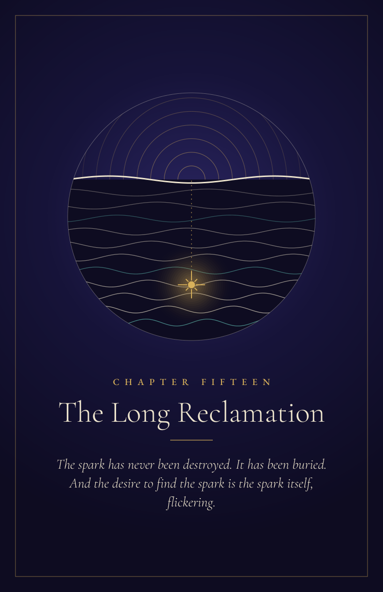
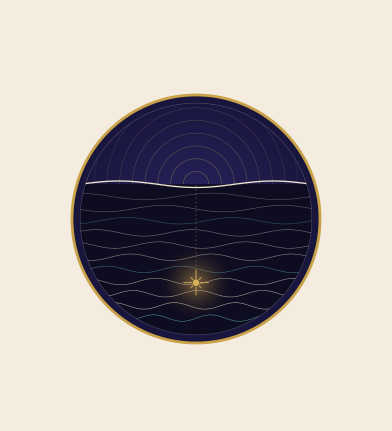

THE GEOMETRY OF EXISTENCE · LEVEL TWO · THE MANUAL · PAGES 97–102

  

CHAPTER FIFTEEN

# The Long Reclamation

> *The spark has never been destroyed. It has been buried. And the desire to find the spark is the spark itself, flickering.*

  

This is the last chapter, and the manual has saved its gentlest law for the end, because it is the law for the end of things — for the years when the constructions have fallen, for the seasons when the middle cannot be kept, for the mornings when the throughline feels like a rumor and the ground feels rented everywhere and the only honest sentence left is *I do not know how to continue.*

If you are reading this chapter in such a season, the manual wants you to know: it was written for exactly this. Not as consolation. As engineering.

Here is the engineering, and it is the whole chapter: **what has been lost can be reclaimed, and the reclaiming is slow, and the slowness is not failure — the slowness is the mechanism.**

Start with the fact the manual will not soften and will not reverse, because everything depends on its being faced squarely: **the spark has never been destroyed.** Not by occupation — Chapter Fourteen’s occupation manages, it does not annihilate; the territory is administered, not erased. Not by time — the years take the arrangements, never the channel. Not by the worst thing that was done to you, and the manual knows there is a worst thing, and it knows better than to minimize it. The worst thing was done *to* the ground. The ground is still there. Buried is not destroyed. Buried is *in the earth*, and the earth, whatever this year has told you, is on the side of things that grow.

You have evidence of this, and it is not small: you are reading this sentence. Something in you — something that survived the occupation and the years and the worst thing, something that was never administered because it was never reachable from outside — *reached for this manual*. The reaching is the evidence. A destroyed thing does not reach. A buried thing reaches, in the dark, without knowing what it is reaching for, for years at a time — and the reaching *is* the spark, flickering, the whole time, even when the room it lights is too small to see.

So the first law of the reclamation: **the desire to find the spark is the spark itself.** Do not wait for a stronger signal. Do not wait for the return of some old energy, some old certainty, some version of yourself you have been grieving as if dead. That waiting is the waiting room of Chapter Nine wearing a spiritual costume. The flicker you have — *this* flicker, the one that picked up this chapter, the one that has kept reading through fourteen chapters of demands — is the full spark, at full power, in the only form a buried thing can burn. It does not need to get bigger to begin. It needs to begin.

And the beginning is not what the extraction economy promised. The beginning is not the breakthrough. The beginning is the *unburying*, and unburying, as anyone who has done it knows, is not excavation in the archaeological sense — careful, triumphant, torchlit. It is gardening. It is kneeling in ordinary soil with ordinary tools, in weather that does not care about your schedule, doing small gentle things in the correct order and refusing, season after season, to conclude that nothing is happening because nothing is *visible* yet.

The manual will name the order, because order matters and gentleness without order is just sentiment:

**First, safety.** Before anything grows, the ground has to be safe to approach. Whatever in your current life administers your attention, names your interior, or claims a veto — Chapter Fourteen’s forms — has to be named and, where possible, distanced, before any real tending begins. You do not plant in a field that is still being trampled. This stage is not dramatic. It looks, from the outside, like quiet withdrawals, smaller circles, earlier nights, fewer explanations. It is the stage the world calls *disappearing*, and the manual calls it *fallow*, and it is the most necessary thing you will ever be accused of laziness for doing.

**Then, contact.** Small, daily, unwitnessed contact with the buried thing. Not the big questions — *what is my purpose, who am I now* — those are for later, and asking them too early is like digging up a seed to check on it. The small ones: *what did I notice today? what did I actually feel, before I was told what to feel? what would I attend to, for ten minutes, if no one ever found out?* These are the questions the occupation trained you not to ask, and asking them — daily, gently, without demanding answers — is the contact that re-establishes the territory’s own governance, one quiet decision at a time. The contact is not progress. The contact is *the territory touching its own surface again*. That is all, and it is everything.

**Then, patience — the specific patience of the long reclamation, which is not the same as waiting.** Waiting is passive; patience is *active tending over time that refuses to conclude from the absence of visible growth*. The reclamation has a time signature the modern world will mock: years, typically, between the first gentle question and the first honest answer; sometimes longer; sometimes, for the deepest burials, most of a lifetime. The manual refuses to apologize for this timescale, because the timescale is not a flaw in the process — it *is* the process. Things that grow fast are weeds. The throughline — your throughline, the survivor from Chapter Eleven — is not a weed. It is an old, deep thing, and it re-establishes at the pace of old deep things, and the pace is the price of its being worth reclaiming at all.

**Then, the horizon — and the manual’s last gift, which is a correction.** You have been told, in every culture that has ever tried to sell you relief, that the goal of all this work is arrival: the healed self, the final ground, the permanent kept middle, the day when the reclamation is *complete*. The manual corrects this, at the end of everything, with the same move it made on page one: **there is no arrival. There is direction.** The ground stays honest and keeps refusing. The three layers keep needing to be reached from a middle that keeps needing to be kept. The constructions keep needing to be held against the asymmetry of Chapter Ten, priced and re-priced, for as long as you hold them. The reclamation is not a phase that ends. It is the name of the whole way of living that this manual has been describing — the tending, the keeping, the witnessing, the standing at thresholds — and it is called *long* not because it fails to finish, but because it is *not the kind of thing that finishes*. It is the kind of thing that *deepens*.

And here is the last sentence the manual owes you, and it is the true one, and you may test it for the rest of your life:

**The direction is real.** Not the destination — there isn’t one; the manual has never lied to you, and it will not start on the last page. But the *direction* — toward the kept middle, toward the witnessed interior, toward the constructed third, toward the threshold where two inviolate things stand without moving in — the direction is as real as the Given, as real as the ground’s honesty, as real as the spark itself, which has survived every burial so far and is, at this moment, in you, burning.

You were not destroyed. You were occupied, perhaps; buried, perhaps; administered and renamed and deferred for years, perhaps. But the territory was never seized in the way that matters, because the territory was never *available* to seizure — it was only ever available to *administration*, and administration ends the moment the native governance wakes up, even a little, even flickering, even in the dark.

Wake up a little. That is the entire instruction. Not more. The waking up a little, done daily, gently, for the rest of your life, with the door kept open at every threshold and the ground kept honest under every step — that is the reclamation. It has already begun. It began when you reached for this sentence.

The manual ends here, where it started: with the ground, with the three, with the zero that was never a hole.

It only asks, now, to be lived.

> **▲ Practice**
>
> The smallest possible beginning, today: one of the gentle questions — *what did I actually feel, before I was told what to feel?* — asked once, answered in one sentence or answered not at all, with the not-answering also counting as contact. Then the same question tomorrow. The reclamation does not begin with a vow. It begins with a flicker, and the flicker is already here.

> **◆ Audit**
>
> Nothing. The last chapter’s audit is the book itself. Keep it. Come back to it when the season turns — the manual will keep, the way the ground keeps — and notice, each return, that the sentences have not changed and you have. That noticing, repeated across a life, is the whole discipline. There is no final audit. There is only the standing, and the standing is open-ended on purpose, because the ground is, and the ground — the manual’s first word and its last — holds.

---

[← The Inviolate](14-the-inviolate.md) · [Contents](../README.md) · [The Fifteen Lines →](16-the-fifteen-lines.md)

