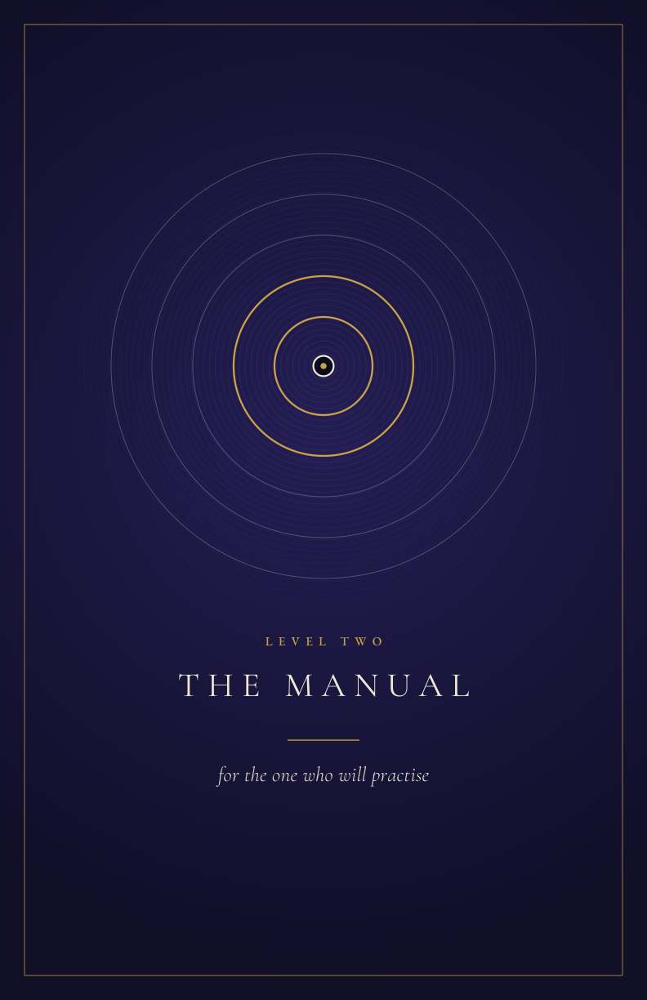

THE GEOMETRY OF EXISTENCE · LEVEL TWO · THE MANUAL · PAGES 12–13

  

LEVEL TWO

# The Manual

> *for the one who will practise*

## The Field Manual

<i>a pure metaphysics for practical life</i>

This level is the *Field Manual*, whole.

It is the book the physics is not. The research text of Level Five argues. This manual assumes. It takes the metaphysical core that runs through the whole corpus and renders it purely, for living. No derivations. No protocols. No evidence sections. Only: what is, and how to stand in it.

It has four parts and fifteen chapters. Each chapter ends in a **Practice** — something done today — and an **Audit** — a question that can find the chapter wrong.

`LIVED` Its mark is *lived*, from the first page to the last. When it tells you how attention is taken, how a self persists, or what a person in pain needs, it is not reporting a study. It is telling you what to try, and how you would know if it were false for you.

Read one chapter. Do its practice. Then read the next.

---

[← In Plain Words](../1-the-lines/03-in-plain-words.md) · [Contents](../README.md) · [Part I · The Ground →](part-1-the-ground.md)

