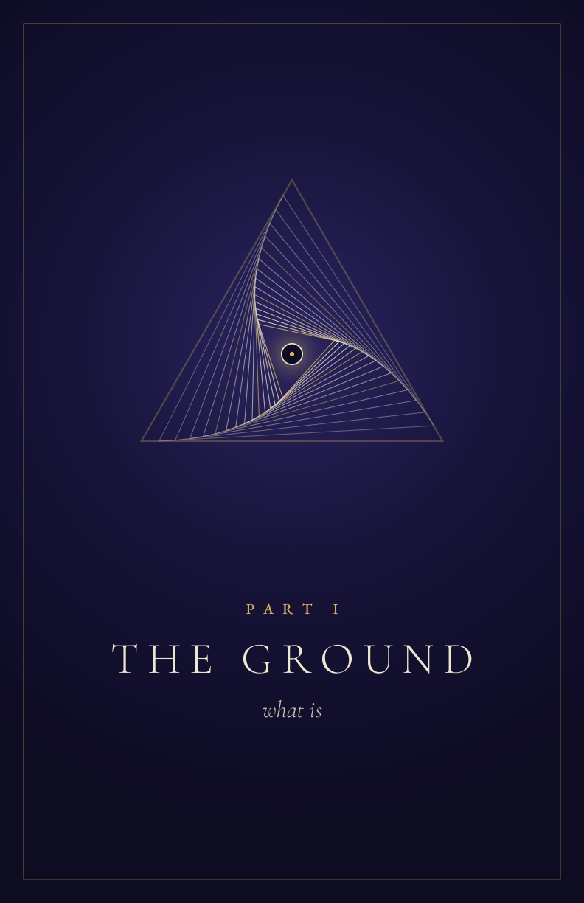

THE GEOMETRY OF EXISTENCE · LEVEL TWO · THE MANUAL · PAGE 14

  

PART I

# The Ground

> *what is*

---

[← Level Two · The Manual](README.md) · [Contents](../README.md) · [PDF ↓](../../edition/README.md) · [The Three and the Zero →](01-the-three-and-the-zero.md)

