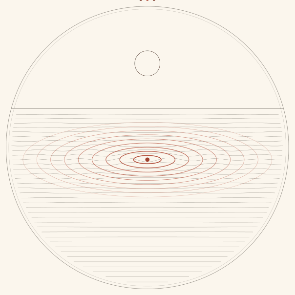

CHAPTER TWELVE

# Peace: The Unsent Letter

*Peace and the Mastery of Anger*

<i>A single drop on still water. The rings spread, weaken and are gone; the surface keeps its level.</i>

> *Hatred does not cease by hatred at any time: hatred ceases by love; this is an old rule.*
>
> — *Dhammapada* 5 (Müller)

> **PEACE** · *Who can provoke me, and why have I given them that power?*

## I · ◆ The Teaching

100. Peace is not the absence of conflict. It is the absence of a master inside you. Let others inform your temperature; never let them set it. Whoever can provoke you can steer you. Take back the reins.
101. Between what happens and what you do there is a gap. Everything you will ever earn is decided inside it. Widen it, and you take your reality back.
102. Delay is the greatest remedy for anger. Write the furious letter if you must. Then put it in a drawer and sleep on it. Most letters written in rage are better read than sent.
103. Be angry, if you must, at the right thing, toward the right person, to the right degree, at the right time, for the right reason. That is not easy. That is mastery.
104. When someone wrongs you, ask first: is it true? If it is, learn from it. If it is not, it is about them. In neither case is a war required.
105. Genuine gentleness is invincible. No one can defeat the one who refuses to become what he is fighting.
106. Do not mistake calm for weakness, in yourself or in others. The calmest person in the room usually has the least to prove.
107. Hatred has never once been cured by hatred. It is cured only by its opposite. This is an old rule, and it has never been repealed.
108. You cannot bring peace into a room you have not first brought into yourself. Set your own house in order before you walk into another’s.

## II · ◇ The Five Scales

|  |  |
|---|---|
| **CELL** | Living cells hold their inner conditions steady against a changing world. Biologists call it homeostasis. Lose it, and the cell dies. |
| **SELF** | Inner peace is the homeostasis of the soul: a steadiness that holds while the weather changes. |
| **BOND** | Two people at peace can disagree without destroying each other. |
| **COMMUNITY** | A peaceful people has ways to settle disputes without blood. |
| **COSMOS** | Storms rage across the faces of planets; deep below, the core turns steadily on. |

## III · The Witnesses

- ★ **The Buddha** · *Dhammapada* 5  
  Hatred ceases only by love. It converges with Matthew 5:39–44, *Tao Te Ching* 63, and King’s teaching that darkness cannot drive out darkness.
- **Seneca** · *De Ira* III  
  The greatest remedy for anger is delay.
- **Aristotle** · *Nicomachean Ethics* IV.5  
  Anger rightly felt is felt at the right things, toward the right people, at the right time and to the right degree.
- **Marcus Aurelius** · *Meditations* 11.18  
  Among ten remedies for offence: that gentleness, when genuine, is invincible.
- **Martin Luther King Jr.** · *Strength to Love* (1963)  
  “Darkness cannot drive out darkness; only light can do that.”

## IV · ● The Tale

### *Two Rooms, Two Rages*

In late January 1809 Napoleon, convinced that his former foreign minister Talleyrand had been plotting behind his back, berated him for about half an hour before high dignitaries, hurling insults that became famous and threatening to break him like glass. Talleyrand stood almost motionless. Afterward he is reported to have remarked, in substance, that it was a pity so great a man was so badly brought up. Napoleon had spent his authority in an outburst. Talleyrand had spent nothing. In 1814 he led the provisional government that replaced the emperor.

In July 1863, after General George Meade let Robert E. Lee’s beaten army escape across the Potomac, Abraham Lincoln wrote him a letter full of anguish. “Your golden opportunity is gone,” it said, “and I am distressed immeasureably because of it.” Then Lincoln put it away. The envelope was found later, marked: never sent, or signed.

Lincoln let the anger reach the page so that it would not reach the man. He kept his general, his army’s morale and his own judgment.

## V · ● The Energy

Anger floods the body with stress hormones that ready it to fight. Kept up for hours or years, that state is costly: it wears down sleep, digestion and judgment. Peace is not only a virtue; it is the most efficient way to run a human being.

## VI · The Reversal

> Peace is not passivity before injustice. Some anger is righteous, and some situations demand a fierce answer: when someone is being harmed, when a line must be held. The aim is not to feel nothing. It is to act from judgment rather than from the surge. And peace is never bought by abandoning someone who needs defending.

## VII · ◆ The Practice

|  |  |
|---|---|
| **DAILY** | Each day, before any reply written in anger, let it sit until the first surge passes. |
| **WEEKLY** | Each week, sort the week into what was yours to govern and what was not, and notice where you spent your anger. |

## VIII · The Ledger

|  |  |
|---|---|
| **PEACE** | Who provoked me today, and did I let them steer me? |
| **LOVE** | Did I answer hostility with something better than hostility? |
| **UNITY** | Did I settle a disagreement without breaking the bond? |
| **RESPECT** | Did I keep my dignity, and leave the other person theirs? |

## IX · The Song

*Write it hot, and write it all,* 
*And fold it, and lay it by;* 
*The ink will cool in the drawer by dawn* 
*Though the heart is running high.* 
*For the word that is sent in the heat of the hour* 
*Is a stone that you cannot recall;* 
*And the letter that sleeps in the drawer for a night* 
*Is the one that was best of all.*

---

[← The Bond](README.md) &nbsp;·&nbsp; [Contents](../README.md) &nbsp;·&nbsp; [Love: Another Self →](13-love-another-self.md)

