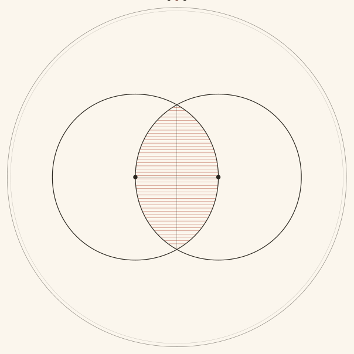

CHAPTER THIRTEEN

# Love: Another Self

*Love and Friendship*

<i>Two circles, each passing through the other’s centre. The shared lens between them is the vesica: neither circle owns it.</i>

> *Charity suffereth long, and is kind.*
>
> — 1 Corinthians 13:4 (KJV)

> **LOVE** · *Whom have I shown up for when it cost me something?*

## I · ◆ The Teaching

109. Love is given freely. Trust is earned slowly. Do not confuse them. You may love someone you cannot yet trust, and trust someone you do not love.
110. Love is not what you feel. It is what you do on the day you do not feel it. Anyone can be loving when it is easy.
111. There are friendships of use, which end when the use ends, and friendships of pleasure, which end when the pleasure fades. The rare friendship is the one where each loves the other’s goodness. That one lasts.
112. A true friend is another self. What you would do for yourself, do for your friend, and expect your friend to tell you the truth you would rather not hear.
113. Of all the things wisdom provides for a happy life, the greatest is friendship. Guard your friendships like treasure, because they are.
114. All real living is meeting. When you truly meet another person, not as a tool or a function but as a whole being, something happens that cannot happen alone.
115. Love is an art, and art wants practice. No one becomes a musician by waiting to feel musical. No one becomes a lover by waiting to feel loving.
116. Keep small promises. The large ones are rarely tested. The small ones are tested every day: the call returned, the hour kept, the thing you said you would do.
117. The one you love is not yours. Love that tries to own becomes a cage, and every cage is broken in the end from the inside. Hold people as you hold water: with an open hand.

## II · ◇ The Five Scales

|  |  |
|---|---|
| **CELL** | Many cells mature only in contact with the right neighbours. Grown alone, they never become what they could be. |
| **SELF** | You too become most fully yourself in the company of those who love you well. |
| **BOND** | Love is the bond in which two selves become more than either could be alone. |
| **COMMUNITY** | A community is the widest circle of friendship: people who choose one another’s good. |
| **COSMOS** | Gravity is the universe’s quiet tendency to draw things together. Love is the human version, and it is a choice. |

## III · The Witnesses

- **Aristotle** · *Nicomachean Ethics* VIII–IX  
  Friendships of utility, pleasure and virtue; only the last endures. A friend is “another self.”
- **Epicurus** · *Principal Doctrines* 27  
  Of all that wisdom provides for a happy life, the greatest is friendship.
- ★ **Paul** · 1 Corinthians 13:4–7  
  Love is patient, kind and enduring: love defined by its conduct, not its feelings.
- **Martin Buber** · *I and Thou* (1923)  
  “All real living is meeting.”
- **Erich Fromm** · *The Art of Loving* (1956)  
  Love is an art that requires knowledge, discipline and practice.

## IV · ● The Tale

### *Whither Thou Goest*

The Book of Ruth tells of Naomi, a widow who has lost both her sons, making ready to go home alone to her own country. She urges her two foreign daughters-in-law to go back to their own families, where they have a future.

One goes. Ruth will not. “Whither thou goest, I will go; and where thou lodgest, I will lodge: thy people shall be my people, and thy God my God.”

Nothing bound her. She gained nothing she could see. She chose to show up for someone at the very moment when showing up cost the most. The tale is set some three thousand years ago, and her words are still spoken at weddings, which tells you what people have always known love to be.

## V · ● The Energy

Love is costly in the moment and fruitful over time. Strong relationships are among the best-documented predictors of long-term health and happiness in modern research. Every hour invested in a real friendship is returned many times over, in years and in joy.

## VI · The Reversal

> Love does not mean tolerating harm. Loyalty to someone who keeps hurting you, or others, is not virtue; it is complicity. You may love from a distance. You may love and still leave. Love without respect becomes possession, and love without self-respect becomes self-erasure.

## VII · ◆ The Practice

|  |  |
|---|---|
| **DAILY** | Each day, keep three small promises and note each one. |
| **WEEKLY** | Each week, show up for someone in a way that costs you something: time, comfort or pride. |

## VIII · The Ledger

|  |  |
|---|---|
| **PEACE** | Did I love without trying to control? |
| **LOVE** | Did I show up when it was inconvenient? |
| **UNITY** | Did I make a friend, or deepen one? |
| **RESPECT** | Did I keep my word in the small things? |

## IX · The Song

*Fair-weather friends are a common coin,* 
*And they spend as easy as found;* 
*But the one who comes when the roof is down* 
*And the creditors stand around,* 
*Who asks no price and who keeps no score,* 
*And who tells you the truth to your face,* 
*Is worth the whole of the market-town,* 
*And the town is a poorer place.*

---

[← Peace: The Unsent Letter](12-peace-the-unsent-letter.md) &nbsp;·&nbsp; [Contents](../README.md) &nbsp;·&nbsp; [The Root →](14-the-root.md)

