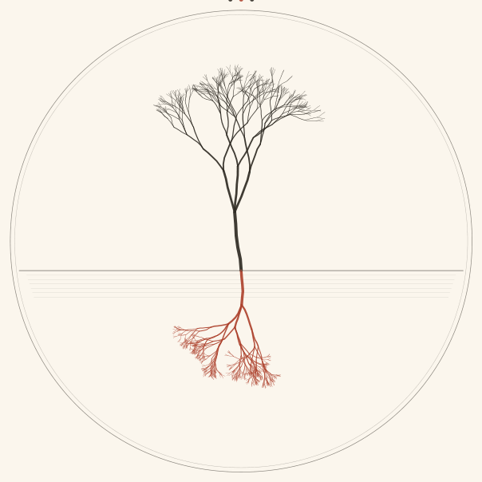

CHAPTER FOURTEEN

# The Root

*Family*

<i>A tree and its roots, grown from one seed by the same branching rule, above the ground and below it.</i>

> *Honour thy father and thy mother.*
>
> — Exodus 20:12 (KJV)

> **RESPECT** · *What did I inherit that I am grateful for, and what must I transform?*

## I · ◆ The Teaching

118. You did not choose your roots. No one does. But you choose what grows from them.
119. Filial love is the root of humaneness. Whoever learns to care for those who raised him learns the first shape of caring for anyone.
120. Honour does not require pretending. You can honour the life you were given and the people who gave it while seeing their faults plainly. Clear sight and honour can live in the same heart.
121. Write down what you were given. A good emperor began his private book not with his achievements but with a long list of what he had learned from each person who shaped him. Begin your own.
122. You carry your family in you, as a converted cell carries the memory of its origin. That memory is lineage, not destiny.
123. Some families wound. If yours did, you are not bound to repeat the wound. The pattern can end with you. That too is a way of honouring your line.
124. Family is not only blood. It is also the people who chose you and whom you chose. Build that family on purpose.
125. Be the kind of ancestor you would want to have. Someone, someday, will inherit what you leave in them.
126. Call home. Not because you must, but because one day you will not be able to.

## II · ◇ The Five Scales

|  |  |
|---|---|
| **CELL** | Every cell in you descends from a single fertilized egg. Your whole body is one family of cells. |
| **SELF** | You descend from an unbroken chain of ancestors reaching back to the beginning of life. |
| **BOND** | A family is the first bond, and it teaches the grammar of all the others. |
| **COMMUNITY** | Families are the cells of a society; their health is its health. |
| **COSMOS** | Every atom in you has a lineage that runs back to the first moments of the universe. |

## III · The Witnesses

- ★ **Confucius** · *Analects* 1.2  
  Filial piety and fraternal respect are the root of humaneness. It converges with the Fifth Commandment.
- **The Decalogue** · Exodus 20:12  
  “Honour thy father and thy mother: that thy days may be long upon the land.”
- **Ptahhotep** · *The Maxims of Ptahhotep*  
  An ancient Egyptian teaching, framed as a vizier instructing his son, on how to live well and keep a household.
- **Marcus Aurelius** · *Meditations* Book 1  
  A whole book of named gratitude: what he learned from his grandfather, his mother, his teachers and friends.

## IV · ● The Tale

### *The Book of What I Was Given*

The *Meditations* of Marcus Aurelius do not open with philosophy. They open with gratitude. Book One is a list: from his grandfather, good morals and the government of his temper; from his mother, piety and generosity, and simplicity in living; from his tutors, endurance of labour and wanting little; from his adoptive father, mildness of temper and unwavering firmness in decisions reached after deliberation.

The most powerful man in the world began his private thoughts by naming his debts. He understood that a self is not self-made. It is assembled, piece by piece, from what others gave.

## V · ● The Energy

Family patterns run on inherited momentum: habits of speech, of anger, of love, handed down without anyone deciding. Breaking a harmful pattern takes deliberate force at first, like pushing a ball over a ridge into a new valley. Once across, the new pattern becomes the momentum your own children inherit.

## VI · The Reversal

> “Honour your parents” has been used to silence people who were harmed by them. Honour never requires you to accept abuse, to stay in danger, or to keep secrets that shelter harm. Protecting yourself is not dishonour. Sometimes the most honourable thing is distance.

## VII · ◆ The Practice

|  |  |
|---|---|
| **DAILY** | Each day, thank one person, aloud or in your mind, for something they gave you. |
| **WEEKLY** | Each week, add a line to your own Book of What I Was Given. |

## VIII · The Ledger

|  |  |
|---|---|
| **PEACE** | Did I make peace with something I inherited? |
| **LOVE** | Did I reach out to family, by blood or by choice? |
| **UNITY** | Did I strengthen the circle that raised me, or the one I am building? |
| **RESPECT** | Did I honour my roots while still choosing my own growth? |

## IX · The Song

*The oak is as deep as the oak is high,* 
*Though the half of it none may see;* 
*And the root that holds in the winter gale* 
*Was a gift to the growing tree.* 
*So give your thanks to the hidden root,* 
*And grow as the root would ask;* 
*And leave in the earth for the ones to come* 
*A root that is fit for the task.*

---

[← Love: Another Self](13-love-another-self.md) &nbsp;·&nbsp; [Contents](../README.md) &nbsp;·&nbsp; [The Living Word →](15-the-living-word.md)

