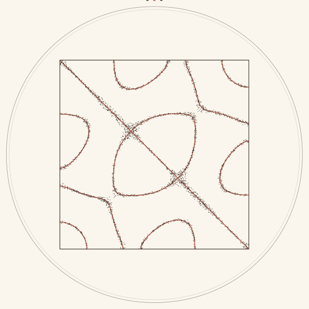

CHAPTER FIFTEEN

# The Living Word

*Speech, Language and Energy*

<i>A Chladni figure: sand on a sounding plate gathers along the lines that stay still. Sound gives the sand its form.</i>

> *Death and life are in the power of the tongue.*
>
> — Proverbs 18:21 (KJV)

> **LOVE** · *Did my words today build, or did they spend?*

## I · ◆ The Teaching

127. Words are the energy you spend most often and notice least. Each one builds the bond or draws it down.
128. How you say a thing carries as much as what you say. The voice carries feeling, and some of it, such as fear, anger and laughter, can be heard even across peoples who share no language.
129. Name the feeling and it loosens its grip. Research suggests that putting an emotion into words is one of the simplest regulators the brain has.
130. A promise is a bridge built of words across the unknown future. Make few. Keep all.
131. Speak the truth, kindly, at the right time. Truth without kindness wounds. Kindness without truth deceives. Both, at the wrong time, are wasted.
132. Before you speak, run the old test: is it true, is it needed, is it kind?
133. Listen as if you might be changed. Most people listen only in order to reply.
134. Say what you saw, what you feel, what you need and what you ask, without accusation. It is harder than attacking, and it works better.
135. The words you say to yourself are the ones you hear most often. Make them worth hearing.

## II · ◇ The Five Scales

|  |  |
|---|---|
| **CELL** | Cells speak in chemical words, signals telling their neighbours to grow, to wait or to die. Life is conversation all the way down. |
| **SELF** | Inner speech shapes what you notice and what you dare to attempt. |
| **BOND** | Bonds live or die in daily small words more than in grand speeches. |
| **COMMUNITY** | A people’s laws, promises and stories are made of words. Corrupt the words and you corrupt the people. |
| **COSMOS** | In many traditions the world begins with a word. Take it as poetry: speech is how minds bring new order into being. |

## III · The Witnesses

- ★ **The Buddha** · Right Speech, the Noble Eightfold Path  
  Speech that is truthful, harmonious, gentle and purposeful. It converges with the Epistle of James and Confucius on the weight of words.
- **James** · James 3:5 (KJV)  
  “The tongue is a little member, and boasteth great things.”
- **Matthew Lieberman and colleagues** · *Psychological Science* (2007)  
  Naming the emotion on a face lowered activity in the brain’s alarm system, compared with naming something else about it: affect labelling.
- **Disa Sauter and colleagues** · *PNAS* (2010)  
  Vocal sounds of some emotions, especially negative ones and laughter, were recognized across cultures that share no language; later studies dispute how far this reaches.
- **Marshall Rosenberg** · *Nonviolent Communication* (1999)  
  Observations, feelings, needs and requests: a grammar for speaking without attack. Widely used, weakly tested.

## IV · ● The Tale

### *Two Speeches at Gettysburg*

On November 19, 1863, at the dedication of the cemetery at Gettysburg, the featured orator was Edward Everett, the most celebrated speaker in America. He spoke for about two hours.

Abraham Lincoln followed with about two hundred and seventy words, in roughly two minutes. The next day Everett wrote to him that he wished he had come as near to the central idea of the occasion in two hours as Lincoln had in two minutes.

Energy in speech is not volume or length. It is truth, compression and timing. Lincoln spent far fewer words than the featured orator, and his are the ones still spoken.

## V · ● The Energy

Speech is cheap to make and dear to repair. A sentence takes seconds; the trust it damages can take months to rebuild. And the voice is an instrument of the body: tone, pace and breath carry your state into a room before your argument does. Settle the breath and the voice follows.

## VI · The Reversal

> Popular claims about language are full of myths. The famous claim that only seven percent of meaning lies in words misreads two small 1967 studies of single words and photographs expressing liking or dislike; their author says the figures do not apply unless a speaker is talking about feelings or attitudes. And words are not spells: saying a thing does not make it so in the world, only in minds. Speak with energy, but never confuse persuasion with truth.

## VII · ◆ The Practice

|  |  |
|---|---|
| **DAILY** | Before one important conversation each day, decide the one true thing you want to say, and say it plainly. |
| **WEEKLY** | Each week, hold one conversation in which you only listen and ask, then reflect back what you heard. |

## VIII · The Ledger

|  |  |
|---|---|
| **PEACE** | Did I name a feeling instead of acting it out? |
| **LOVE** | Did my words build someone up? |
| **UNITY** | Did I listen as if I might be changed? |
| **RESPECT** | Did I keep every promise I made with words? |

## IX · The Song

*The sand on the plate is a scattered thing* 
*Till the bow is drawn on the rim;* 
*Then it runs to the lines where the stillness is,* 
*And the shape is a shape to the hymn.* 
*So mind what you sound when you speak to a soul,* 
*For the soul is a plate of sand,* 
*And it gathers itself to the word that you give* 
*In a form you never planned.*

---

[← The Root](14-the-root.md) &nbsp;·&nbsp; [Contents](../README.md) &nbsp;·&nbsp; [Unity: Through Other Persons →](16-unity-through-other-persons.md)

