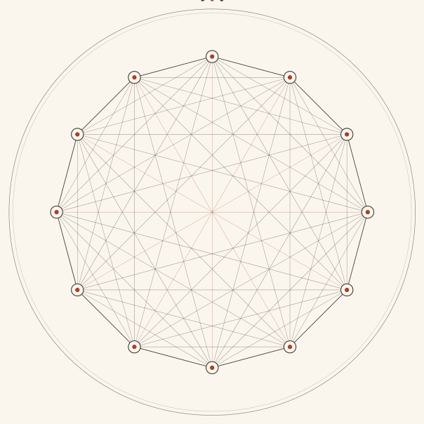

CHAPTER SIXTEEN

# Unity: Through Other Persons

*Community*

<i>Twelve points on a ring, every one joined to every other: sixty-six bonds, and no member left at the edge.</i>

> *For the strength of the Pack is the Wolf, and the strength of the* *Wolf is the Pack.*
>
> — Rudyard Kipling, “The Law of the Jungle” (1895)

> **UNITY** · *Will this room be better because I came?*

## I · ◆ The Teaching

136. A person is a person through other persons. Remove every relation from your life and see what is left: not a self, but the outline of where a self could have been.
137. What is not good for the swarm is not good for the bee. Whatever you take from the circle, you take from yourself.
138. Everyone is welcome in the circle. Not everyone is trusted with its fire. Open the door to all; hand the torch to those who have shown they will carry it.
139. Your place in the circle is not given by the circle. It is earned by what you add to it. Ask each time you enter a room: will this room be better because I came?
140. Unity is not sameness. A choir in which every voice sings the same note is not harmony; it is noise made louder. Seek out the voice that disagrees with you.
141. Build a fellowship, not a following. Those who follow a person fall with that person. Those who share a purpose outlast any one of them.
142. Beware the unity that needs an enemy. A crowd bound by what it hates is held together by the same rope that will strangle it.
143. Welcome the newcomer as you wish you had been welcomed. The circle is renewed only by those who are let in.
144. When the circle breaks, do not ask who broke it first. Ask what each of you can carry back to mend it.

## II · ◇ The Five Scales

|  |  |
|---|---|
| **CELL** | A single cell becomes an organ only together with others. Alone, it is a cell. Together, they are a heart. |
| **SELF** | Your talents become real only when they meet other people’s needs. |
| **BOND** | Every friendship is a community of two. |
| **COMMUNITY** | We are caught in an inescapable network of mutuality: what touches one directly touches all indirectly. |
| **COSMOS** | Galaxies cluster, stars form in nurseries, and nothing in the universe is truly alone. |

## III · The Witnesses

- ★ **Ubuntu** · *Umuntu ngumuntu ngabantu*; explained by Desmond Tutu, *No Future*  
  Without Forgiveness *(1999)* A person is a person through other persons. It converges with Aristotle’s *Politics* I.2, Marcus Aurelius and Donne.
- **Marcus Aurelius** · *Meditations* 6.54  
  “That which is not good for the swarm, neither is it good for the bee.” (Long)
- **John Donne** · *Devotions upon Emergent Occasions* (1624)  
  “No man is an island, entire of itself; every man is a piece of the continent, a part of the main.”
- **Martin Luther King Jr.** · “Letter from Birmingham Jail” (1963)  
  We are caught in an inescapable network of mutuality, tied in a single garment of destiny.
- **The Haudenosaunee** · The Great Law of Peace  
  The Peacemaker and Hiawatha united warring nations beneath the Tree of Peace.
- **Émile Durkheim** · *The Elementary Forms of Religious Life* (1912)  
  “Collective effervescence”: the surge of shared energy when people gather in common purpose, the scholar’s name for what happens on a dance floor at its best.

## IV · ● The Tale

### *Three Councils*

The Haudenosaunee Confederacy joined the Mohawk, Oneida, Onondaga, Cayuga and Seneca nations under a constitution remembered as the Great Law of Peace; the Tuscarora joined around 1722. Its founding date is debated, but it endured for centuries through councils, consensus and clearly defined roles. In 1751 Benjamin Franklin, writing in the contemptuous language of his time, argued that if these nations could form a lasting union, surely a dozen English colonies could do the same.

In 1860 Abraham Lincoln won the presidency and then gave the men who had competed against him for the nomination, William Seward, Salmon Chase and Edward Bates, the most powerful posts in his government. Several of them thought themselves his betters. He used their talent and held a quarrelsome coalition together through the nation’s worst crisis.

In April 1961 President Kennedy approved the Bay of Pigs invasion after advisers with serious doubts kept them to themselves. It failed within days. Eighteen months later, in the Cuban Missile Crisis, he ran his councils differently. By Robert Kennedy’s account, the President sometimes stayed away so that the group would argue freely. The crisis ended without war.

## V · ● The Energy

Gatherings generate something none of the people bring alone. The sociologist Durkheim called it collective effervescence: the lift of shared purpose. It is a social and psychological thing, not a mysterious field, and it is real. A community is a way of multiplying human energy without making it from nothing.

## VI · The Reversal

> Belonging can curdle into conformity. A circle that punishes every dissenting voice has stopped being a community and become a mob. And unity can be a mask for exclusion: “us” is always in danger of being defined by “them.” Keep the door open and the talk honest.

## VII · ◆ The Practice

|  |  |
|---|---|
| **DAILY** | Each day, do one small thing that makes a shared space better: hold a door, clear a table, learn a name. |
| **WEEKLY** | Each week, welcome one newcomer properly, or seek out one voice that disagrees with you. |

## VIII · The Ledger

|  |  |
|---|---|
| **PEACE** | Did I bring calm to a group, or noise? |
| **LOVE** | Did I welcome someone who stood outside the circle? |
| **UNITY** | Did I build a fellowship or a following? |
| **RESPECT** | Did I let a dissenting voice be heard? |

## IX · The Song

*Twelve round a fire on a winter night,* 
*And never a back to the cold;* 
*The young at the hearth and the strangers in,* 
*And the tales of the old retold.* 
*For the fire is fed by each one’s wood,* 
*And it warms by each one’s share;* 
*And the man who brings no stick to the blaze* 
*Has no right to the warmth that’s there.*

---

[← The Living Word](15-the-living-word.md) &nbsp;·&nbsp; [Contents](../README.md) &nbsp;·&nbsp; [Respect: The Floor and the Ceiling →](17-respect-the-floor-and-the-ceiling.md)

