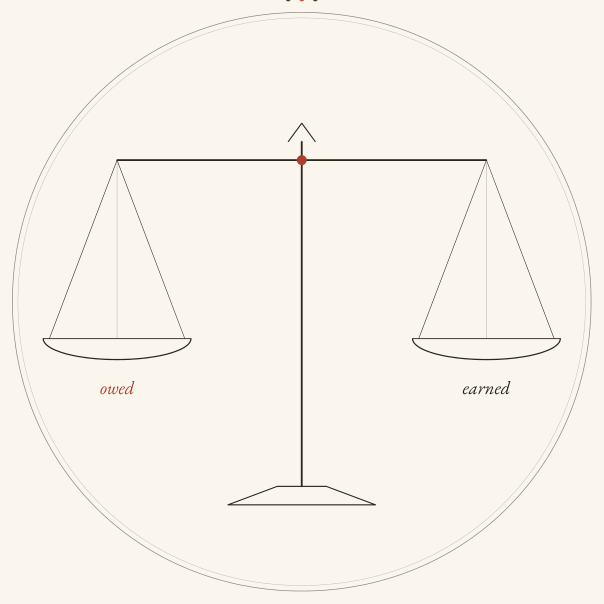

CHAPTER SEVENTEEN

# Respect: The Floor and the Ceiling

*Respect, Dignity and Justice*

<i>The balance: on one pan, what is owed to everyone; on the other, what must be earned. The beam is level only when both are kept.</i>

> *What is hateful to you, do not do to your fellow: this is the whole* *Torah; the rest is commentary.*
>
> — Hillel, Babylonian Talmud, *Shabbat* 31a

> **RESPECT** · *Did I give the floor to everyone today, even the ones I would rather not?*

## I · ◆ The Teaching

145. Dignity is owed. Respect is earned. Role courtesy is offered, and revoked by abuse. What is extracted by threat is not respect; it is fear wearing respect’s mask.
146. Every person stands on a floor of dignity that you did not grant and cannot revoke. Never lower the floor to punish someone who has not reached the ceiling.
147. You may withhold your trust, your praise and your friendship from those who have not earned them. You may never withhold their dignity. The moment you do, you teach the world the floor was never real, and you stand on it too.
148. Respect is the ceiling, built plank by plank by conduct seen over time. No title raises it. No birth raises it. No crowd raises it.
149. When you demand respect, you announce that you have not earned it. Whoever has earned it never needs to ask.
150. At the floor, respect flows in every direction or it does not flow. Give it only upward and you are a servant. Give it only downward and you are a tyrant. Roles may shape courtesy; they never lower the floor.
151. What is hateful to you, do not do to another. Then go further: do not do to others what you would not accept if you stood where they stand, with their values. That is the whole of the law. The rest is commentary.
152. Do justly. Love mercy. Walk humbly. Three instructions, and a lifetime to keep them.
153. Keep a ledger, not of others, but of yourself. What did you give, what did you earn, what did you spend? Read it honestly every week.

## II · ◇ The Five Scales

|  |  |
|---|---|
| **CELL** | Healthy cells respect one another’s boundaries. When a cell ignores every signal to stop and takes from all around it, we call it cancer. |
| **SELF** | Self-respect has two halves: the dignity you are owed, and the standards you earn. |
| **BOND** | In a healthy bond, each gives the other the floor and earns from the other the ceiling. |
| **COMMUNITY** | Justice is a community’s way of keeping the floor level for everyone. |
| **COSMOS** | Nothing in the universe is beneath notice. Every particle obeys the same laws as every star. |

## III · The Witnesses

- **Immanuel Kant** · *Groundwork of the Metaphysics of Morals* (1785), Ak. 4:429, 4:434–  
  *435* Treat humanity always as an end, never merely as a means; everything has either a price or a dignity.
- **Stephen Darwall** · “Two Kinds of Respect,” *Ethics* 88 (1977)  
  Recognition respect is owed to every person; appraisal respect is a judgment of character that must be earned.
- ★ **The Golden Rule** · Hillel, *Shabbat* 31a; *Analects* 15.24; Matthew 7:12; Leviticus 19:18  
  Found independently across traditions: do not do to others what you would not want done to you.
- **Mencius** · *Mencius* 2A6  
  Anyone who suddenly sees a child about to fall into a well feels alarm and compassion: the sprouts of goodness are in everyone.
- **The Prophet Micah** · Micah 6:8  
  “Do justly, and to love mercy, and to walk humbly.”
- **The Anishinaabe** · The Seven Grandfather Teachings  
  Wisdom, Love, Respect, Bravery, Honesty, Humility and Truth, held as oral teachings whose forms vary among communities.

## IV · ● The Tale

### *Tea in Orania*

Nelson Mandela spent twenty-seven years in prison under apartheid. As president he did not repay its architects in kind. On August 15, 1995, he flew to Orania, a remote settlement founded as a refuge for Afrikaners, to take tea with Betsie Verwoerd, the ninety-four-year-old widow of Hendrik Verwoerd, the prime minister most associated with building apartheid.

Earlier that year, at the Rugby World Cup final at Ellis Park on June 24, he walked onto the field wearing the green Springbok jersey of the team’s captain, a jersey long seen as a symbol of white rule. The crowd, mostly white, began to chant his name.

Each gesture extended the floor of dignity to people who had denied it to him. Each disarmed opponents who had expected revenge.

Set beside them the photographs from Abu Ghraib prison, broadcast in April 2004, which showed detainees stripped of the most basic dignity. Whatever those prisoners had done, the images became one of the most damaging recruiting tools America’s enemies ever had.

Lower the floor beneath anyone, and the whole house shakes.

## V · ● The Energy

Respect works like stored energy in a community: trust built up over years lets people cooperate quickly, without contracts or guards. Contempt drains that store. A workplace, a family or a nation where dignity is routinely denied must spend enormous energy on control, because it can no longer rely on good faith.

## VI · The Reversal

> Keeping the floor does not mean removing consequences. A person who has done harm can be stopped, held to account and kept from doing it again, all without being stripped of their humanity. Accountability is compatible with dignity. Cruelty is not. And earning respect does not mean chasing everyone’s approval: some will withhold it unjustly, and that is their ledger, not yours.

## VII · ◆ The Practice

|  |  |
|---|---|
| **DAILY** | Each day, extend dignity to one person you would rather not: the rude stranger, the rival, the one who wronged you. |
| **WEEKLY** | Each week, keep your Respect Ledger: what you gave, what you earned, what you spent. |

## VIII · The Ledger

|  |  |
|---|---|
| **PEACE** | Did I keep the floor even when I was provoked? |
| **LOVE** | Did I treat someone as an end, not a means? |
| **UNITY** | Did I give respect in every direction, up, down and across? |
| **RESPECT** | Did I earn anything today, or only demand it? |

## IX · The Song

*There’s a floor that was laid before you came,* 
*And it runs beneath every door;* 
*The beggar, the king and the enemy stand* 
*On the very same planks of the floor.* 
*But the roof you must raise with your own two hands,* 
*And raise it by what you do;* 
*And no man can lend you a single beam,* 
*And no man can take it from you.*

---

[← Unity: Through Other Persons](16-unity-through-other-persons.md) &nbsp;·&nbsp; [Contents](../README.md) &nbsp;·&nbsp; [Repair →](18-repair.md)

