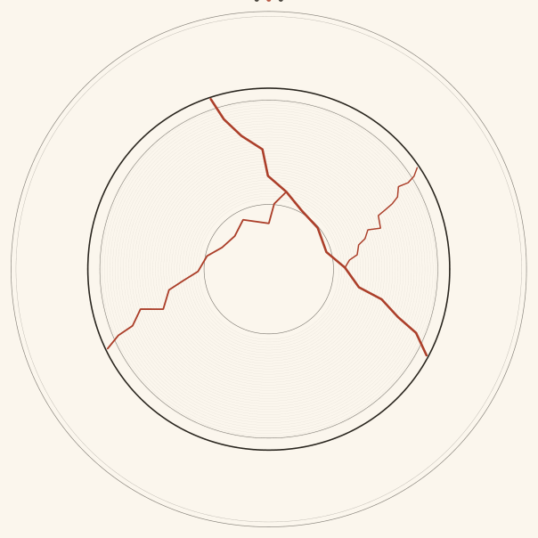

CHAPTER EIGHTEEN

# Repair

*Conflict, Repair and Forgiveness*

<i>Kintsugi: the broken bowl mended with gold. The break is not hidden; it becomes the most visible line in the vessel.</i>

> *With malice toward none, with charity for all.*
>
> — Abraham Lincoln, Second Inaugural Address, March 4, 1865

> **LOVE** · *Who is reaching toward me, and will I take the hand?*

## I · ◆ The Teaching

154. Every bond will break at some point. The question is never whether, but whether it will be mended.
155. After a rupture, someone must move first. Pride tells you to wait until the other has crawled. Pride is a poor counsellor. Every hour of delay hardens the injury into identity.
156. If you bring your gift to the altar and there remember that your brother has something against you, leave your gift and go first to be reconciled. Repair comes before ritual.
157. Separate the person from the act. The act may be judged. The person keeps the floor. Then ask three questions: What happened? Who was harmed? What would make it right?
158. When you have done harm, name it exactly. Apologize without “but.” Make it right in a way that costs you something. Then keep behaving well long after anyone is watching.
159. Repentance is complete when you meet the same situation again, with the same power and the same temptation, and choose otherwise.
160. Forgiveness is the only remedy for the fact that what is done cannot be undone. The promise is the only remedy for the fact that the future cannot be known. Forgive, and promise.
161. A peace held in place by humiliation is only a pause between wars. Build a peace in which your former enemy has something to lose by breaking it.
162. Take the reaching hand quickly the first time; the second time, ask what has changed. Forgive inwardly as often as it takes, because you refuse to let the harm own you. Restore access only as fast as conduct changes.

## II · ◇ The Five Scales

|  |  |
|---|---|
| **CELL** | Your cells repair damage to their DNA constantly, many thousands of times a day. Life is not the absence of damage; it is the habit of repair. |
| **SELF** | You will fail yourself. Self-repair is the practice of beginning again without self-contempt. |
| **BOND** | A bond that has been broken and well mended can be stronger than one never tested. |
| **COMMUNITY** | Societies that repair after conflict, through justice and reconciliation, escape the next war. |
| **COSMOS** | Even after catastrophe, the forests grow back. The world has a long habit of mending. |

## III · The Witnesses

- **Hannah Arendt** · *The Human Condition* (1958), §§33–34  
  Forgiveness answers the irreversibility of action; the promise answers its unpredictability.
- **Maimonides** · *Mishneh Torah*, Laws of Repentance 2:1–2  
  Complete repentance is shown when one meets the same situation with the same power and does not repeat the wrong.
- ★ **Jesus** · Matthew 5:23–24; 18:21–22  
  Reconcile with your brother before you offer your gift; forgive not seven times but seventy times seven.
- **Desmond Tutu** · *No Future Without Forgiveness* (1999)  
  Forgiveness as practical politics, rooted in Ubuntu: without it, there is no future.

## IV · ● The Tale

### *Two Peaces*

The Treaty of Versailles, signed on June 28, 1919, held Germany responsible for the losses of the war as the basis for reparations, stripped it of territory and laid heavy payments upon it. It was strong enough to wound and too weak to hold. Within a generation a demagogue had built a movement on the grievance it created.

After 1945 the United States took the opposite road. Through the Marshall Plan, signed into law in April 1948, Congress appropriated about thirteen billion dollars over four years for European recovery, including for the western zones of its recent enemy. By 1951 France and West Germany had agreed to pool their coal and steel under a common authority. A new war between them became nearly unthinkable.

And on April 9, 1865, at Appomattox Court House, Ulysses Grant accepted Lee’s surrender on generous terms. Confederate soldiers could go home; officers kept their sidearms and their horses; men who owned horses or mules could take them home for the spring ploughing. Grant sent twenty-five thousand rations to the starving army and stopped the celebratory salute of his own guns. He wrote later that he did not want to exult over their downfall.

## V · ● The Energy

A grudge is a debt on which you keep paying interest. It occupies memory, troubles sleep and colours every new encounter. Repair releases that energy. Research on trust also gives a practical rule: an apology mends failures of competence better than failures of integrity, and when trust has been broken by deceit, promises and apologies help only when consistent conduct follows them. Words open the door. Behaviour walks through it.

## VI · The Reversal

> Forgiveness is not the same as reconciliation, and neither is the same as trust. You can forgive someone and never let them near you again. A hand held out by someone who keeps harming you is not reconciliation; it is a tactic. And no one should be pressed to forgive on someone else’s timetable. Repair is a process, not a password.

## VII · ◆ The Practice

|  |  |
|---|---|
| **DAILY** | Each day, take any reaching hand quickly, and reach first when you were the one at fault. |
| **WEEKLY** | Each week, name one harm you have done, apologize without “but,” make it right, and check back in a month. |

## VIII · The Ledger

|  |  |
|---|---|
| **PEACE** | Did I let an old injury steer a new moment? |
| **LOVE** | Did I move first toward repair? |
| **UNITY** | Did I leave my opponent a road back to the circle? |
| **RESPECT** | Did I own my part, exactly and without excuses? |

## IX · The Song

*The bowl was dropped, and the bowl was split,* 
*And the pieces lay on the stone;* 
*And the fool said, “Throw it out with the ash,”* 
*And the wise said, “Leave it alone.”* 
*Then he gathered the shards and he filled every seam* 
*With a river of honest gold;* 
*And the bowl that was broken is dearer now* 
*Than the bowl that was never old.*

---

[← Respect: The Floor and the Ceiling](17-respect-the-floor-and-the-ceiling.md) &nbsp;·&nbsp; [Contents](../README.md) &nbsp;·&nbsp; [The Work →](../4-the-work/README.md)

