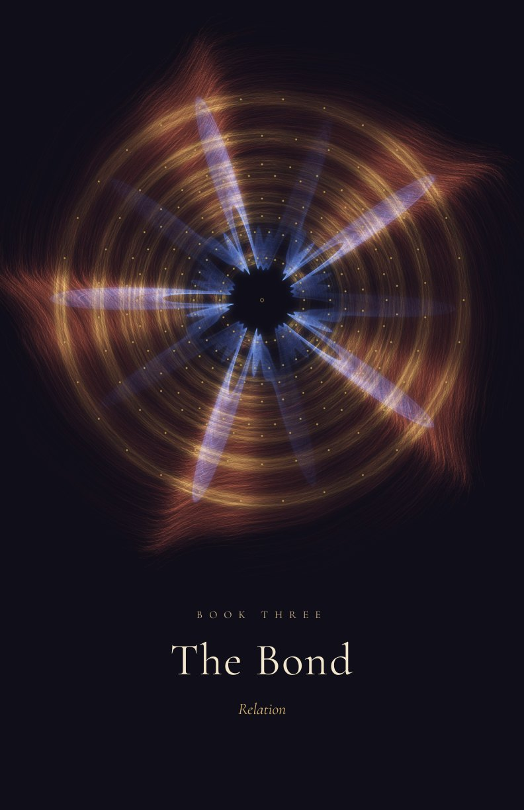

BOOK THREE

# The Bond

*Connection is the responsibility you may choose. No one lives alone, and no one becomes a self alone. This Book concerns the bonds through which your reality is woven: peace with others, love and friendship, family, the living word, community, respect, and the repair of what breaks. Here the four words of the creed come fully alive.*

12. [Peace: The Unsent Letter](12-peace-the-unsent-letter.md)
13. [Love: Another Self](13-love-another-self.md)
14. [The Root](14-the-root.md)
15. [The Living Word](15-the-living-word.md)
16. [Unity: Through Other Persons](16-unity-through-other-persons.md)
17. [Respect: The Floor and the Ceiling](17-respect-the-floor-and-the-ceiling.md)
18. [Repair](18-repair.md)

---

[← The Last Freedom](../2-the-light/11-the-last-freedom.md) &nbsp;·&nbsp; [Contents](../README.md) &nbsp;·&nbsp; [Peace: The Unsent Letter →](12-peace-the-unsent-letter.md)

