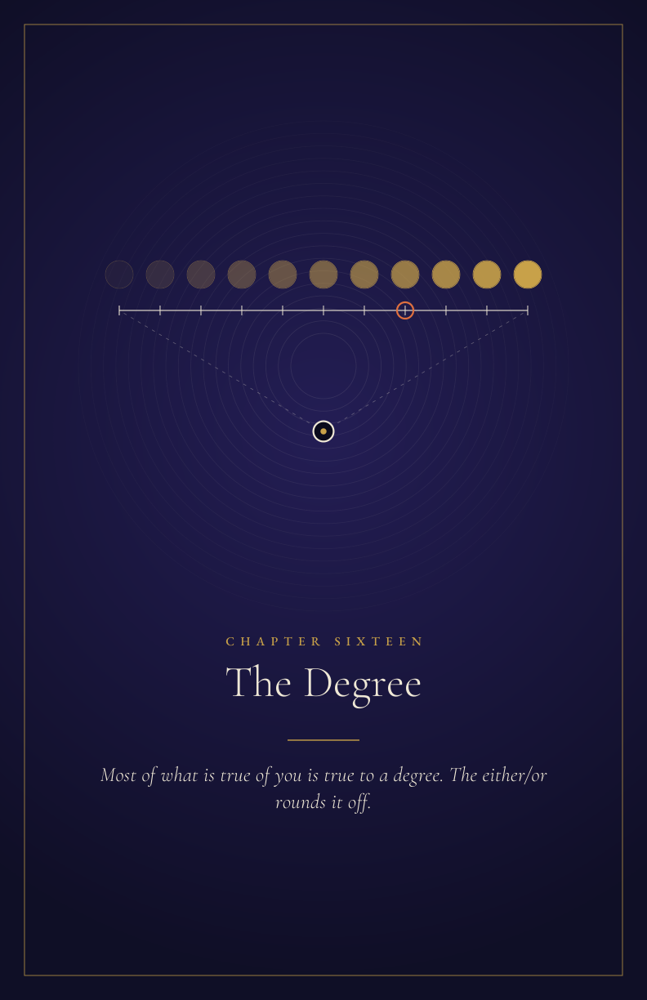
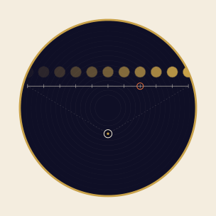
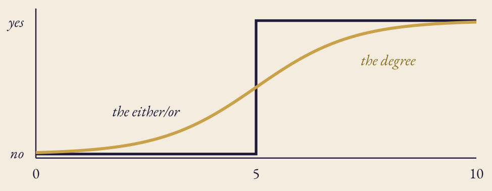
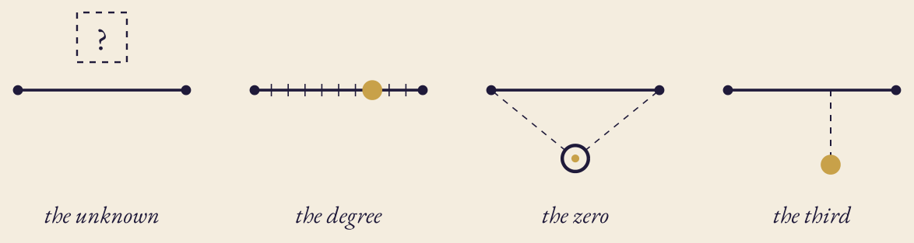

THE GEOMETRY OF EXISTENCE · LEVEL THREE · THE DEGREE · PAGES 106–110

  

CHAPTER SIXTEEN

# The Degree

> *Most of what is true of you is true to a degree. The either/or rounds it off.*

  

A light switch has two positions. A dimmer has every position between them. Most of what matters in a life is a dimmer that somebody reported as a switch.

Are you a patient person? The honest answer is not yes and it is not no. It is *somewhat* — more with strangers than with family, more in the morning than at night. The either/or of Chapter Five takes that honest somewhat and rounds it: anything past the middle is called yes, anything short of it is called no, and the rounding is then mistaken for the fact.

That is one exact form of the compression this manual has been naming since its first page. **A binary is a degree that has been rounded.**

  

<i>The same fact, reported two ways. The stepped line is the either/or. The curve is what was</i>

<i>there before the rounding.</i>

`ON RECORD` The idea has a date. In 1965 Lotfi Zadeh, an engineer at Berkeley, published a paper called “Fuzzy Sets.” It let a thing belong to a class to a grade anywhere from zero to one, and it showed that the ordinary all-ornothing class is only the special case in which every grade happens to be zero or one. Forty-five years earlier the logician Jan Łukasiewicz had already built a working logic with a third value, for what is possible but not yet settled. Neither man broke logic. Each showed that two values had been a choice.

Now the care this chapter exists for. There are four different things people call “the middle,” and a life goes wrong by confusing them.

**The unknown.** One of the two answers is correct and you do not know which. This is the waiting room of Chapter One. `ON RECORD` The standard database language handles a missing value exactly this way: a comparison against it comes out *unknown*, and when the system has to act — when it selects rows — it keeps only what is true. The unknown is thrown out with the false. A binary with a waiting room is still a binary, and the machines prove it every second.

**The degree.** Nothing is unknown. You have looked. The glass is seven-tenths full, and looking again will not make it full or empty. A degree is a settled fact about a thing that is partly one way and partly the other.

**The zero.** The middle you stand in — the kept ground of Chapter Eight. It is not a number on any line. It is the place from which the lines can be seen.

**The third.** Built underneath the pair, off its line altogether.

Here is the sentence that keeps this chapter honest: **a degree is not the third.** A degree is a position on the pair’s own line. Five out of ten is exactly the midpoint Chapter Six told you to refuse as a solution. Grading tells you more precisely where you stand on the axis. It never leaves the axis. Only building does that.

  

<i>Four middles. The unknown waits to become one of two. The degree sits on the line. The zero is where you stand to see the line. The third is off the line.</i>

So what is the degree for? It is for seeing truly before you build. It does three jobs.

It restores size. “I am a failure” is a rounding. “This project stands at three out of ten” is a measurement, and a three can be worked.

It shows movement. From three to four is real progress, and the either/or cannot see it, because both are still “no.” People quit things that were working because their only instrument had two readings.

It makes the audits honest. Chapter Seven asked whether your ground is owned or rented. Almost no floor is purely either. Ask instead: *how far is this floor mine?*

A degree is not a chance. “There is a seventy percent chance the door is locked” is doubt about a yes-or-no fact, and it ends when you try the handle. “The door is seven-tenths shut” is no doubt at all. Do not let one stand in for the other.

Two cautions, and then the practice.

The first: the number is not exact. Nobody’s patience is 0.73 rather than 0.72, and a book that pretended otherwise would be trading one false precision for another. `ARGUED` Philosophers do not agree that truth itself comes in degrees; some hold that every such question has a sharp answer we merely cannot find. This manual takes the degree as an instrument, not a doctrine. Use coarse marks — zero to ten — and anchor both ends in plain words.

The second: “it’s about a five, it’s complicated” is the waiting room with a number painted on the door. A grade that names nothing that would move it is a null. Every grade in this book comes with the observation that would raise it and the observation that would lower it. Without those, you have not graded. You have deferred in decimals.

> **▲ Practice**
>
> Take the binary you named in Chapter Five. Draw one line. Write what zero means at the left end and what ten means at the right, in plain words a stranger could check. Mark where you stand today. Then write two sentences: *this mark goes up one when I see —* and *this mark goes down one when I see —*. Keep the page. You will need it in Chapter Eighteen.

> **◆ Audit**
>
> Where do you use “sort of,” “kind of,” or “it’s complicated” as a place to hide? Pick one. Give it a line, two anchors, a mark, and the two observations. If you cannot name what would move the mark, say so plainly: it was never a degree. It was a waiting room.

---

[← Level Three · The Degree](README.md) · [Contents](../README.md) · [PDF ↓](../../edition/README.md) · [The Weakest Link →](17-the-weakest-link.md)

