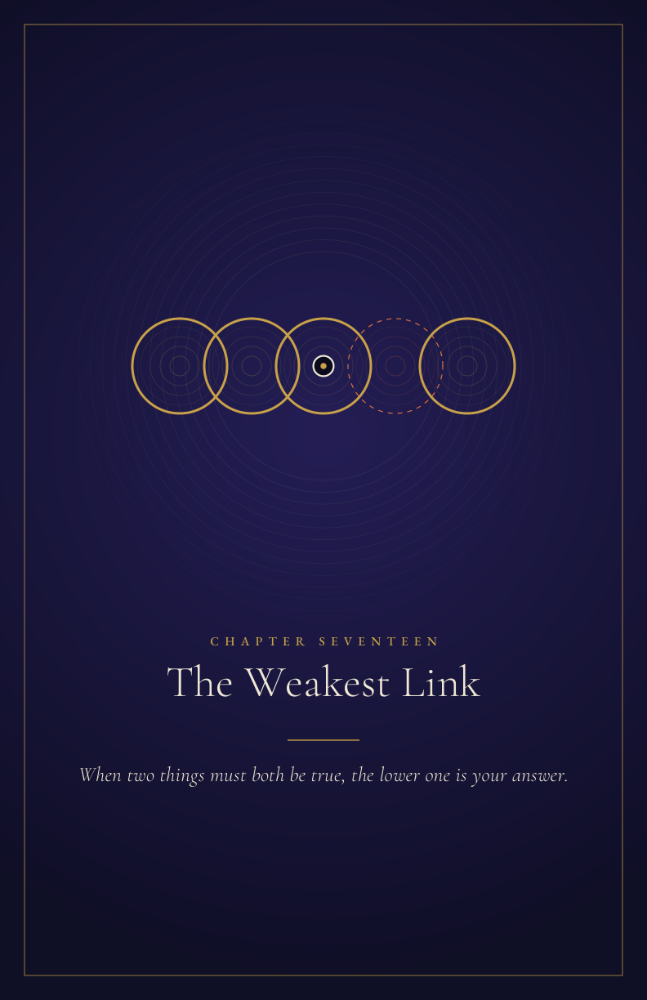
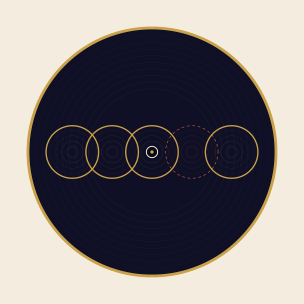
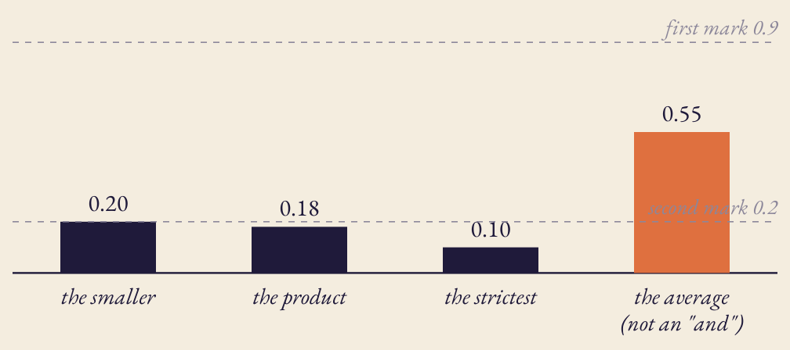

THE GEOMETRY OF EXISTENCE · LEVEL THREE · THE DEGREE · PAGES 111–114

  

CHAPTER SEVENTEEN

# The Weakest Link

> *When two things must both be true, the lower one is your answer.*

  

A bridge with one sound pier and one cracked pier is not a medium bridge.

You know this about bridges. You forget it about yourself. You score a conversation that was nine parts honest and two parts kind as “pretty good,” and you are puzzled when the other person does not come back.

The rule of this chapter is short. **When both are required, take the lower.**

`DEMONSTRATED` In graded logic the standard “and” of two degrees is the smaller of the two, and every well-behaved way of forming a graded “and” gives a result no higher than the smaller. Put nine-tenths with two-tenths: the smaller is 0.2; multiplying gives 0.18; the strictest standard form gives 0.1. The average says 0.55. No form of “and” says 0.55. Only averaging does, and averaging is a different operation that answers a different question.

  

<i>Nine-tenths and two-tenths, combined four ways. Three are forms of “and.” The fourth is an average, which lets the strong score pay for the weak one.</i>

`ON RECORD` People average by nature. When researchers in 1980 compared the logician’s “and” with the judgments real people made, they found that people almost always let a high mark make up for a low one. So this chapter does not describe what you already do. It corrects it.

Averaging is not always wrong. A meal can be rescued by its dessert. A season can survive one bad game. Averaging is right when the parts can stand in for each other. It is wrong when each part is required, because a requirement cannot be bought with a surplus somewhere else. `ARGUED` Which case you are in is a judgment about the situation, not a law of nature, and you have to make it before you score, not after you see the numbers.

So the discipline has one question in front of it: *are these both required, or will either do?*

If both are required, your score is the lowest mark, and your work this week is that mark and nothing else. Polishing the nine while the two stays a two is how capable people stand still.

If either will do, your score is the highest mark. Chapter Three said that rest can be a horizon, a fire, or a person who is not a problem to be solved. Any one of them is rest. You do not need all three.

Now read the manual again with this rule in your hand.

Chapter Thirteen scored empathy in two columns, accuracy and welfare, and said both must pass and it would not let you average them. This is why. Understanding at nine and care at two is the cruelty of the clear-eyed. Care at nine and understanding at two is the tyranny of the warm-hearted. The empathy you actually delivered is the two.

Chapter Six said a real third costs you something from both poles. If it cost you eight from one and nothing from the other, its mark is nothing. You shopped.

Chapter Seven: your freedom is the mark of the shakiest floor under a load-bearing wall. Four owned walls do not average out one rented one.

Chapter Eight: the day’s reach is the layer you reached least.

Chapter Fourteen: a relationship is as free of occupation as its worst channel. Two clean forms do not excuse the third.

One more thing the lower-of-two rule shows, and it is strange enough to state carefully. `DEMONSTRATED` Under the standard operators, the statement “patient *and* not patient” is not simply false for a person who is half patient. It is half true — and it is never more than half true for anyone. (Other ways of defining the operators restore the classical law; this is a fact about one system, not about logic as such.) `ARGUED` Read that as a signal, not a scandal. The place where a thing is as much its opposite as itself is the place where the pair’s own vocabulary has stopped telling you anything. That is not where you pick a side. That is where Chapter Six begins.

> **▲ Practice**
>
> Choose one thing you want that has several requirements — a hard conversation that needs honesty, kindness, and the right moment; a piece of work that needs skill, time, and someone to receive it. Grade each requirement from zero to ten, with anchors. Circle the lowest. That is your score. For seven days, work only on the circled one.

> **◆ Audit**
>
> Where are you letting a nine excuse a two? Name the nine you are proud of and the two it is covering. Then ask who has been living with the two.

---

[← The Degree](16-the-degree.md) · [Contents](../README.md) · [Act Crisp →](18-act-crisp.md)

